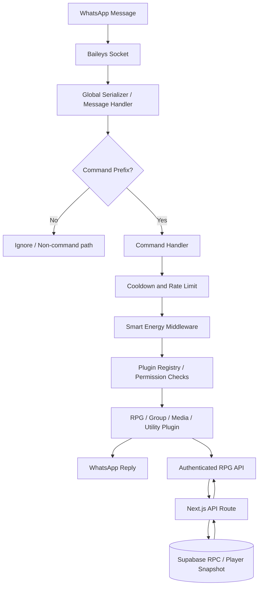
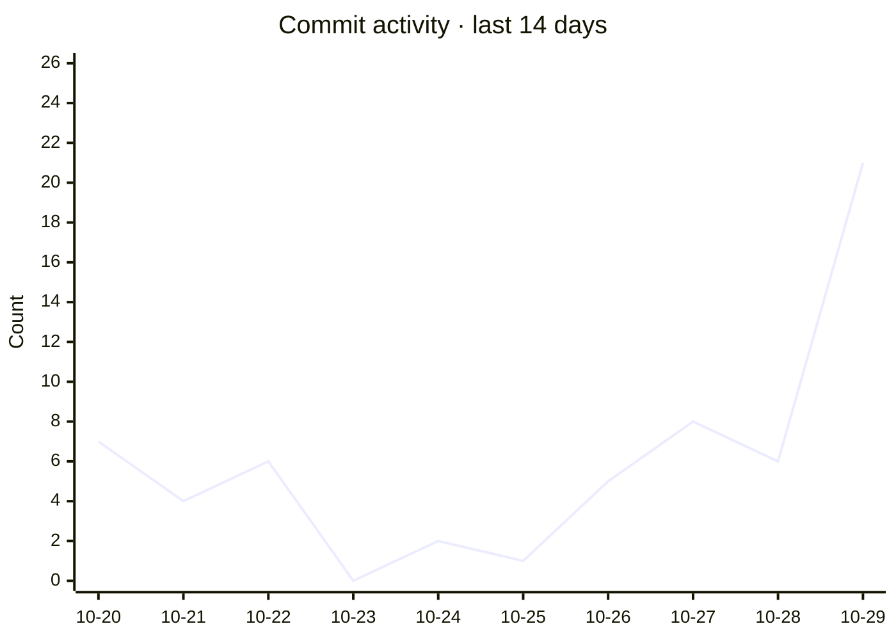

<div align="center">

# ⚡ WHISKAYBOT
### WhatsApp Automation · RPG Economy · Smart Energy Middleware

       

**A separate runtime for WhatsApp. Not bundled with the Next.js RPG website.**

</div>

```text
██╗    ██╗██╗  ██╗██╗███████╗██╗  ██╗ █████╗ ██╗   ██╗
██║    ██║██║  ██║██║██╔════╝██║ ██╔╝██╔══██╗╚██╗ ██╔╝
██║ █╗ ██║███████║██║███████╗█████╔╝ ███████║ ╚████╔╝ 
██║███╗██║██╔══██║██║╚════██║██╔═██╗ ██╔══██║  ╚██╔╝  
╚███╔███╔╝██║  ██║██║███████║██║  ██╗██║  ██║   ██║   
 ╚══╝╚══╝ ╚═╝  ╚═╝╚═╝╚══════╝╚═╝  ╚═╝╚═╝  ╚═╝   ╚═╝   
```

> **Runtime contract:** Node.js 20+, ESM, plugin discovery, WhatsApp transport via Baileys, bounded energy ledger, and optional authenticated RPG website APIs. A green local test suite does not imply live WhatsApp or Supabase connectivity.

## 🧭 Contents

- [Identity & responsibilities](#-identity--responsibilities)
- [Architecture map](#-architecture-map)
- [Smart Energy Middleware](#-smart-energy-middleware)
- [Worker status & runtime statistics](#-worker-status--runtime-statistics)
- [Command catalog](#-command-catalog)
- [Global Auction House](#-global-auction-house)
- [World Boss webhook](#-world-boss-webhook)
- [Jadibot secure pairing portal](#-jadibot-secure-pairing-portal)
- [GitHub metrics and automation](#-github-metrics-and-automation)
- [Install & configure](#-install--configure)
- [Security and operations](#-security-and-operations)
- [📚 Documentation & Archives](#-documentation--archives)
- [Stage 37 — Experimental-Bell parity transplant](#stage-37--experimental-bell-parity-transplant)
- [Stage 40 — Downloader Feature Parity](#stage-40--downloader-feature-parity-iteration-1–9)


## Stage 40 — Downloader Feature Parity (Iteration 1–9)

- Iteration 3 details and test report: [`STAGE-40-ITERATION-3.md`](docs/stages/STAGE-40-ITERATION-3.md) · [`TEST-REPORT-STAGE-40-ITERATION-3.md`](docs/stages/TEST-REPORT-STAGE-40-ITERATION-3.md). Iteration 4 alias audit and format-picker parity: [`STAGE-40-ITERATION-4.md`](docs/stages/STAGE-40-ITERATION-4.md) · [`TEST-REPORT-STAGE-40-ITERATION-4.md`](docs/stages/TEST-REPORT-STAGE-40-ITERATION-4.md). Iteration 5 provider URL hardening: [`STAGE-40-ITERATION-5.md`](docs/stages/STAGE-40-ITERATION-5.md) · [`TEST-REPORT-STAGE-40-ITERATION-5.md`](docs/stages/TEST-REPORT-STAGE-40-ITERATION-5.md). Iteration 6 hardens provider response validation and makes downloader selection tokens sender/chat-safe and bounded: [`STAGE-40-ITERATION-6.md`](docs/stages/STAGE-40-ITERATION-6.md) · [`TEST-REPORT-STAGE-40-ITERATION-6.md`](docs/stages/TEST-REPORT-STAGE-40-ITERATION-6.md). Iteration 7 adds a 1 MiB provider response cap and prevents unavailable format attempts from burning valid tokens: [`STAGE-40-ITERATION-7.md`](docs/stages/STAGE-40-ITERATION-7.md) · [`TEST-REPORT-STAGE-40-ITERATION-7.md`](docs/stages/TEST-REPORT-STAGE-40-ITERATION-7.md).

- Added shared-provider downloader command adapters for Pinterest, MediaFire, Spotify, YouTube URL downloads, and RedNote/Xiaohongshu. Existing TikTok, Instagram, Facebook, and format selection are retained. Provider APIs must be configured externally using `MEDIA_DOWNLOADER_API_URLS` / `MEDIA_DOWNLOADER_API_URL`.
- YouTube search/play commands include `.ytsearch` / `.yts` and `.ytplay` / `.play`, with paginated results, video preview, and explicit MP3/MP4 selection. They require `yt-dlp`; MP3/M4A/Opus conversion requires FFmpeg. Stage 40 Iteration 3 adds `.ytm4a`, `.playvn` (Opus voice note), `.dlvlink` (format picker), and `.youtube` / `.yt` search aliases. Iteration 4 adds the MP4 option to `.dlvlink` and fills in missing downloader aliases from the source command inventory. Iterations 5–7 harden provider URL validation, response-size limits, and format-selection tokens. Iteration 8 adds owner-only `.saveimg [nama-file]` (aliases `.saveimage`, `.saveimagepath`, `.imgsave`): reply to an image or send an image with the command as its caption; the image is saved under `data/saved-images/` and the bot returns the relative and absolute path. Supported formats: JPEG, PNG, WebP, GIF; max 15 MiB; existing files are not overwritten. Iteration 9 limits YouTube search queries to 200 characters, expires inactive search sessions after 30 minutes, and adds tests against lookalike platform domains.
- Added `.gitclone owner/repo`, `.gitclone https://github.com/owner/repo`, and optional `owner/repo#branch` for public GitHub repository ZIP downloads. Archives are capped at 24 MB and the bot never executes repository code.
- Tests verify URL validation, aliases, repo parsing, size/host guardrails, and plugin inventory. Provider downloads and live WhatsApp delivery still require deployment-level validation.

## Stage 39 — Group Administration Parity (Iteration 1–6)

- Group moderation: `.bancmd`, `.unbancmd`, `.ephemeral`, `.groupschedule`, `.absen`, `.pinchat`, `.pinpesan`.
- Group aliases: `.open`, `.close`, `.locked`, `.unlocked`, `.linkgc`, `.resetlink`, `.setname`, `.setdescription`.
- Unified settings shortcut: `.group open|close|link|resetlink|locked|unlocked|setname <nama>|setdesc <deskripsi>`.
- Media/member tools: `.totag`, `.tohidetag`, `.inviteinfo <link>`, `.setppgc`, `.getpp [mention/reply]`, `.getppgc`, `.setwelcometext`, `.setleavetext`.
- Per-group blacklist: `.blacklist @anggota` / `.unblacklist @anggota`; subsequent messages from blacklisted non-admin/non-owner members are suppressed and deleted when bot permissions allow.
- Info alias: `.infogc` / `.infogroup` maps to `.groupinfo`.
- Live WhatsApp compatibility depends on the installed Baileys version and actual group permissions; test in a non-production group before enabling moderation automation.

## 🧩 Identity & responsibilities

WHISKAYBOT owns WhatsApp message intake, command parsing, permission checks, energy accounting, group moderation, and the bot-side integration boundary. The RPG website owns the authoritative inventory/Gold transactions when its Supabase RPC endpoints are configured. The bot should never infer a successful database transaction from a timeout.

| Layer | Responsibility | Persistence / boundary |
|---|---|---|
| Baileys transport | Receive/send WhatsApp messages | WhatsApp session credentials must remain private |
| Global message handler | Serialize messages, recognize command prefixes, route commands | Per-message; no business state should be inferred from RAM |
| Plugin registry | Discover command modules and metadata | Source files under `src/plugins/` |
| Middleware | Cooldown, rate-limit and energy accounting | Energy ledger is a local JSON file; back it up and do not confuse it with RPG player persistence |
| RPG economy client | Call protected web endpoints | `DUNGEON_WEBSITE_URL` + shared sync token |
| Supabase | Player snapshot, guild and auction RPC transactions | Server-side service role only, configured in website project |

## 🗺️ Architecture map



## 🔋 Smart Energy Middleware

The energy estimator is a deterministic heuristic, not an LLM request. Unless a plugin declares a fixed `energyCost`, the middleware computes a bounded complexity estimate from the command text. The estimator considers token count (capped at 160), operator/math markers, quote markers, token uniqueness, character classes, a small deterministic lexical term, and Jaccard similarity to the five most recent commands. Similar repeated inputs receive a modest discount. The estimate is clamped to **0.25–8.75 energy points**; a plugin fixed cost is clamped to **0.05–10**. Actual charge is capped at the user's remaining energy.

```text
raw = 0.38 + token_term + math_term + quote_term
      + uniqueness_term + character_class_term
      + deterministic_lexical_term - recent_similarity_discount
estimated_cost = clamp(round(raw, 2), 0.25, 8.75)
actual_cost = min(current_energy, estimated_cost)
new_energy = clamp(current_energy - actual_cost, 0, 100)
```

Mutations are serialized within one Node.js process and written using temporary-file + rename. This protects concurrent writes in that process, but **does not provide distributed locking across multiple bot replicas**. The ledger is bounded to 5,000 users. Energy middleware fails open if its ledger throws, so an outage should be visible in logs and should not be mistaken for a successful charge.

## 📊 Worker status & runtime statistics

The implementation exposes runtime metrics through `getEnergyRuntimeInfo()` and owner command `.worker`. Metrics include Node version, platform/architecture, RSS, heap use, worker implementation label, and an approximate pending-write indicator. Command hits and audit events are file-backed and are not a live distributed monitoring system.

| Metric | Meaning | Caveat |
|---|---|---|
| `rssMB` | Resident process memory | Runtime snapshot, not historical chart |
| `heapUsedMB` | Current JS heap in use | Changes with garbage collection |
| `node` / `platform` | Runtime version and host | Useful for deployment diagnostics |
| `worker` | Current implementation descriptor | `inline-bounded-O(n)` is a label, not a separate worker thread |
| `commands` / `totalSpent` | Per-user energy counters | Backed by local ledger JSON |
| command hit totals | Recorded command usage | Not guaranteed cross-replica consistent |

## 🧰 Command catalog

Commands are sourced from plugin metadata under `src/plugins/`. Prefix defaults are `.`, `!`, `/`, and `#`; aliases depend on the registered plugin. Group moderation requires group context, caller permissions, and bot admin rights for most mutations. Some media commands require FFmpeg or provider credentials.

### RPG

| Perintah | Fungsi |
|---|---|
| `.auction` | Pasar lelang global untuk menjual dan membeli loot menggunakan Gold |
| `.buy` | Beli item RPG dari toko dashboard |
| `.craft` | Craft item dari material dungeon |
| `.daily` | Klaim hadiah harian WHISKAY RPG (+100 Gold) |
| `.inventory, .inv, .equip, .unequip, .use, .usepotion, .buff, .guild, .quest, .weather, .map, .dungeon, .adventure, .spiritgacha` | Inventory, equipment, potion, gacha summon, spirit collection, dungeon, adventure, guild, quest, weather, map |
| `.explore, .enterdungeon` | Jelajahi dunia dan sinkronkan checkpoint dungeon |
| `.gacha` | Summon equipment acak dengan Gold |
| `.guild` | Buat guild, bergabung, mengeluarkan anggota, dan donasi Gold |
| `.rpgsync` | Periksa koneksi dashboard WHISKAY RPG |
| `.trade` | Transfer Gold atau item kepada pemain lain di grup |
| `.rpg, .dungeon, .adventure` | Aksi RPG |

### Group

| Perintah | Fungsi |
|---|---|
| `.kick, .add, .promote, .demote, .linkgroup` | Moderasi grup WhatsApp: kick, add, promote, demote, linkgroup |
| `.grouphelp, .groupinfo, .admins, .tagall, .hidetag, .revoke, .setsubject, .setdesc, .closegroup, .opengroup` | Informasi, mention anggota, tautan undangan, nama/deskripsi, buka/tutup grup |
| `.ephemeral off|24h|7d|90d|status` | Atur pesan sementara grup (bergantung dukungan Baileys/WhatsApp) |
| `.bancmd <command>, .unbancmd <command>, .bancmd --list` | Blokir/buka blokir command untuk anggota non-admin pada grup ini; command pemulihan dilindungi |

### Media

| Perintah | Fungsi |
|---|---|
| `.meme, .captionimg` | Tambahkan caption meme atas/bawah pada gambar yang direply |

### Utility

| Perintah | Fungsi |
|---|---|
| `.leveling, .profile, .rank, .rankmatrix, .levelnotify, .leaderboard, .setpp` | Level, XP, rank, profile card dan notifikasi kenaikan level |
| `.menu, .help` | Font, widget, template, border, spasi, gambar, urutan dan ketebalan font |
| `.setmenu` | Pengaturan kategori: template (16 tema + random dengan konfirmasi), font, widget, simbol, kutipan, gambar/kanvas dan reset tampilan |
| `.telur, .kalkulatortelur, .hitungtelur` | Kalkulator telur via daftar preset, input manual, kartu hasil Canvas dan tautan website |
| `.ping, .p` | Lihat bantuan perintah |
| `.dlselect` | Kirim format downloader yang dipilih |
| `.fb` | Pilih format unduhan facebook melalui tombol interaktif |
| `.ig` | Pilih format unduhan instagram melalui tombol interaktif |
| `.tiktok` | Pilih format unduhan tiktok melalui tombol interaktif |
| `.charge, .hit, .setpayment, .bukti, .status, .premium` | Smart Energy, dashboard hit, premium, pembayaran dan status worker |
| `.jadibot, .jadibotstatus, .jadibotlogin, .jadibotlogout, .perpanjang` | Sewa sub-bot 30 hari, QR/Pairing Portal, status, login/logout, dan perpanjangan |
| `.listjadibot, .jadibotapprove, .stopjadibot, .setjadibotharga, .setjadibotdurasi` | Kontrol jadibot khusus owner: daftar sesi, verifikasi perpanjangan, penghentian, harga dan durasi |

### Premium / Owner

| Perintah | Fungsi |
|---|---|
| `.autoclean, .cleaner, .clean` | Auto-hapus .bak/.tmp/.swp files |
| `.bc, .broadcast` | Pengumuman owner ke grup atau pengguna terdaftar |
| `.console, .consolef` | Konsol owner: async eval, shell exec, Python dan source filter |
| `.hotreload, .hr` | Toggle auto hot-reload runtime |
| `.hrlog, .watchlog, .changelog` | Entri terbaru |
| `.reload, .rl` | Lihat bantuan perintah |
| `.sourcereload, .sreload` | Auto-restart pada perubahan core files |
| `.webstatus, .webpush, .webreport, .webhelp, .webset, .websale, .webexpense, .webproduct` | Integrasi website Razzaq Ventures |
| `.worker` | Worker monitor, audit log dan matriks rank |
| `.zip, .backup` | Kirim backup source (tanpa sessions & node_modules) |

### AI & Tools

| Perintah | Fungsi |
|---|---|
| `.ask, .ai` | Percakapan asisten AI melalui OpenAI atau Gemini |
| `.vipgen` | Generator ide berbasis template, memakai Limit |
| `.berita, .news` | Berita terbaru dari RSS publik |
| `.scrape` | Ambil metadata dan teks utama dari halaman web publik |
| `.s, .sticker` | Ubah gambar atau video pendek yang direply menjadi stiker WebP |
| `.ytmp3` | Unduh audio YouTube menjadi MP3 |
| `.ytm4a` | Unduh audio YouTube menjadi M4A |
| `.playvn` | Kirim audio YouTube sebagai voice note Opus |
| `.dlvlink` | Tampilkan pilihan format untuk URL YouTube |
| `.github, .githubstats` | Statistik repository dan traffic GitHub (jika token berizin tersedia) |
| `.github commits, .github issues, .github workflows` | Commit terakhir, issue terbuka, dan status GitHub Actions |


### Stage 18: auction commands

| Command | Function |
|---|---|
| `.auction sell <item-id> <price>` | Removes one item from inventory and lists it for sale |
| `.auction list` | Lists active global listings |
| `.auction buy <listing-id>` | Atomically charges buyer Gold, transfers item, and credits seller |
| `.auction help` | Shows command format |

Auction RPCs run server-side in Supabase. Listings are active until purchased; this stage does not yet provide cancellation, expiry, or a listing fee. Item IDs must match the inventory's `id`.

## 🚨 World Boss webhook

The bot exposes `POST /webhooks/world-boss` on `WHISKAY_BOT_WEBHOOK_PORT` (default `8787`). The website's `/api/world-boss/announce` route verifies the signed game access token and forwards a fixed event to the bot. The bot checks the shared bearer secret, validates `event: world_boss_spawned`, then sends the fixed announcement to groups the bot currently participates in.

```text
WHISKAY_BOT_WEBHOOK_URL=https://<your-bot-host>/webhooks/world-boss
WHISKAY_BOSS_WEBHOOK_SECRET=<long-random-secret>
WHISKAY_BOT_WEBHOOK_PORT=8787
```

Do not expose the webhook on the public internet without HTTPS, firewall restrictions, and a long random secret. The same secret must be configured on both services. If the bot runs only on a phone/Termux behind NAT, the website cannot call its private localhost; use a secured public reverse proxy or disable the integration.

## 🚀 Install & configure

```bash
node --version   # Node.js 20+
cp .env.example .env
npm ci
npm test
npm start
```

Set `DUNGEON_WEBSITE_URL`, `DUNGEON_SYNC_TOKEN`, `WHISKAY_BOSS_WEBHOOK_PORT`, and `WHISKAY_BOSS_WEBHOOK_SECRET`. Keep `.env`, Baileys auth state, and any service-role key out of Git. The bot does not need the Supabase service-role key; the website API owns database access.

## 🛡️ Security and operations

- Keep bot and website as separate deployables with separate ZIPs and separate environment variables.
- Never trust a browser-supplied Gold, item count, price, or seller identity. Auction state changes run inside SQL RPC transactions.
- The webhook broadcasts only a fixed, validated announcement; it does not accept arbitrary broadcast text.
- Test group moderation in a private test group before using real groups.
- Use backups before applying `schema.sql`; review SQL migrations before running them in production.
- A successful unit test does not prove WhatsApp login, public webhook reachability, or Supabase credentials work.

## 🧰 Stage 19 — Menu Canvas & Timed Energy

### Menu markers and spacing

- `⚡` marks commands using dynamic energy estimation; `📌` marks plugins declaring a static energy cost. `🎟️` marks Limit usage and `💎` marks Premium-only commands.
- A blank line is inserted before every category header. Use `.setmenu spacing 0|1|2|3` to control command-row spacing.
- `.setmenu template <name>` applies a theme-specific font and widget layout. `.setmenu template random` randomizes the visual preset, font, widget selection, borders, order and spacing.

### Dynamic menu widgets

| Command | Effect |
|---|---|
| `.setmenu widget rpgstatus on` | Show Level, XP and Coin/Gold summary when the profile data is available |
| `.setmenu widget leaderboard on` | Show a short leaderboard preview |
| `.setmenu widget commandhits on` | Show the persisted total command-hit counter |
| `.setmenu widget <name> off` | Hide a widget |
| `.setmenu image official` | Enable landscape Menu Card V2 |
| `.profile` | Send the portrait Profile Card V2 with progress and player stats |
| `.setpp` (reply to an image) | Save that image as the circular avatar injected into Profile Card V2 |

### Timed charging

| Command | Effect |
|---|---|
| `.charge` | Start timed charging; progress is derived from persisted timestamps |
| `.statusbaterai` | Display current energy and estimated completion time |
| `.charge stop` | Manually unplug while preserving accrued progress |
| `.setenergy auto on` | **Owner only:** enable passive regen of 0.01 percentage points per second |
| `.setenergy auto off` | **Owner only:** disable passive regen |
| `.raidboss` | High-energy simulation; blocked during charging with a CPU warning |

Charging is modeled at 1 percentage point per 252 seconds (420 minutes from 0% to 100%). It completes automatically at 100%. Persist `data/energy-ledger.json` and `data/runtime-switches.json` between restarts. The optional native `canvas` module is used when installed; FFmpeg SVG rendering remains the fallback. See [Stage 19 Audit](docs/STAGE-19-AUDIT.md) for limitations and verification details.

## 🤖 Jadibot secure pairing portal

The `.jadibot` rental plugin supports QR and phone-number pairing, 30-day default access, status/logout/reconnect, manual payment review, and owner-controlled pricing/duration. The recommended `.jadibot pairing` path sends a time-limited CTA URL to a mini-web page. The page accepts an international-format phone number, then opens WhatsApp to the main bot with `.jadibotconfirm <one-time-token>` prefilled. The user must still press **Send** in WhatsApp; a website cannot silently send a WhatsApp message on the user's behalf. The pairing code is sent only by the bot in the original private chat, not rendered on the public web page.

- `.jadibot` — choose QR or pairing.
- `.jadibot pairing` — create a single-use portal link (10-minute expiry); `.jadibot pairing 628xxxxxxxxxx` remains as a manual fallback.
- `.jadibotconfirm <token>` — verifies the ticket owner and starts pairing after the user sends the prefilled WhatsApp message.
- `.jadibotstatus`, `.jadibotlogin`, `.jadibotlogout` — view status, reconnect saved auth, or clear the sub-bot session.
- `.perpanjang [days]`, `.buktijadibot <ref>`, `.jadibotapprove <user-key>` — request renewal and have the owner manually verify payment before extending access.
- `.setjadibotharga <IDR>`, `.setjadibotdurasi <days>`, `.listjadibot`, `.stopjadibot <user-key>` — owner controls.

Settings are in `.env.example` under `JADIBOT_*`. Local development automatically tries to launch a temporary TryCloudflare quick tunnel if no known server/deployment marker or public URL is configured. If a public URL or deployment environment is detected, the tunnel is disabled; set `JADIBOT_PUBLIC_URL` to the HTTPS address routed to the configured `JADIBOT_PORT`. Quick tunnels are for testing/development, not production, and the URL changes when the tunnel is restarted. See [pairing portal deployment and security](docs/JADIBOT-MINI-PORTAL.md) and [implementation/testing report](docs/TEST-REPORT-2026-10-25.md).

## 🐙 GitHub metrics and automation

Use `.github` or `.githubstats` for repository stars, forks, open issues/PR, last push timestamp, and—when a repository traffic token is configured—page views, unique visitors and clones for the **last 14 days**. Additional commands: `.github commits`, `.github issues`, and `.github workflows`. Configure `WHISKAY_GITHUB_REPO`, and set `WHISKAY_GITHUB_TRAFFIC_TOKEN` if the running bot should read private traffic data. GitHub's traffic API does **not** provide a lifetime visitor total.

The workflow [`github-metrics.yml`](.github/workflows/github-metrics.yml) refreshes repository metrics and README timestamp on a six-hour cadence, workflow dispatch, and relevant pushes. The existing repository update-history workflow appends source-update metadata with timestamps. History and snapshots live under `docs/metrics/` and `docs/history/`; check [GitHub metrics notes](docs/GITHUB-AUTOMATION.md). The generated README block is bounded by `GITHUB_METRICS_START/END`, so automation updates only that block and preserves the rest of the README.

**Documentation maintenance contract:** every feature, fix, removal or test change must add a dated change record under `docs/`, update the `docs/README.md` index, and update this root `README.md` without deleting unrelated existing information. Mermaid architecture diagrams and explicit test reports are expected for substantial changes.

<!-- GITHUB_METRICS_START -->
> Snapshot terakhir: **2026-10-29T10:01:44+00:00** (UTC). GitHub Actions dijadwalkan menyegarkan data setiap 6 jam dan saat ada push yang relevan.

| Metrik | Nilai |
|---|---:|
| Repository | [`razzaqinspires/whiskay-bot`](https://github.com/razzaqinspires/whiskay-bot) |
| ⭐ Stars | 1 |
| 🍴 Forks | 0 |
| 🧩 Open issues / PR | 0 |
| 👥 Pengunjung unik (14 hari terakhir) | Belum tersedia — token traffic belum punya akses |
| 👁️ Tampilan halaman (14 hari terakhir) | Belum tersedia |
| 📦 Clone (14 hari terakhir) | Belum tersedia |

**Catatan:** data traffic GitHub hanya tersedia untuk 14 hari terakhir melalui API, bukan jumlah pengunjung sepanjang masa. Untuk statistik itu, berikan secret `WHISKAY_GITHUB_TRAFFIC_TOKEN` dengan permission *Administration: Read* pada repository. Jika token tidak tersedia/ditolak, README tidak mengarang angka. [Dokumentasi API traffic](https://docs.github.com/en/rest/metrics/traffic).

### Grafik traffic dan laju pembaruan

> Grafik **GitHub page views · rolling 14-day total** akan muncul setelah metrik tersedia dari GitHub Actions.



Riwayat snapshot tersimpan: **2** (maksimum 90 snapshot lokal di berkas metrik). Buka [Insights → Traffic](https://github.com/razzaqinspires/whiskay-bot/graphs/traffic) untuk tampilan paling mutakhir langsung dari GitHub.
<!-- GITHUB_METRICS_END -->

## 🛡️ Stage 2 — Pairing Portal Hardening (2026-10-26)

- Pairing form submissions are limited to 8 attempts per 10 minutes per source address; excess attempts receive HTTP `429` and `Retry-After`.
- The endpoint requires JSON and rejects declared bodies over 4 KiB before parsing; JSON responses include security headers (`nosniff`, frame protection, no-referrer, restrictive CSP).
- A GitHub Actions CI workflow runs `npm ci`, JavaScript syntax checks, and the full regression suite on pushes and pull requests.
- Rate limiting is process-local; multi-instance deployments should enforce shared throttling at the trusted reverse proxy. See [security hardening](docs/SECURITY-HARDENING-2026-10-26.md), [changelog](docs/CHANGELOG-2026-10-26.md), and [test report](docs/TEST-REPORT-2026-10-26.md).


## 🚀 Stage 26 — Reliability & Event Integrity

Stage 26 adds per-message correlation metadata and privacy-safe event counters. `src/core/serializer.js` attaches `ctx.event`, `ctx.correlationId`, and `ctx.receivedAt`; `src/handlers/message.js` emits typed `message:received` and `command:recognized` events. The compatibility serializer remains unchanged.

- Stage plan: [`docs/stages/STAGE-26.md`](docs/stages/STAGE-26.md)
- Verification: `npm run verify:stage26`
- Scope: telemetry/event foundations only; live webhook delivery and distributed persistence require separate integration tests.

## 📚 Documentation & Archives

| Document | Path |
|---|---|
| [Jadibot mini-web pairing and deployment](docs/JADIBOT-MINI-PORTAL.md) | `docs/JADIBOT-MINI-PORTAL.md` |
| [Stage 2 — Jadibot security hardening](docs/SECURITY-HARDENING-2026-10-26.md) | `docs/SECURITY-HARDENING-2026-10-26.md` |
| [Changelog — 2026-10-26](docs/CHANGELOG-2026-10-26.md) | `docs/CHANGELOG-2026-10-26.md` |
| [Test report — 2026-10-26](docs/TEST-REPORT-2026-10-26.md) | `docs/TEST-REPORT-2026-10-26.md` |
| [GitHub metrics and automation](docs/GITHUB-AUTOMATION.md) | `docs/GITHUB-AUTOMATION.md` |
| [Architecture map — pairing portal and GitHub flow](docs/ARCHITECTURE-MAP.md) | `docs/ARCHITECTURE-MAP.md` |
| [Change log — 2026-10-25](docs/CHANGELOG-2026-10-25.md) | `docs/CHANGELOG-2026-10-25.md` |
| [Testing and verification report — 2026-10-25](docs/TEST-REPORT-2026-10-25.md) | `docs/TEST-REPORT-2026-10-25.md` |


The table below lists Markdown documentation present in this repository; paths are relative and GitHub-compatible.

| Dokumen | Path |
|---|---|
| [Documentation index](docs/README.md) | `docs/README.md` |
| [Tahap 16 — Guild dan AI Short-Term Memory](docs/STAGE-16-GUILD-AI-MEMORY.md) | `docs/STAGE-16-GUILD-AI-MEMORY.md` |
| [Stage 17 — Bot WhatsApp audit](docs/STAGE-17-AUDIT.md) | `docs/STAGE-17-AUDIT.md` |
| [Stage 18 — Bot implementation & audit](docs/STAGE-18-AUDIT.md) | `docs/STAGE-18-AUDIT.md` |
| [WhiskayBot Menu Update](docs/archive/bot/README-MENU-UPDATE.md) | `docs/archive/bot/README-MENU-UPDATE.md` |
| [WhiskayBot — Menu, Profile & Dungeon Upgrade](docs/archive/bot/README-REWORK.md) | `docs/archive/bot/README-REWORK.md` |
| [WhiskayBot v2.3.4 — Profile/Menu Image + Scrape](docs/archive/bot/README-UPDATE-2.3.4.md) | `docs/archive/bot/README-UPDATE-2.3.4.md` |
| [WhiskayBot v2.3.5 — YouTube tools](docs/archive/bot/README-YOUTUBE-2.3.5.md) | `docs/archive/bot/README-YOUTUBE-2.3.5.md` |
| [WHISKAYBOT](docs/archive/bot/ROOT-README.md) | `docs/archive/bot/ROOT-README.md` |
| [Stage 9 — RPG Economy (Bot)](docs/archive/bot/STAGE-9-ECONOMY.md) | `docs/archive/bot/STAGE-9-ECONOMY.md` |
| [Operational history, audit, and visitor analytics](docs/archive/bot/docs/ANALYTICS-AND-AUDIT.md) | `docs/archive/bot/docs/ANALYTICS-AND-AUDIT.md` |
| [Razzaq Ventures Website Integration](docs/archive/bot/docs/RAZZAQ-WEBSITE-INTEGRATION.md) | `docs/archive/bot/docs/RAZZAQ-WEBSITE-INTEGRATION.md` |
| [WhiskayBot Menu Update](docs/archive/bot/docs/README-MENU-UPDATE.md) | `docs/archive/bot/docs/README-MENU-UPDATE.md` |
| [WhiskayBot v2.3.4 — Profile/Menu Image + Scrape](docs/archive/bot/docs/README-UPDATE-2.3.4.md) | `docs/archive/bot/docs/README-UPDATE-2.3.4.md` |
| [WhiskayBot v2.3.5 — YouTube tools](docs/archive/bot/docs/README-YOUTUBE-2.3.5.md) | `docs/archive/bot/docs/README-YOUTUBE-2.3.5.md` |
| [WhiskayBot v2.3.6 — Documentation, RPG, Ping and Repository Audit](docs/archive/bot/docs/RELEASE-2.3.6.md) | `docs/archive/bot/docs/RELEASE-2.3.6.md` |
| [WhiskayBot v2.3.7 — YouTube Preview & Profile Canvas](docs/archive/bot/docs/RELEASE-2.3.7.md) | `docs/archive/bot/docs/RELEASE-2.3.7.md` |
| [WhiskayBot v2.3.8](docs/archive/bot/docs/RELEASE-2.3.8.md) | `docs/archive/bot/docs/RELEASE-2.3.8.md` |
| [WhiskayBot v2.3.9](docs/archive/bot/docs/RELEASE-2.3.9.md) | `docs/archive/bot/docs/RELEASE-2.3.9.md` |
| [WhiskayBot 2.4.0 — RPG Gacha and shared inventory metadata](docs/archive/bot/docs/RELEASE-2.4.0-RPG-GACHA.md) | `docs/archive/bot/docs/RELEASE-2.4.0-RPG-GACHA.md` |
| [Stage 7 — Interactive downloader](docs/archive/bot/docs/STAGE-7-DOWNLOADER.md) | `docs/archive/bot/docs/STAGE-7-DOWNLOADER.md` |
| [Stage 9 — RPG Economy](docs/archive/bot/docs/STAGE-9-ECONOMY.md) | `docs/archive/bot/docs/STAGE-9-ECONOMY.md` |
| [Source update history](docs/archive/bot/docs/history/README.md) | `docs/archive/bot/docs/history/README.md` |
| [WhiskayBot Menu Update](docs/archive/complete-bot/docs/archive/bot/README-MENU-UPDATE.md) | `docs/archive/complete-bot/docs/archive/bot/README-MENU-UPDATE.md` |
| [WhiskayBot — Menu, Profile & Dungeon Upgrade](docs/archive/complete-bot/docs/archive/bot/README-REWORK.md) | `docs/archive/complete-bot/docs/archive/bot/README-REWORK.md` |
| [WhiskayBot v2.3.4 — Profile/Menu Image + Scrape](docs/archive/complete-bot/docs/archive/bot/README-UPDATE-2.3.4.md) | `docs/archive/complete-bot/docs/archive/bot/README-UPDATE-2.3.4.md` |
| [WhiskayBot v2.3.5 — YouTube tools](docs/archive/complete-bot/docs/archive/bot/README-YOUTUBE-2.3.5.md) | `docs/archive/complete-bot/docs/archive/bot/README-YOUTUBE-2.3.5.md` |
| [WHISKAYBOT](docs/archive/complete-bot/docs/archive/bot/ROOT-README.md) | `docs/archive/complete-bot/docs/archive/bot/ROOT-README.md` |
| [Stage 9 — RPG Economy (Bot)](docs/archive/complete-bot/docs/archive/bot/STAGE-9-ECONOMY.md) | `docs/archive/complete-bot/docs/archive/bot/STAGE-9-ECONOMY.md` |
| [Operational history, audit, and visitor analytics](docs/archive/complete-bot/docs/archive/bot/docs/ANALYTICS-AND-AUDIT.md) | `docs/archive/complete-bot/docs/archive/bot/docs/ANALYTICS-AND-AUDIT.md` |
| [Razzaq Ventures Website Integration](docs/archive/complete-bot/docs/archive/bot/docs/RAZZAQ-WEBSITE-INTEGRATION.md) | `docs/archive/complete-bot/docs/archive/bot/docs/RAZZAQ-WEBSITE-INTEGRATION.md` |
| [WhiskayBot Menu Update](docs/archive/complete-bot/docs/archive/bot/docs/README-MENU-UPDATE.md) | `docs/archive/complete-bot/docs/archive/bot/docs/README-MENU-UPDATE.md` |
| [WhiskayBot v2.3.4 — Profile/Menu Image + Scrape](docs/archive/complete-bot/docs/archive/bot/docs/README-UPDATE-2.3.4.md) | `docs/archive/complete-bot/docs/archive/bot/docs/README-UPDATE-2.3.4.md` |
| [WhiskayBot v2.3.5 — YouTube tools](docs/archive/complete-bot/docs/archive/bot/docs/README-YOUTUBE-2.3.5.md) | `docs/archive/complete-bot/docs/archive/bot/docs/README-YOUTUBE-2.3.5.md` |
| [WhiskayBot v2.3.6 — Documentation, RPG, Ping and Repository Audit](docs/archive/complete-bot/docs/archive/bot/docs/RELEASE-2.3.6.md) | `docs/archive/complete-bot/docs/archive/bot/docs/RELEASE-2.3.6.md` |
| [WhiskayBot v2.3.7 — YouTube Preview & Profile Canvas](docs/archive/complete-bot/docs/archive/bot/docs/RELEASE-2.3.7.md) | `docs/archive/complete-bot/docs/archive/bot/docs/RELEASE-2.3.7.md` |
| [WhiskayBot v2.3.8](docs/archive/complete-bot/docs/archive/bot/docs/RELEASE-2.3.8.md) | `docs/archive/complete-bot/docs/archive/bot/docs/RELEASE-2.3.8.md` |
| [WhiskayBot v2.3.9](docs/archive/complete-bot/docs/archive/bot/docs/RELEASE-2.3.9.md) | `docs/archive/complete-bot/docs/archive/bot/docs/RELEASE-2.3.9.md` |
| [WhiskayBot 2.4.0 — RPG Gacha and shared inventory metadata](docs/archive/complete-bot/docs/archive/bot/docs/RELEASE-2.4.0-RPG-GACHA.md) | `docs/archive/complete-bot/docs/archive/bot/docs/RELEASE-2.4.0-RPG-GACHA.md` |
| [Stage 7 — Interactive downloader](docs/archive/complete-bot/docs/archive/bot/docs/STAGE-7-DOWNLOADER.md) | `docs/archive/complete-bot/docs/archive/bot/docs/STAGE-7-DOWNLOADER.md` |
| [Stage 9 — RPG Economy](docs/archive/complete-bot/docs/archive/bot/docs/STAGE-9-ECONOMY.md) | `docs/archive/complete-bot/docs/archive/bot/docs/STAGE-9-ECONOMY.md` |
| [Source update history](docs/archive/complete-bot/docs/archive/bot/docs/history/README.md) | `docs/archive/complete-bot/docs/archive/bot/docs/history/README.md` |
| [Changelog — Whiskay RPG Next.js update](docs/archive/complete-bot/docs/archive/web/CHANGELOG.md) | `docs/archive/complete-bot/docs/archive/web/CHANGELOG.md` |
| [WHISKAY RPG Open World Action Update v2](docs/archive/complete-bot/docs/archive/web/OPEN-WORLD-ACTION-UPDATE-V2.md) | `docs/archive/complete-bot/docs/archive/web/OPEN-WORLD-ACTION-UPDATE-V2.md` |
| [WHISKAY RPG — Open World Action Update](docs/archive/complete-bot/docs/archive/web/OPEN-WORLD-ACTION-UPDATE.md) | `docs/archive/complete-bot/docs/archive/web/OPEN-WORLD-ACTION-UPDATE.md` |
| [Whiskay RPG — Next.js 3D Arena Scaffold](docs/archive/complete-bot/docs/archive/web/ROOT-README.md) | `docs/archive/complete-bot/docs/archive/web/ROOT-README.md` |
| [Whiskay RPG — Seed, Template & Spirit Sheet](docs/archive/complete-bot/docs/archive/web/SEED-TEMPLATE-SPIRIT-SHEET.md) | `docs/archive/complete-bot/docs/archive/web/SEED-TEMPLATE-SPIRIT-SHEET.md` |
| [Stage 1 — Story Lore UI & Dungeon Mechanics](docs/archive/complete-bot/docs/archive/web/STAGE-1-LORE-DUNGEON.md) | `docs/archive/complete-bot/docs/archive/web/STAGE-1-LORE-DUNGEON.md` |
| [Stage 11 — World Environment](docs/archive/complete-bot/docs/archive/web/STAGE-11-SETUP.md) | `docs/archive/complete-bot/docs/archive/web/STAGE-11-SETUP.md` |
| [WHISKAY RPG — Stage 12–13](docs/archive/complete-bot/docs/archive/web/STAGE-12-13-SETUP.md) | `docs/archive/complete-bot/docs/archive/web/STAGE-12-13-SETUP.md` |
| [Stage 2 — Player Snapshot API (Corrected)](docs/archive/complete-bot/docs/archive/web/STAGE-2-PLAYER-SYNC-API.md) | `docs/archive/complete-bot/docs/archive/web/STAGE-2-PLAYER-SYNC-API.md` |
| [Stage 4 — Quick Use Potion + Floor 5 Elite Boss](docs/archive/complete-bot/docs/archive/web/STAGE-4-BOSS-QUICK-USE.md) | `docs/archive/complete-bot/docs/archive/web/STAGE-4-BOSS-QUICK-USE.md` |
| [WHISKAY RPG — Tahap 5 & 6](docs/archive/complete-bot/docs/archive/web/STAGE-5-6-SETUP.md) | `docs/archive/complete-bot/docs/archive/web/STAGE-5-6-SETUP.md` |
| [WHISKAY RPG — Stage 9 & 10](docs/archive/complete-bot/docs/archive/web/STAGE-9-10-SETUP.md) | `docs/archive/complete-bot/docs/archive/web/STAGE-9-10-SETUP.md` |
| [Perbaikan deployment Vercel](docs/archive/complete-bot/docs/archive/web/VERCEL-DEPLOY-FIX.md) | `docs/archive/complete-bot/docs/archive/web/VERCEL-DEPLOY-FIX.md` |
| [Source update history](docs/archive/complete-bot/docs/history/README.md) | `docs/archive/complete-bot/docs/history/README.md` |
| [Tahap 14 — Implementation & Verification Report](docs/archive/complete-bot/docs/stage14/IMPLEMENTATION-REPORT.md) | `docs/archive/complete-bot/docs/stage14/IMPLEMENTATION-REPORT.md` |
| [Smart Energy Worker — Tahap 14](docs/archive/complete-bot/docs/stage14/SMART-ENERGY-WORKER.md) | `docs/archive/complete-bot/docs/stage14/SMART-ENERGY-WORKER.md` |
| [Tahap 14 — Setup dan verifikasi](docs/archive/complete-bot/docs/stage14/STAGE-14-SETUP.md) | `docs/archive/complete-bot/docs/stage14/STAGE-14-SETUP.md` |
| [WhiskayBot Menu Update](docs/archive/complete-bot/docs/stages/README-MENU-UPDATE.md) | `docs/archive/complete-bot/docs/stages/README-MENU-UPDATE.md` |
| [WhiskayBot — Menu, Profile & Dungeon Upgrade](docs/archive/complete-bot/docs/stages/README-REWORK.md) | `docs/archive/complete-bot/docs/stages/README-REWORK.md` |
| [WhiskayBot v2.3.4 — Profile/Menu Image + Scrape](docs/archive/complete-bot/docs/stages/README-UPDATE-2.3.4.md) | `docs/archive/complete-bot/docs/stages/README-UPDATE-2.3.4.md` |
| [WhiskayBot v2.3.5 — YouTube tools](docs/archive/complete-bot/docs/stages/README-YOUTUBE-2.3.5.md) | `docs/archive/complete-bot/docs/stages/README-YOUTUBE-2.3.5.md` |
| [Stage 9 — RPG Economy (Bot)](docs/archive/complete-bot/docs/stages/STAGE-9-ECONOMY.md) | `docs/archive/complete-bot/docs/stages/STAGE-9-ECONOMY.md` |
| [WhiskayBot Menu Update](docs/archive/complete-web/docs/archive/bot/README-MENU-UPDATE.md) | `docs/archive/complete-web/docs/archive/bot/README-MENU-UPDATE.md` |
| [WhiskayBot — Menu, Profile & Dungeon Upgrade](docs/archive/complete-web/docs/archive/bot/README-REWORK.md) | `docs/archive/complete-web/docs/archive/bot/README-REWORK.md` |
| [WhiskayBot v2.3.4 — Profile/Menu Image + Scrape](docs/archive/complete-web/docs/archive/bot/README-UPDATE-2.3.4.md) | `docs/archive/complete-web/docs/archive/bot/README-UPDATE-2.3.4.md` |
| [WhiskayBot v2.3.5 — YouTube tools](docs/archive/complete-web/docs/archive/bot/README-YOUTUBE-2.3.5.md) | `docs/archive/complete-web/docs/archive/bot/README-YOUTUBE-2.3.5.md` |
| [WHISKAYBOT](docs/archive/complete-web/docs/archive/bot/ROOT-README.md) | `docs/archive/complete-web/docs/archive/bot/ROOT-README.md` |
| [Stage 9 — RPG Economy (Bot)](docs/archive/complete-web/docs/archive/bot/STAGE-9-ECONOMY.md) | `docs/archive/complete-web/docs/archive/bot/STAGE-9-ECONOMY.md` |
| [Operational history, audit, and visitor analytics](docs/archive/complete-web/docs/archive/bot/docs/ANALYTICS-AND-AUDIT.md) | `docs/archive/complete-web/docs/archive/bot/docs/ANALYTICS-AND-AUDIT.md` |
| [Razzaq Ventures Website Integration](docs/archive/complete-web/docs/archive/bot/docs/RAZZAQ-WEBSITE-INTEGRATION.md) | `docs/archive/complete-web/docs/archive/bot/docs/RAZZAQ-WEBSITE-INTEGRATION.md` |
| [WhiskayBot Menu Update](docs/archive/complete-web/docs/archive/bot/docs/README-MENU-UPDATE.md) | `docs/archive/complete-web/docs/archive/bot/docs/README-MENU-UPDATE.md` |
| [WhiskayBot v2.3.4 — Profile/Menu Image + Scrape](docs/archive/complete-web/docs/archive/bot/docs/README-UPDATE-2.3.4.md) | `docs/archive/complete-web/docs/archive/bot/docs/README-UPDATE-2.3.4.md` |
| [WhiskayBot v2.3.5 — YouTube tools](docs/archive/complete-web/docs/archive/bot/docs/README-YOUTUBE-2.3.5.md) | `docs/archive/complete-web/docs/archive/bot/docs/README-YOUTUBE-2.3.5.md` |
| [WhiskayBot v2.3.6 — Documentation, RPG, Ping and Repository Audit](docs/archive/complete-web/docs/archive/bot/docs/RELEASE-2.3.6.md) | `docs/archive/complete-web/docs/archive/bot/docs/RELEASE-2.3.6.md` |
| [WhiskayBot v2.3.7 — YouTube Preview & Profile Canvas](docs/archive/complete-web/docs/archive/bot/docs/RELEASE-2.3.7.md) | `docs/archive/complete-web/docs/archive/bot/docs/RELEASE-2.3.7.md` |
| [WhiskayBot v2.3.8](docs/archive/complete-web/docs/archive/bot/docs/RELEASE-2.3.8.md) | `docs/archive/complete-web/docs/archive/bot/docs/RELEASE-2.3.8.md` |
| [WhiskayBot v2.3.9](docs/archive/complete-web/docs/archive/bot/docs/RELEASE-2.3.9.md) | `docs/archive/complete-web/docs/archive/bot/docs/RELEASE-2.3.9.md` |
| [WhiskayBot 2.4.0 — RPG Gacha and shared inventory metadata](docs/archive/complete-web/docs/archive/bot/docs/RELEASE-2.4.0-RPG-GACHA.md) | `docs/archive/complete-web/docs/archive/bot/docs/RELEASE-2.4.0-RPG-GACHA.md` |
| [Stage 7 — Interactive downloader](docs/archive/complete-web/docs/archive/bot/docs/STAGE-7-DOWNLOADER.md) | `docs/archive/complete-web/docs/archive/bot/docs/STAGE-7-DOWNLOADER.md` |
| [Stage 9 — RPG Economy](docs/archive/complete-web/docs/archive/bot/docs/STAGE-9-ECONOMY.md) | `docs/archive/complete-web/docs/archive/bot/docs/STAGE-9-ECONOMY.md` |
| [Source update history](docs/archive/complete-web/docs/archive/bot/docs/history/README.md) | `docs/archive/complete-web/docs/archive/bot/docs/history/README.md` |
| [Changelog — Whiskay RPG Next.js update](docs/archive/complete-web/docs/archive/web/CHANGELOG.md) | `docs/archive/complete-web/docs/archive/web/CHANGELOG.md` |
| [WHISKAY RPG Open World Action Update v2](docs/archive/complete-web/docs/archive/web/OPEN-WORLD-ACTION-UPDATE-V2.md) | `docs/archive/complete-web/docs/archive/web/OPEN-WORLD-ACTION-UPDATE-V2.md` |
| [WHISKAY RPG — Open World Action Update](docs/archive/complete-web/docs/archive/web/OPEN-WORLD-ACTION-UPDATE.md) | `docs/archive/complete-web/docs/archive/web/OPEN-WORLD-ACTION-UPDATE.md` |
| [Whiskay RPG — Next.js 3D Arena Scaffold](docs/archive/complete-web/docs/archive/web/ROOT-README.md) | `docs/archive/complete-web/docs/archive/web/ROOT-README.md` |
| [Whiskay RPG — Seed, Template & Spirit Sheet](docs/archive/complete-web/docs/archive/web/SEED-TEMPLATE-SPIRIT-SHEET.md) | `docs/archive/complete-web/docs/archive/web/SEED-TEMPLATE-SPIRIT-SHEET.md` |
| [Stage 1 — Story Lore UI & Dungeon Mechanics](docs/archive/complete-web/docs/archive/web/STAGE-1-LORE-DUNGEON.md) | `docs/archive/complete-web/docs/archive/web/STAGE-1-LORE-DUNGEON.md` |
| [Stage 11 — World Environment](docs/archive/complete-web/docs/archive/web/STAGE-11-SETUP.md) | `docs/archive/complete-web/docs/archive/web/STAGE-11-SETUP.md` |
| [WHISKAY RPG — Stage 12–13](docs/archive/complete-web/docs/archive/web/STAGE-12-13-SETUP.md) | `docs/archive/complete-web/docs/archive/web/STAGE-12-13-SETUP.md` |
| [Stage 2 — Player Snapshot API (Corrected)](docs/archive/complete-web/docs/archive/web/STAGE-2-PLAYER-SYNC-API.md) | `docs/archive/complete-web/docs/archive/web/STAGE-2-PLAYER-SYNC-API.md` |
| [Stage 4 — Quick Use Potion + Floor 5 Elite Boss](docs/archive/complete-web/docs/archive/web/STAGE-4-BOSS-QUICK-USE.md) | `docs/archive/complete-web/docs/archive/web/STAGE-4-BOSS-QUICK-USE.md` |
| [WHISKAY RPG — Tahap 5 & 6](docs/archive/complete-web/docs/archive/web/STAGE-5-6-SETUP.md) | `docs/archive/complete-web/docs/archive/web/STAGE-5-6-SETUP.md` |
| [WHISKAY RPG — Stage 9 & 10](docs/archive/complete-web/docs/archive/web/STAGE-9-10-SETUP.md) | `docs/archive/complete-web/docs/archive/web/STAGE-9-10-SETUP.md` |
| [Perbaikan deployment Vercel](docs/archive/complete-web/docs/archive/web/VERCEL-DEPLOY-FIX.md) | `docs/archive/complete-web/docs/archive/web/VERCEL-DEPLOY-FIX.md` |
| [Source update history](docs/archive/complete-web/docs/history/README.md) | `docs/archive/complete-web/docs/history/README.md` |
| [Tahap 14 — Implementation & Verification Report](docs/archive/complete-web/docs/stage14/IMPLEMENTATION-REPORT.md) | `docs/archive/complete-web/docs/stage14/IMPLEMENTATION-REPORT.md` |
| [Smart Energy Worker — Tahap 14](docs/archive/complete-web/docs/stage14/SMART-ENERGY-WORKER.md) | `docs/archive/complete-web/docs/stage14/SMART-ENERGY-WORKER.md` |
| [Tahap 14 — Setup dan verifikasi](docs/archive/complete-web/docs/stage14/STAGE-14-SETUP.md) | `docs/archive/complete-web/docs/stage14/STAGE-14-SETUP.md` |
| [Changelog — Whiskay RPG Next.js update](docs/archive/complete-web/docs/stages/CHANGELOG.md) | `docs/archive/complete-web/docs/stages/CHANGELOG.md` |
| [WHISKAY RPG Open World Action Update v2](docs/archive/complete-web/docs/stages/OPEN-WORLD-ACTION-UPDATE-V2.md) | `docs/archive/complete-web/docs/stages/OPEN-WORLD-ACTION-UPDATE-V2.md` |
| [WHISKAY RPG — Open World Action Update](docs/archive/complete-web/docs/stages/OPEN-WORLD-ACTION-UPDATE.md) | `docs/archive/complete-web/docs/stages/OPEN-WORLD-ACTION-UPDATE.md` |
| [Whiskay RPG — Seed, Template & Spirit Sheet](docs/archive/complete-web/docs/stages/SEED-TEMPLATE-SPIRIT-SHEET.md) | `docs/archive/complete-web/docs/stages/SEED-TEMPLATE-SPIRIT-SHEET.md` |
| [Stage 1 — Story Lore UI & Dungeon Mechanics](docs/archive/complete-web/docs/stages/STAGE-1-LORE-DUNGEON.md) | `docs/archive/complete-web/docs/stages/STAGE-1-LORE-DUNGEON.md` |
| [Stage 11 — World Environment](docs/archive/complete-web/docs/stages/STAGE-11-SETUP.md) | `docs/archive/complete-web/docs/stages/STAGE-11-SETUP.md` |
| [WHISKAY RPG — Stage 12–13](docs/archive/complete-web/docs/stages/STAGE-12-13-SETUP.md) | `docs/archive/complete-web/docs/stages/STAGE-12-13-SETUP.md` |
| [Stage 2 — Player Snapshot API (Corrected)](docs/archive/complete-web/docs/stages/STAGE-2-PLAYER-SYNC-API.md) | `docs/archive/complete-web/docs/stages/STAGE-2-PLAYER-SYNC-API.md` |
| [Stage 4 — Quick Use Potion + Floor 5 Elite Boss](docs/archive/complete-web/docs/stages/STAGE-4-BOSS-QUICK-USE.md) | `docs/archive/complete-web/docs/stages/STAGE-4-BOSS-QUICK-USE.md` |
| [WHISKAY RPG — Tahap 5 & 6](docs/archive/complete-web/docs/stages/STAGE-5-6-SETUP.md) | `docs/archive/complete-web/docs/stages/STAGE-5-6-SETUP.md` |
| [WHISKAY RPG — Stage 9 & 10](docs/archive/complete-web/docs/stages/STAGE-9-10-SETUP.md) | `docs/archive/complete-web/docs/stages/STAGE-9-10-SETUP.md` |
| [Perbaikan deployment Vercel](docs/archive/complete-web/docs/stages/VERCEL-DEPLOY-FIX.md) | `docs/archive/complete-web/docs/stages/VERCEL-DEPLOY-FIX.md` |
| [Changelog — Whiskay RPG Next.js update](docs/archive/web/CHANGELOG.md) | `docs/archive/web/CHANGELOG.md` |
| [WHISKAY RPG Open World Action Update v2](docs/archive/web/OPEN-WORLD-ACTION-UPDATE-V2.md) | `docs/archive/web/OPEN-WORLD-ACTION-UPDATE-V2.md` |
| [WHISKAY RPG — Open World Action Update](docs/archive/web/OPEN-WORLD-ACTION-UPDATE.md) | `docs/archive/web/OPEN-WORLD-ACTION-UPDATE.md` |
| [Whiskay RPG — Next.js 3D Arena Scaffold](docs/archive/web/ROOT-README.md) | `docs/archive/web/ROOT-README.md` |
| [Whiskay RPG — Seed, Template & Spirit Sheet](docs/archive/web/SEED-TEMPLATE-SPIRIT-SHEET.md) | `docs/archive/web/SEED-TEMPLATE-SPIRIT-SHEET.md` |
| [Stage 1 — Story Lore UI & Dungeon Mechanics](docs/archive/web/STAGE-1-LORE-DUNGEON.md) | `docs/archive/web/STAGE-1-LORE-DUNGEON.md` |
| [Stage 11 — World Environment](docs/archive/web/STAGE-11-SETUP.md) | `docs/archive/web/STAGE-11-SETUP.md` |
| [WHISKAY RPG — Stage 12–13](docs/archive/web/STAGE-12-13-SETUP.md) | `docs/archive/web/STAGE-12-13-SETUP.md` |
| [Stage 2 — Player Snapshot API (Corrected)](docs/archive/web/STAGE-2-PLAYER-SYNC-API.md) | `docs/archive/web/STAGE-2-PLAYER-SYNC-API.md` |
| [Stage 4 — Quick Use Potion + Floor 5 Elite Boss](docs/archive/web/STAGE-4-BOSS-QUICK-USE.md) | `docs/archive/web/STAGE-4-BOSS-QUICK-USE.md` |
| [WHISKAY RPG — Tahap 5 & 6](docs/archive/web/STAGE-5-6-SETUP.md) | `docs/archive/web/STAGE-5-6-SETUP.md` |
| [WHISKAY RPG — Stage 9 & 10](docs/archive/web/STAGE-9-10-SETUP.md) | `docs/archive/web/STAGE-9-10-SETUP.md` |
| [Perbaikan deployment Vercel](docs/archive/web/VERCEL-DEPLOY-FIX.md) | `docs/archive/web/VERCEL-DEPLOY-FIX.md` |
| [Source update history](docs/history/README.md) | `docs/history/README.md` |
| [Tahap 14 — Implementation & Verification Report](docs/stage14/IMPLEMENTATION-REPORT.md) | `docs/stage14/IMPLEMENTATION-REPORT.md` |
| [Smart Energy Worker — Tahap 14](docs/stage14/SMART-ENERGY-WORKER.md) | `docs/stage14/SMART-ENERGY-WORKER.md` |
| [Tahap 14 — Setup dan verifikasi](docs/stage14/STAGE-14-SETUP.md) | `docs/stage14/STAGE-14-SETUP.md` |
| [Stage 15 Implementation Report](docs/stage15/IMPLEMENTATION-REPORT.md) | `docs/stage15/IMPLEMENTATION-REPORT.md` |
| [Stage 15 Setup](docs/stage15/SETUP.md) | `docs/stage15/SETUP.md` |
| [Tahap 16 — Guild & Short-Term AI Memory](docs/stage16/GUILD-AND-AI-MEMORY.md) | `docs/stage16/GUILD-AND-AI-MEMORY.md` |
| [WhiskayBot Menu Update](docs/stages/README-MENU-UPDATE.md) | `docs/stages/README-MENU-UPDATE.md` |
| [WhiskayBot — Menu, Profile & Dungeon Upgrade](docs/stages/README-REWORK.md) | `docs/stages/README-REWORK.md` |
| [WhiskayBot v2.3.4 — Profile/Menu Image + Scrape](docs/stages/README-UPDATE-2.3.4.md) | `docs/stages/README-UPDATE-2.3.4.md` |
| [WhiskayBot v2.3.5 — YouTube tools](docs/stages/README-YOUTUBE-2.3.5.md) | `docs/stages/README-YOUTUBE-2.3.5.md` |
| [Stage 9 — RPG Economy (Bot)](docs/stages/STAGE-9-ECONOMY.md) | `docs/stages/STAGE-9-ECONOMY.md` |
---

<div align="center">

**WHISKAYBOT · Your command bridge to the world.**

</div>


## 🆕 v2.5.5 — Calculator Canvas, Menu Presets & Serializer Compatibility

### Egg calculator
- `.telur` opens a native-flow single-select list of common cash/price combinations.
- `Input Manual` shows `.telur hitung <uang> <harga>`; example: `.telur hitung 10000 1700`.
- Results include whole eggs, total, change/shortfall and an optional Canvas receipt image.
- `EGG_CALCULATOR_URL` controls the optional HTTPS website CTA. The bot-side calculation remains usable if the Canvas renderer is unavailable.

### Structured menu settings
- `.setmenu` now groups options into explicit categories: templates, typography/symbols, widgets/content, energy/layout, image/canvas and maintenance.
- Six additional themes: `ocean`, `sunset`, `emerald`, `sakura`, `monochrome`, `royal`.
- Selecting a template or Random opens a confirmation step. Confirming replaces presentation settings only; it does not erase account, payment, or RPG data.
- Widget symbols can be controlled through `.setmenu symbols` and the menu quote mode through `.setmenu quote`.
- `bot-preview` quotes are labelled as bot previews and never impersonate another user.

### Baileys compatibility notes
- Serializer records `responseType` and `selectedButtonData` for native-flow responses, with tolerant parsing of `paramsJson` key variants.
- Interactive list support is not guaranteed across all WhatsApp clients/releases. Keep the plain-text fallback path enabled.
- See [Baileys issue #2465](https://github.com/WhiskeySockets/Baileys/issues/2465) for a 2026 report about list messages not being delivered/rendered consistently and the [current upstream README](https://github.com/WhiskeySockets/Baileys/blob/master/README.md) for the documented `sendMessage(..., { quoted })` contract.

### Verification
- Added `test/egg-calculator-calculation.test.js` and `test/setmenu-templates-structure.test.js`.
- The final test report must distinguish local unit/syntax checks from WhatsApp live-client tests; no live WhatsApp send is claimed by this release.


### v2.5.5 verification record

See [`docs/TEST-REPORT-2026-10-26-MENU-EGG-CANVAS.md`](docs/TEST-REPORT-2026-10-26-MENU-EGG-CANVAS.md) for exact local checks, the dependency-install timeout, and live-client tests not performed.


## v2.6 — Nexora, Anonymous Chat, User Registry & Balance

- **Nexora AI layer:** non-prefixed private messages can reach the AI after registration; group replies require a bot mention or reply by default. Configure `AI_CHAT_MODE`.
- **Anonymous chat:** `.anon start|next|status|stop`; pairs only registered users, forwards messages without intentionally exposing partner JIDs, and ends both sides when stopped.
- **Registration gate:** users are observed automatically but `registered` stays `false` until `.daftar`. The central `CommandHandler` gates commands, avoiding edits to every plugin.
- **Balance and top-up:** `.saldo`, `.topup 10000`; owner commands `.topuppending` and `.topupapprove REF`. Pending top-up is not credited until verified.
- **Jadibot billing:** non-owner premium users need enough balance before a new rental; renewals charge balance. Pairing portal now explains `Failed to fetch` and requires the configured URL to route `/pair/*` and `/api/pair/*` to the bot process.
- **Fun games:** `.truth`, `.dare`, `.tod`; `.catur @opponent` starts an experimental button-driven chess session. Chess engine limitations are documented.
- **Persistence:** `data/app-database.json` uses serialized writes, temp-file + rename, and `.bak` recovery. Keep `data/` on persistent disk.
- **Menu widgets:** balance, all observed users, and registered users are independently toggleable in `.setmenu widget`.
- **Validation:** new tests are under `test/app-database-anonymous.test.js`, `test/ai-trigger-and-registration.test.js`, and `test/chess-rules.test.js`.

Detailed notes: [`docs/ANONYMOUS-NEXORA-REGISTRATION-BALANCE.md`](docs/ANONYMOUS-NEXORA-REGISTRATION-BALANCE.md).

### Known limitations in v2.6

- Chess is an experimental training mode with basic piece movement and button ownership validation; it is not a complete chess engine.
- Anonymous chat is opt-in and requires registered accounts; do not share personal information with strangers.
- Nexora is an AI assistant, not evidence of artificial consciousness or self-training.
- The pairing portal requires an HTTPS reverse proxy to the Node portal process on hosted deployments.
- The JSON database is designed for one running bot process and persistent local storage; multi-instance deployments should use a transactional database.

## Media downloader requirements

- YouTube commands use the external `yt-dlp` executable or Python module (`python3 -m yt_dlp`) and require FFmpeg for audio conversion. Install/update `yt-dlp` and FFmpeg on the host; they are system tools, not bundled npm dependencies.
- TikTok, Instagram, Facebook, Pinterest, MediaFire, Spotify, YouTube, and RedNote commands use the shared `MEDIA_DOWNLOADER_API_URL` provider contract. Configure one or more providers with `MEDIA_DOWNLOADER_API_URLS` (comma-separated fallback list) and/or `MEDIA_DOWNLOADER_API_URL`; the first successful provider is used. Each must return JSON with `videoHD`, `videoSD`, `audio`, and optional `thumbnail` URLs. The bot validates HTTP(S) media URLs, rejects obvious localhost/local-domain and private/reserved IP-literal media targets, sanitizes provider-supplied titles, and binds format selection tokens to the requesting sender/chat. This URL check does not resolve DNS; network-level egress controls are still recommended for untrusted providers. Provider-specific coverage depends on your configured service; no downloader API is bundled.
- Do not use these tools to download private, paywalled, or copyrighted media without permission.
- Upstream Baileys issue #2850 warns about bulk-message account restrictions; avoid stealthy bulk messaging or automation intended to evade platform anti-spam controls.

- GitHub update history: `.github/workflows/repo-update-history.yml` now reads the commit timestamp for workflow dispatches when the event payload lacks a timestamp, then falls back to UTC runner time.


## Stage 20 — Virtual Pet, Canvas Mini-Games & Group Safety
- `npm start` startup fix: `attachSerializerRuntime` is now exported from `src/core/serializer.js`.
- Nexora system instructions are prefilled in `.env.example` under `AI_SYSTEM_PROMPT`; copy the sample to `.env` and add your private API keys.
- Virtual pet: `.hatch`, `.feed [item-id]`, `.mypet`; data lives in the web RPG database and requires `DUNGEON_SYNC_TOKEN` plus the `/api/player/pet` route.
- Visual slot: `.slot` or `.casino`; it is a no-stakes mini-game and sends a generated image when `canvas` or FFmpeg is available.
- `.welcome on` enables Canvas V2 member cards for joins/leaves. `.antilink on` checks WhatsApp group invite links only. Default behavior is warning; automatic kick is opt-in and disabled by default.
- See [`docs/STAGE-20-MILESTONE.md`](docs/STAGE-20-MILESTONE.md) for deployment notes. Never distribute `.env`, session credentials, or `data/`.


## Update 2.8.1 — Setmenu, Menu Card V2 & Owner Command Tester

- `.testcommands` / `.testcmds` is an owner-only diagnostic command. It inventories registered plugin commands and runs the Node.js test suite, then returns a WhatsApp interactive response with **Simpan & Update README** and **Jangan Simpan** buttons.
- Saving the audit creates `test/owner-command-audit-<id>.test.js` and appends the report summary to this README. The full temporary report is stored under `data/test-reports/`. Command plugins are not blindly invoked: some commands send messages, mutate balances/data, or trigger external side effects.
- `.setmenu order` now opens an interactive selector for `category`, `az`, and `za`.
- Two templates added: `neon` and `zen`.
- Added five optional operational widgets: `biocore` (runtime/plugin registry status), `events` (recorded command-hit counter), `messages` (sum of locally recorded user message counts), `uptime`, and `database` (local user count and last update time). The bio-core label is a runtime status label, not a claim that the bot is conscious.
- Widget symbols can be set before/after each widget, and `.setmenu symbols count` toggles sequential numbering for widget lines.
- Command rows now render as `1. /command 🎟️ ⚡ 1,30%`: count first, command next, access/premium symbols after the command, and at most one energy symbol at the end before the optional percentage.
- Quote menu now exposes standard quote, no quote, bot preview, and synthetic fake-quote experiments. Synthetic previews are labelled as bot-authored and do not select a fake third-party/verified persona. WhatsApp rendering can vary by client and Baileys version.
- Menu Card V2 uses a landscape 1200×675 (16:9) canvas fallback and attaches it to the interactive message when Baileys media upload is available.
- Added structural regression tests in `test/setmenu-owner-audit-and-energy-order.test.js`.


See also: [Setmenu, Quoted Messages, Card V2, and Owner Command Tester](docs/SETMENU-QUOTED-CARD-TESTER.md).

## 2026-10-29 — YouTube downloader reliability and documentation archive

The YouTube MP3/MP4 sender now uses the project's Baileys serializer contract (`ctx.sock.sendMessage`) rather than the nonexistent `ctx.send` method. MP4 extraction supports separate video/audio streams, a 720p ceiling and generic format fallback. The reported `Requested format is not available` condition now has a clearer diagnostic. See [YouTube downloader fix](docs/YOUTUBE-DOWNLOADER-FIX-2026-10-29.md) and [unit test report](docs/TEST-REPORT-2026-10-29-YOUTUBE.md).

Run `npm test` to include the new tests for format selection and media sending. They are unit tests; they do not claim that arbitrary YouTube URLs or live WhatsApp uploads were tested.

## Documentation archive — stages 1–22

The original setup reports, audit reports, release notes and archived README copies remain preserved. The [master stage archive](docs/STAGE-1-22-MASTER-ARCHIVE.md) provides a chronological register and explains which systems are prototypes versus production-verified. The [documentation index](docs/README.md) lists active and archived Markdown files. The documentation maintenance rule is additive: append corrections and new reports; do not delete historical records or overwrite unrelated README sections.


### Test environment note — 2026-10-29

The focused YouTube unit tests pass (3/3), and syntax checks pass for all JavaScript files under `src/`, `test/`, and `scripts/`. The complete `npm test` run found 90 tests: 86 passed and 4 errored because the workspace does not have installed dependencies (`dotenv` missing). Install dependencies and rerun before treating the full suite as green.

## Stage 23 — Integration foundation (2026-10-29)
- See `docs/STAGE-23-IMPLEMENTATION-2026-10-29.md` for scope, command syntax, security caveats, tests, and deferred live-integration items.
- Preserve previous stage notes and archives; Stage 23 supplements rather than replaces historical documentation.
### Stage 23 commands
- `.setmenu battery match_menu|default` — battery display font.
- `.setmenu notification hide|merge|separate` — energy footer behavior.
- `.charge` — choose standard 5V or Premium fast-charge voltages.
- `.charge upgrade` — capacity +50 for 100 Mod Coins.
- `.statusbaterai` — energy progress, voltage and Mod Coin status.
- `.buy modcoin 100` — quote an invoice; owner must verify payment before crediting coins.
- `.modcoin add <nomor/JID> <jumlah>` — owner-only manual credit after payment verification.
- `.newcmd`, `.batterydashboard [page]`, `.menu [page]` — new-command countdown and 100-row pagination.

Payment verification and Web Companion snapshot synchronization must be configured and verified separately; do not treat an invoice or webhook response alone as proof of payment.

Documentation archive: `docs/STAGE-1-23-MASTER-ARCHIVE.md` and `docs/README.md`. Historical stage documents remain preserved.

## Stage 23+ Rev. 2 (29 Oktober 2026)
- `ctx.reply(text)` khusus teks; `ctx.send(options)` untuk text/media/interactive/list/rich/table. Compatibility layer `serializer-compat.cjs` tetap tidak diubah.
- Preferensi `.setmenu battery match_menu|default` hanya mengubah status energi pada menu, bukan font command lain. `.setmenu notification hide|merge|separate` mengatur bubble status energi.
- Pilihan gambar mencakup Menu V1/V2 dan Profile RPG V1/V2. Owner dapat menjalankan `.setenergy reset [nomor-user/@tag]`; tanpa target mengarah ke akun owner yang menjalankan.
- Detail dan batasan: `docs/STAGE-23-LITERACY-UPDATE-2026-10-29-REV2.md`.

## Stage 24 — Terminal & RPG World Depth

- Terminal theme engine: `src/utils/logger.js`; owner command `.setlog 1-5`.
- Stage 24 design/test record: `docs/stages/STAGE-24.md`.
- Five log themes and typed event methods; no added color dependency.
- Web Companion companion package includes seeded world generation, combat FX overlay, loading screen and world-coordinate schema.
- Stage 24 structural verification: `npm run verify:stage24`.
- Some large systems (live WebSocket relay, production post-processing, dynamic AI events, auction escrow, gacha ticketing and economy ledger) remain integration work; see stage docs. Do not treat design contracts as deployed services.


## Stage 25 — Repository Identity, Menfess & World Integration

- Stage 25 implementation notes: [`docs/stages/STAGE-25.md`](docs/stages/STAGE-25.md).
- Optional PM2: `npm run start:pm2`, `npm run logs:pm2`, `npm run restart:pm2`, `npm run stop:pm2`. PM2 must be installed on the host.
- Menfess foundation: `.menfess help`, `.menfess send <nomor> <pesan>`, `.menfess end <id-sesi>`. Automatic quoted-reply interception is not claimed complete until central middleware wiring is verified.
- Tests: `npm run verify:stage25`.
- Never commit `.env`, GitHub tokens, WhatsApp sessions, or Supabase service-role credentials. Configure repository identity placeholders before release.


## Stage 27 — Durable Event Outbox & Idempotent Processing

- Version: 2.13.0
- Stage 27 specification: `docs/stages/STAGE-27.md`.
- Bot event processing now has a durable/idempotent foundation: bounded event types, event IDs, retries, and duplicate suppression.
- Verification: `npm run verify:stage27`; full configured checks: `npm run verify:all`.
- The Bot file-backed queue is single-process/persistent-disk only. For replicas or serverless deployments, use a database-backed transactional outbox.
- Event ingestion is not a completed business-effect worker: currency/inventory mutations still require atomic transactions, and live Supabase deployment/testing must be performed separately.
- Preserve Stage 1–26 documentation and historical records; Stage 27 supplements rather than replaces them.

- Master archive index through Stage 27: `docs/stages/STAGE-1-27-MASTER-ARCHIVE.md`.


## Stage 28 — Durable Event Processing & Transaction Safety

- Version: 2.14.0
- Scope: event envelope validation, idempotency primitives, retry strategy, and transaction-safety requirements.
- Stage documentation: `docs/stages/STAGE-28.md`.
- Verification: `npm run verify:stage28` and `npm run verify:all`.
- Archive policy: all prior stage documentation is retained; this section extends rather than replaces the history.
- Production caveat: multi-instance deduplication and atomic business transactions require database-backed implementation and integration testing.


## Stage 29 — Menu Studio & Contextual Explore (2026-10-29)

Stage 29 extends menu customization with independent widget-symbol visibility, complete saved-settings summary, additional Kawaii/Boxed/Japanese/Developer templates, configurable synthetic contact/product quote previews, forwarded-label modes, recommendation controls, `.explore`, `.imagine`, and `.character`. Battery dashboard excludes group/broadcast/newsletter identifiers from displayed rows. `.status` now includes runtime, memory, uptime, PID, OS and energy/economy detail. See [`docs/stages/STAGE-29.md`](docs/stages/STAGE-29.md) and [`docs/stages/TEST-REPORT-STAGE-29.md`](docs/stages/TEST-REPORT-STAGE-29.md).

The AI menu mode is a configuration switch only until an AI provider integration is configured and validated; registry/permission data remains authoritative. Stage 29 preserves previous stage documentation and does not claim durable event processing beyond Stage 28's documented limits.


## Stage 30 — Context-Aware Recommendations (2026-10-29)

- Version: 2.16.0.
- Stage specification: [`docs/stages/STAGE-30.md`](docs/stages/STAGE-30.md).
- Added bounded input/recommendation policy helpers and focused Stage 30 verification.
- Run `npm run verify:stage30` or `npm run verify:all`.
- The checks are local/static tests; they do not replace live WhatsApp, database, or deployed end-to-end verification.


## Stage 31 — Coin Mod Audit, Energy Contract & Work Memory

- Bot version: `2.17.0`. Detail: [`docs/stages/STAGE-31.md`](docs/stages/STAGE-31.md).
- Coin Mod adalah saldo virtual internal pada `data/energy-ledger.json`, terpisah dari Gold RPG dan uang fiat. `.modcoin history` menampilkan 10 transaksi terbaru akun sendiri; target lain hanya dapat dilihat owner. Riwayat disimpan bersama saldo dan dibatasi 100 entri per akun.
- `.modcoin add <nomor/JID> <jumlah>` hanya untuk owner setelah verifikasi manual; `.buy modcoin [jumlah]` saat ini menampilkan instruksi pembayaran manual dan belum mengkredit otomatis.
- Fast Charge di atas 5V memerlukan Premium dan biaya `(volt - 5) × 10` Coin Mod; kegagalan memulai charge mengembalikan biaya. `.charge upgrade` menambah kapasitas 50 dengan biaya 100 Coin Mod, maksimum kapasitas 10.000.
- Energi dinamis dihitung dari teks command dengan `complexityScore`, dibatasi `0,25–8,75` poin; fixed plugin cost dibatasi `0,05–10`. Konsumsi aktual adalah nilai minimum antara estimasi dan energi tersisa. Regenerasi pasif opsional adalah `+0,01` poin persentase per tick 1 detik sampai kapasitas, kecuali saat charging. Cooldown dan Limit adalah mekanisme terpisah.
- Ledger file memiliki lock dalam proses, tetapi tidak memberikan transaksi lintas replica. Payment gateway otomatis, webhook signature, dan settlement live belum diimplementasikan.
- QA: `npm run verify:stage31` atau `npm run verify:all`. Laporan: [`TEST-REPORT-STAGE-31.md`](docs/stages/TEST-REPORT-STAGE-31.md). Tes lokal bukan bukti konektivitas WhatsApp/payment gateway live.
- Troubleshooting: jika history kosong, record lama mungkin belum pernah memiliki transaksi tercatat; jika ledger JSON rusak, hentikan bot dan backup file sebelum restore; jangan edit saldo produksi tanpa audit.
- Memori arahan lintas stage: [`MEMORY.md`](MEMORY.md).


## Stage 32 — Menu UX, energi, profile, dan leveling

- **Desain widget** (`.setmenu widgetdesign`): `classic`, `minimal`, `cyberpunk`, `kawaii`, `boxed`, `elegant`, `japanese`, `developer`. Desain isi widget terpisah dari template menu dan simbol sebelum/sesudah.
- **Simbol** (`.setmenu symbols`): pilih preset melalui list, tampil/sembunyi, reset; simbol tidak mengganti desain widget.
- **Widget energi** (`.setmenu energywidget on|off`): sembunyikan baris energi pada menu tanpa mengubah penghitungan baterai.
- **Pagination** (`.setmenu pages`): 100–500 command per halaman; `unlimited` mematikan pagination dan tidak direkomendasikan untuk daftar sangat panjang. `showNextPageInfo` menyimpan preferensi tampilan info halaman.
- **Profile card** (`.profile widgets`): widget profile diatur terpisah; menu profile menyediakan list pengaturan dan pilihan kanvas. Gambar manual disimpan per chat+user agar tidak berbagi path antarakun.
- **Reset pabrik** (`.setmenu reset`): pilih reset menu, status, profile, atau semua tampilan. Progres RPG dan ekonomi tidak dihapus.
- **Default global owner** (`.setmenu global-default apply`): menyimpan baseline konfigurasi menu/status/profile canvas owner. Per-user override yang ada tetap dipertahankan; reset memakai baseline global.
- **Coin Mod** (`.modcoin`): menu interaktif menampilkan saldo, riwayat, beli koin, status baterai, dan upgrade. Coin Mod adalah saldo virtual internal, bukan uang fiat atau Gold RPG.
- **Energi habis**: command berbiaya dihentikan ketika saldo sudah 0. Command pemulihan yang dibebaskan: `menu`, `help`, `setmenu`, `status`, `statusbaterai`, `profile`, `charge`, `modcoin`, `ping`, `owner`. Energi masih dihitung sebelum command berbiaya; kegagalan baca ledger tetap fail-open untuk menghindari outage total.
- **Leveling**: operasi write XP/profile/group diserialisasi dalam satu proses agar pesan paralel tidak menimpa perubahan XP. Penyimpanan tetap JSON lokal dan bukan transaksi lintas-instance.
- **Serializer**: entrypoint adalah `src/core/serializer.js` yang menggunakan `src/core/serializer-compat.cjs`. File bernama `serializer-compact.cjs` tidak ditemukan dalam arsip yang diaudit.
- **Verifikasi**: `npm run verify:stage32` dan `npm run verify:all`. Hasil tes lokal bukan bukti pengujian WhatsApp live.

- **Stage 32 work record:** [`docs/stages/STAGE-32.md`](docs/stages/STAGE-32.md), [`docs/stages/TEST-REPORT-STAGE-32.md`](docs/stages/TEST-REPORT-STAGE-32.md), [`docs/stages/STAGE-32-250-SUBCATEGORIES.md`](docs/stages/STAGE-32-250-SUBCATEGORIES.md).


## Stage 33 — Feature parity dari audit Knightbot-MD (2026-10-29)

- Audit referensi: [mruniquehacker/Knightbot-MD `commands/`](https://github.com/mruniquehacker/Knightbot-MD/tree/main/commands), inventaris 106 file pada saat pemeriksaan. Fitur dibandingkan dengan registry Whiskay; source tidak disalin baris demi baris. Lisensi root referensi tidak berhasil ditemukan melalui endpoint GitHub, jadi implementasi baru ditulis ulang dari perilaku/ide umum dan tidak mendistribusikan source referensi.
- **Hiburan lokal**: `.funhelp`, `.eightball`, `.fact`, `.joke`, `.compliment`, `.flirt`, `.insult`, `.quote`, `.shayari`, `.roseday`; konten lokal, tidak membutuhkan API key. `.insult` hanya roasting ringan non-targeting; fakta trivia tetap perlu diverifikasi untuk kebutuhan penting.
- **Trivia interaktif**: `.trivia` membuat satu ronde dengan pilihan jawaban dan batas sesi dua menit. Status sesi berada di memori proses dan hilang setelah restart; tidak memberikan poin/Gold RPG.
- **Tic-Tac-Toe**: `.tictactoe` atau `.ttt`, permainan solo melawan bot dengan langkah via list, validasi kotak, win/block dasar, dan kedaluwarsa 10 menit. Sesi lokal hanya in-memory.
- **Cuaca**: `.cuaca <kota>` memakai geocoding dan kondisi saat ini dari Open-Meteo, tanpa API key. Hasil adalah kondisi saat ini, bukan prakiraan jangka panjang.
- **Terjemahan**: `.translate <bahasa-asal> <bahasa-tujuan> <teks>` / `.terjemah ...` melalui MyMemory. Contoh: `.translate id en Selamat pagi`. Teks dikirim ke provider pihak ketiga; jangan mengirim rahasia, password, data pribadi, atau dokumen sensitif.
- **Pencarian anime/manga**: `.anime <judul>` dan `.manga <judul>` melalui Jikan API; hasil memuat judul, jenis/status, skor, ringkasan pendek, dan URL sumber. Layanan publik dapat menerapkan rate limit.
- **Sudah ada dan tidak diduplikasi**: `.github`, `.imagine`, `.character`, `.s/.sticker`, downloader TikTok/Instagram/Facebook, AI chat, group tools, news, menfess, dan command RPG.
- **Sengaja tidak diport secara otomatis**: pembuka pesan view-once/anti-delete yang dapat mengekspos pesan privat, eskalasi sudo, API key tertanam, pengaturan autoread/autotyping yang butuh runtime hook, serta remove-background/remini/gif/Spotify yang memerlukan provider/token/service berbeda. Kandidat ini dicatat untuk penilaian per fitur, bukan dianggap hilang tanpa audit.
- **Konfigurasi**: tidak ada secret baru. `.cuaca`, `.translate`, `.anime`, dan `.manga` memerlukan akses internet keluar. Perubahan endpoint eksternal, timeout, dan fallback sudah dibatasi.
- **QA**: `npm run verify:stage33` menjalankan tujuh regression tests; `npm run verify:all` juga mencakup semua verifikasi terdahulu. Tes provider live tidak dijalankan oleh unit test lokal.
- Work record: [`docs/stages/STAGE-33.md`](docs/stages/STAGE-33.md), [`docs/stages/TEST-REPORT-STAGE-33.md`](docs/stages/TEST-REPORT-STAGE-33.md), [`docs/stages/STAGE-33-250-SUBCATEGORIES.md`](docs/stages/STAGE-33-250-SUBCATEGORIES.md). Memori kerja: [`MEMORY.md`](MEMORY.md).


## Stage 34 — Energy Intelligence, Chronos & Safe Autonomy (2026-10-29)

- Independent widget symbols: `.setmenu symbols visible before on|off` and `.setmenu symbols visible after on|off`; hide/show retains stored values and is independent from widget design/template.
- Workload-aware energy middleware classifies recovery/free, static and dynamic commands. A command is rejected before execution if its estimated cost exceeds available energy. Ledger failures fail closed for command execution.
- `.energy status|saver on|off`: Saver unlocks only below 20%, reduces eligible cost by 45%, and increases cooldown by 2.5×. Active saver renders only the first five sorted menu categories while energy is below 20%.
- `.typo on|off|threshold 68` provides owner-controlled command typo suggestions with edit-distance similarity percentage.
- Background `JobLoader` + `ChronosCortex` loads explicit interval jobs with duplicate rejection and bounded concurrency. `.reminder` persists reminders; `.adzan` supports admin-controlled manual group schedules with a per-group IANA timezone (default `Asia/Jakarta`).
- Three failures within 15 minutes logically quarantine a command for 30 minutes; `.quarantine list|reset` is owner-only and never edits source code.
- `.nsfw` currently controls the master switch, pause and token policy only. No NSFW content generators are enabled; group opt-in/provider audit remain a gap.
- `.bc --preview pesan` counts targets without sending. RPG `WorldManager` supports bounded render radius/tree density and emits `whiskay:world-telemetry`; it still uses procedural low-poly trees rather than a new photorealistic asset pack.
- Bell helper audit uses a Feature Gap Ledger and Event Shell Adapter; features already covered by Whiskay are not cloned.
- Detail: [`docs/stages/STAGE-34.md`](docs/stages/STAGE-34.md), [`STAGE-34-BELL-GAP-LEDGER.md`](docs/stages/STAGE-34-BELL-GAP-LEDGER.md), [`STAGE-34-250-SUBCATEGORIES.md`](docs/stages/STAGE-34-250-SUBCATEGORIES.md), [`STAGE-34-LITERACY-6-OWNER-BACKLOG.md`](docs/stages/STAGE-34-LITERACY-6-OWNER-BACKLOG.md).
- Verification: `npm run verify:stage34`; local tests do not replace live WhatsApp/API checks.


## Stage 35 — Chess, XP and command assistance

- `.catur @lawan` / `.catur 628xxxx@s.whatsapp.net`: legal chess powered by `chess.js`, challenge buttons, suggested move, selectable legal moves, PGN/FEN and leaderboard (`.catur leaderboard`).
- Successfully executed commands award 3–5 XP with a 15-second per-command anti-farming cooldown; level-up notifications link to profile and leaderboard.
- Unknown commands can display typo suggestions with similarity percentages; configure with `.typo`.
- Low-energy and insufficient-energy flows expose interactive actions for energy status, charging and Energy Saver.
- See `docs/stages/STAGE-35.md` for the feature-gap ledger and deployment caveats. Install dependencies with `npm install`; optional Canvas PNG rendering can be enabled with `npm install @napi-rs/canvas`.

- Stage 35 details: `docs/stages/STAGE-35.md`, `STAGE-35-250-SUBCATEGORIES.md`, `STAGE-35-LITERACY-6-OWNER-BACKLOG.md`, and `STAGE-35-BELL-GAP-LEDGER.md`.


## Stage 36 — Experimental-Bell audit and Werewolf MVP
- Safe event registry and guards: `src/core/event-registry.js`; locale and normalization adapters: `src/core/event-locale.js`, `src/core/helper-feature-adapter.js`.
- Newly added Werewolf engine, persistent room store and plugins: `src/lib/werewolf-engine.js`, `src/lib/werewolf-store.js`, `src/plugins/games/werewolf.js`, `src/plugins/games/werewolf-private.js`.
- Source audit from the uploaded Experimental-Bell archive: `docs/stages/STAGE-36-SOURCE-AUDIT.md` and `docs/stages/STAGE-36-EXPERIMENTAL-BELL-INVENTORY.md`.
- Literasi 1–5 (250 subcategories with actual status flags): `docs/stages/STAGE-36-LITERASI-1-5.md`.
- Verify with `npm run verify:stage36` or `npm run verify:all`. Werewolf is an MVP, not complete parity; timers, automatic DM room binding, Mayor weighting, Hunter trigger, and role-edge-case tests remain gaps.

- Third-party attribution and adaptation policy: `NOTICE-THIRD-PARTY.md`.


## Stage 37 — Experimental-Bell parity transplant (work in progress)

- **Tujuan:** transplantasi command per command dari [Rifza123/Experimental-Bell](https://github.com/Rifza123/Experimental-Bell) ke arsitektur plugin Whiskay; bukan menyalin runtime event lama secara mentah.
- **Ledger parity:** [`docs/stages/STAGE-37-EXPERIMENTAL-BELL-PARITY.json`](docs/stages/STAGE-37-EXPERIMENTAL-BELL-PARITY.json) mencatat 17 keluarga event, target Whiskay, prioritas, dan status audit. Status `partial` berarti fitur belum terbukti setara penuh.
- **Audit & kebijakan:** [`docs/stages/STAGE-37.md`](docs/stages/STAGE-37.md). Semua command dan alias harus punya target plugin atau alasan pengecualian yang terdokumentasi. Pertahankan seluruh game yang ada di sumber—termasuk `family100`, `susunkata`, `tebakgambar`, `tebakanime`, dan game lainnya—bukan hanya Werewolf.
- **Keamanan:** pertahankan `PluginManager`, `CommandHandler`, serializer Whiskay, middleware izin/energi, dan transaksi RPG yang sudah menjadi otoritas. Tidak boleh menyalin `.env`, sesi WhatsApp, atau kredensial.
- **Verifikasi:** `npm run verify:stage37` memeriksa ledger dan dokumentasi; `npm run verify:all` juga menjalankannya setelah suite sebelumnya. Hasil terbaru: [`docs/stages/TEST-REPORT-STAGE-37.md`](docs/stages/TEST-REPORT-STAGE-37.md). Tes lokal tidak membuktikan provider/API atau WhatsApp live.
- **Status jujur:** ledger dan dokumentasi Stage 37 sudah disiapkan; transplantasi penuh belum boleh dinyatakan selesai sampai pemetaan command/alias dan pengujian tiap batch selesai.

## Stage 39 — Group administration parity (Iteration 4)

- Added persistent `.absen buka [judul]`, `.absen`, `.absen list`, `.absen tutup`, and `.absen reset`. Admin/owner opens, closes, and resets; members can register once while active. Attendance records are capped at 1,000 per group and stored in `data/group-settings.json`.
- Added `.pinchat` / `.pinpesan` for replying to a message and requesting a pin duration of `24h`, `7d`, or `30d`. Requires group-admin authorization and catches API errors; exact support depends on the deployed Baileys/WhatsApp version.
- Validation: Stage 39 mocked tests cover duplicate attendance, lifecycle permissions, persisted entries, and pin payload construction. Live pin behavior is not yet confirmed.
- Detail: [`docs/stages/STAGE-39-GROUP-ADMIN-ITERATION-4.md`](docs/stages/STAGE-39-GROUP-ADMIN-ITERATION-4.md).

## Stage 39 — Group administration parity (Iteration 3)

- Added `.totag` and `.tohidetag` for relaying a replied-to text or supported media into the current group; `.totag` displays member handles, while `.tohidetag` mentions members without displaying the handles. Media relays are capped at 15 MB.
- Added `.inviteinfo <WhatsApp invite link>` with strict `chat.whatsapp.com` URL validation and a capability guard for `groupGetInviteInfo`.
- Added `.setppgc` to update a group profile picture by replying to JPEG/PNG/WebP media; checks MIME, 5 MB size limit, bot-admin permission, and socket method availability.
- Validation: `npm run verify:stage39` includes mocked socket coverage; live WhatsApp behavior and exact Baileys API support must still be checked on a real group.
- Detail: [`docs/stages/STAGE-39-GROUP-ADMIN-ITERATION-3.md`](docs/stages/STAGE-39-GROUP-ADMIN-ITERATION-3.md).

## Stage 39 — Group administration parity (Iteration 2)

- Added `.groupschedule close HH:MM` and `.groupschedule open HH:MM` to schedule group closure/opening in WIB; `.groupschedule list` shows settings and `.groupschedule off` disables both times.
- A Chronos background job checks every 30 seconds, persists independent close/open execution dates, and records failures in logs. The bot must be online at the scheduled minute, the socket API must be available, and the bot must have group-admin permissions. Missed schedules are not replayed automatically.
- Added `.setleavetext <text>` to complement `.setwelcometext <text>`; `{user}` and `{group}` placeholders are rendered by the existing participant update handler.
- Validation: `npm run verify:stage39` covers schedule persistence, valid time syntax, once-per-date execution, missing socket handling, and the existing Iteration 1 tests. Mock sockets do not prove live WhatsApp permissions.
- Detail: [`docs/stages/STAGE-39-GROUP-ADMIN-ITERATION-2.md`](docs/stages/STAGE-39-GROUP-ADMIN-ITERATION-2.md).

## Stage 39 — Group administration parity (Iteration 1)

- Audit awal `helpers/Events/group.js` dari Experimental-Bell dibandingkan plugin grup Whiskay yang sudah ada; tidak menggandakan command yang telah tersedia.
- Ditambahkan daftar blokir command per grup melalui `.bancmd` / `.unbancmd`, persisten, dengan command pemulihan yang dilindungi. Command yang diblokir hanya dicegah bagi anggota non-admin; admin grup dan owner tetap dapat mengelola kebijakan.
- Ditambahkan `.ephemeral off|24h|7d|90d|status`; aksi memakai `groupToggleEphemeral` jika tersedia dan tidak mengaku berhasil jika transport tidak mendukungnya.
- Belum dipindahkan pada iterasi ini: jadwal buka/tutup otomatis, template welcome/leave berbasis media, `totag` forwarding, invite-info lookup, dan perubahan foto grup. Perlu kontrak API, batasan keamanan, serta pengujian terpisah.

## Stage 38 — Owner parity transplant (Iterations 1–4)

- Iteration 1: owner-only `.listgc [halaman]` / `.listgroup [halaman]`, `.join <tautan-undangan>` / `.masuk`, `.leave confirm` / `.keluar confirm`, `.listuser [halaman]`, and `.cekapikey`.
- Iteration 2: `.banned` / `.banuser` with timed or permanent bans, `.unbanned` / `.unbanuser`, `.addenergy` / `.kurangenergy` with a bounded energy-admin audit trail, `.getdata stats|user`, scoped `.setdata` / `.deldata` for owner nickname/note only, `.listbans`, and `.listenergy`.
- Timed bans are cleared by the command gate on a target's first command after expiry; legacy bans without `banUntil` remain permanent. Owners cannot ban themselves or configured owners through this plugin; unverified LID targets are rejected for ban actions.
- `.setdata` and `.deldata` do not accept arbitrary database paths/fields. Secret values and raw database exports are never included in responses. Existing `.bc`, `.opsstatus`, `.console`, `.eval`, `.reload`, `.testcommands`, `.groupbot`, `.setenergy`, `.saluran`, `.zip`, and related owner controls remain in place.
- Iteration 3: `.addowner`, `.delowner`, `.listowners` backed by `data/owner-access.json`; only the primary owner from `OWNERS` may alter owner grants. `.blockuser` / `.unblockuser` call the native Baileys blocklist only after explicit `confirm`, accept PN JIDs only, and refuse self/owner targets. `.sessionstatus` reports session file metadata only; no session deletion or credential content access is exposed. See [`STAGE-38-OWNER-ACCESS-ITERATION-3.md`](docs/stages/STAGE-38-OWNER-ACCESS-ITERATION-3.md).
- Iteration 4: `.offline <alasan>`, `.online`, and `.offlinestatus` persist a maintenance mode in runtime state. Non-owner commands are gated while the mode is active, essential help/registration/status commands remain available, and owner commands still work. Notices are rate-limited per sender in the current process. Remote auto-update is intentionally deferred until a trusted source and integrity/rollback contract are configured. See [`STAGE-38-OFFLINE-MODE-ITERATION-4.md`](docs/stages/STAGE-38-OFFLINE-MODE-ITERATION-4.md).
- Detail/audit: [`docs/stages/STAGE-38.md`](docs/stages/STAGE-38.md), [`STAGE-38-OWNER-PARITY-AUDIT.md`](docs/stages/STAGE-38-OWNER-PARITY-AUDIT.md), [`STAGE-38-OWNER-MANAGEMENT-ITERATION-2.md`](docs/stages/STAGE-38-OWNER-MANAGEMENT-ITERATION-2.md), and [`TEST-REPORT-STAGE-38.md`](docs/stages/TEST-REPORT-STAGE-38.md).
- Verify: `npm run verify:stage38`; full regression: `npm run verify:all`. Mock tests do not replace live WhatsApp validation.

