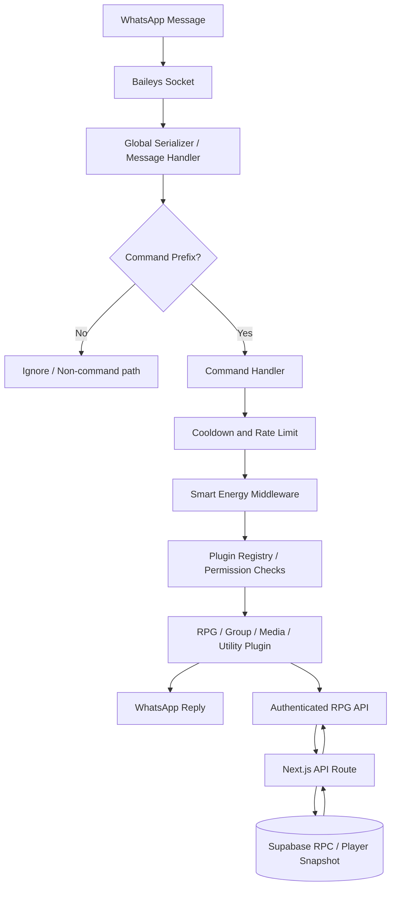
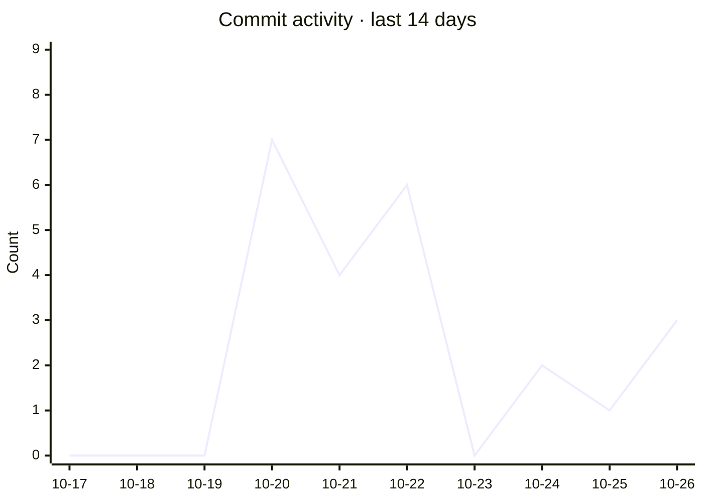
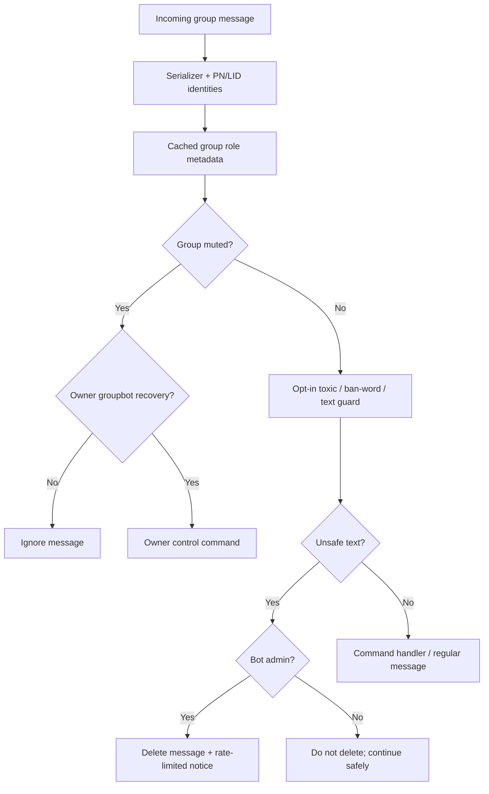

<div align="center">

# ⚡ WHISKAYBOT
### WhatsApp Automation · RPG Economy · Smart Energy Middleware

       

**A separate runtime for WhatsApp. Not bundled with the Next.js RPG website.**

</div>

```text
██╗    ██╗██╗  ██╗██╗███████╗██╗  ██╗ █████╗ ██╗   ██╗
██║    ██║██║  ██║██║██╔════╝██║ ██╔╝██╔══██╗╚██╗ ██╔╝
██║ █╗ ██║███████║██║███████╗█████╔╝ ███████║ ╚████╔╝ 
██║███╗██║██╔══██║██║╚════██║██╔═██╗ ██╔══██║  ╚██╔╝  
╚███╔███╔╝██║  ██║██║███████║██║  ██╗██║  ██║   ██║   
 ╚══╝╚══╝ ╚═╝  ╚═╝╚═╝╚══════╝╚═╝  ╚═╝╚═╝  ╚═╝   ╚═╝   
```

> **Runtime contract:** Node.js 20+, ESM, plugin discovery, WhatsApp transport via Baileys, bounded energy ledger, and optional authenticated RPG website APIs. A green local test suite does not imply live WhatsApp or Supabase connectivity.

## 🧭 Contents

- [Identity & responsibilities](#-identity--responsibilities)
- [Architecture map](#-architecture-map)
- [Smart Energy Middleware](#-smart-energy-middleware)
- [Worker status & runtime statistics](#-worker-status--runtime-statistics)
- [Command catalog](#-command-catalog)
- [Global Auction House](#-global-auction-house)
- [World Boss webhook](#-world-boss-webhook)
- [Jadibot secure pairing portal](#-jadibot-secure-pairing-portal)
- [Group control and anti-flood safety](#-group-control-and-anti-flood-safety)
- [Cognitive AI and RPG Tactical Coach](#-cognitive-ai-and-rpg-tactical-coach)
- [GitHub metrics and automation](#-github-metrics-and-automation)
- [Install & configure](#-install--configure)
- [Security and operations](#-security-and-operations)
- [📚 Documentation & Archives](#-documentation--archives)

## 🧩 Identity & responsibilities

WHISKAYBOT owns WhatsApp message intake, command parsing, permission checks, energy accounting, group moderation, and the bot-side integration boundary. The RPG website owns the authoritative inventory/Gold transactions when its Supabase RPC endpoints are configured. The bot should never infer a successful database transaction from a timeout.

| Layer | Responsibility | Persistence / boundary |
|---|---|---|
| Baileys transport | Receive/send WhatsApp messages | WhatsApp session credentials must remain private |
| Global message handler | Serialize messages, recognize command prefixes, route commands | Per-message; no business state should be inferred from RAM |
| Plugin registry | Discover command modules and metadata | Source files under `src/plugins/` |
| Middleware | Cooldown, rate-limit and energy accounting | Energy ledger is a local JSON file; back it up and do not confuse it with RPG player persistence |
| RPG economy client | Call protected web endpoints | `DUNGEON_WEBSITE_URL` + shared sync token |
| Supabase | Player snapshot, guild and auction RPC transactions | Server-side service role only, configured in website project |

## 🗺️ Architecture map



## 🔋 Smart Energy Middleware

The energy estimator is a deterministic heuristic, not an LLM request. Unless a plugin declares a fixed `energyCost`, the middleware computes a bounded complexity estimate from the command text. The estimator considers token count (capped at 160), operator/math markers, quote markers, token uniqueness, character classes, a small deterministic lexical term, and Jaccard similarity to the five most recent commands. Similar repeated inputs receive a modest discount. The estimate is clamped to **0.25–8.75 energy points**; a plugin fixed cost is clamped to **0.05–10**. Actual charge is capped at the user's remaining energy.

```text
raw = 0.38 + token_term + math_term + quote_term
      + uniqueness_term + character_class_term
      + deterministic_lexical_term - recent_similarity_discount
estimated_cost = clamp(round(raw, 2), 0.25, 8.75)
actual_cost = min(current_energy, estimated_cost)
new_energy = clamp(current_energy - actual_cost, 0, 100)
```

Mutations are serialized within one Node.js process and written using temporary-file + rename. This protects concurrent writes in that process, but **does not provide distributed locking across multiple bot replicas**. The ledger is bounded to 5,000 users. Energy middleware fails open if its ledger throws, so an outage should be visible in logs and should not be mistaken for a successful charge.

## 📊 Worker status & runtime statistics

The implementation exposes runtime metrics through `getEnergyRuntimeInfo()` and owner command `.worker`. Metrics include Node version, platform/architecture, RSS, heap use, worker implementation label, and an approximate pending-write indicator. Command hits and audit events are file-backed and are not a live distributed monitoring system.

| Metric | Meaning | Caveat |
|---|---|---|
| `rssMB` | Resident process memory | Runtime snapshot, not historical chart |
| `heapUsedMB` | Current JS heap in use | Changes with garbage collection |
| `node` / `platform` | Runtime version and host | Useful for deployment diagnostics |
| `worker` | Current implementation descriptor | `inline-bounded-O(n)` is a label, not a separate worker thread |
| `commands` / `totalSpent` | Per-user energy counters | Backed by local ledger JSON |
| command hit totals | Recorded command usage | Not guaranteed cross-replica consistent |

## 🧰 Command catalog

Commands are sourced from plugin metadata under `src/plugins/`. Prefix defaults are `.`, `!`, `/`, and `#`; aliases depend on the registered plugin. Group moderation requires group context, caller permissions, and bot admin rights for most mutations. Some media commands require FFmpeg or provider credentials.

### RPG

| Perintah | Fungsi |
|---|---|
| `.auction` | Pasar lelang global untuk menjual dan membeli loot menggunakan Gold |
| `.buy` | Beli item RPG dari toko dashboard |
| `.craft` | Craft item dari material dungeon |
| `.daily` | Klaim hadiah harian WHISKAY RPG (+100 Gold) |
| `.inventory, .inv, .equip, .unequip, .use, .usepotion, .buff, .guild, .quest, .weather, .map, .dungeon, .adventure, .spiritgacha` | Inventory, equipment, potion, gacha summon, spirit collection, dungeon, adventure, guild, quest, weather, map |
| `.explore, .enterdungeon` | Jelajahi dunia dan sinkronkan checkpoint dungeon |
| `.gacha` | Summon equipment acak dengan Gold |
| `.guild` | Buat guild, bergabung, mengeluarkan anggota, dan donasi Gold |
| `.rpgsync` | Periksa koneksi dashboard WHISKAY RPG |
| `.trade` | Transfer Gold atau item kepada pemain lain di grup |
| `.rpg, .dungeon, .adventure` | Aksi RPG; `.rpg coach` memberi saran taktis berdasarkan HP, gold, potion, level, dan lantai |

### Group

| Perintah | Fungsi |
|---|---|
| `.kick, .add, .promote, .demote, .linkgroup` | Moderasi grup WhatsApp: kick, add, promote, demote, linkgroup |
| `.groupbot panel|list|status|mute|unmute|onlyhere|reset` | Owner mengatur grup yang dibisukan; `onlyhere` mematikan bot di semua grup kecuali grup saat ini |
| `.antitoxic`, `.antibanword`, `.textguard` | Admin grup mengatur filter kata toxic, frasa terlarang, dan teks flood/lag |
| `.groupstatus`, `.grouphelp` | Status dan panduan keamanan grup |

### Media

| Perintah | Fungsi |
|---|---|
| `.meme, .captionimg` | Tambahkan caption meme atas/bawah pada gambar yang direply |

### Utility

| Perintah | Fungsi |
|---|---|
| `.leveling, .profile, .rank, .rankmatrix, .levelnotify, .leaderboard, .setpp` | Level, XP, rank, profile card dan notifikasi kenaikan level |
| `.menu, .help` | Font, widget, template, border, spasi, gambar, urutan dan ketebalan font |
| `.ping, .p` | Lihat bantuan perintah |
| `.dlselect` | Kirim format downloader yang dipilih |
| `.fb` | Pilih format unduhan facebook melalui tombol interaktif |
| `.ig` | Pilih format unduhan instagram melalui tombol interaktif |
| `.tiktok` | Pilih format unduhan tiktok melalui tombol interaktif |
| `.charge, .hit, .setpayment, .bukti, .status, .premium` | Smart Energy, dashboard hit, premium, pembayaran dan status worker |
| `.jadibot, .jadibotstatus, .jadibotlogin, .jadibotlogout, .perpanjang` | Sewa sub-bot 30 hari, QR/Pairing Portal, status, login/logout, dan perpanjangan |
| `.listjadibot, .jadibotapprove, .stopjadibot, .setjadibotharga, .setjadibotdurasi` | Kontrol jadibot khusus owner: daftar sesi, verifikasi perpanjangan, penghentian, harga dan durasi |

### Premium / Owner

| Perintah | Fungsi |
|---|---|
| `.autoclean, .cleaner, .clean` | Auto-hapus .bak/.tmp/.swp files |
| `.bc, .broadcast` | Pengumuman owner ke grup atau pengguna terdaftar |
| `.console, .consolef` | Konsol owner: async eval, shell exec, Python dan source filter |
| `.hotreload, .hr` | Toggle auto hot-reload runtime |
| `.hrlog, .watchlog, .changelog` | Entri terbaru |
| `.reload, .rl` | Lihat bantuan perintah |
| `.sourcereload, .sreload` | Auto-restart pada perubahan core files |
| `.webstatus, .webpush, .webreport, .webhelp, .webset, .websale, .webexpense, .webproduct` | Integrasi website Razzaq Ventures |
| `.worker` | Worker monitor, audit log dan matriks rank |
| `.zip, .backup` | Kirim backup source (tanpa sessions & node_modules) |

### AI & Tools

| Perintah | Fungsi |
|---|---|
| `.ask, .ai` | Percakapan asisten AI melalui OpenAI atau Gemini |
| `.vipgen` | Generator ide berbasis template, memakai Limit |
| `.berita, .news` | Berita terbaru dari RSS publik |
| `.scrape` | Ambil metadata dan teks utama dari halaman web publik |
| `.s, .sticker` | Ubah gambar atau video pendek yang direply menjadi stiker WebP |
| `.ytmp3` | Unduh audio YouTube menjadi MP3 |
| `.github, .githubstats` | Statistik repository dan traffic GitHub (jika token berizin tersedia) |
| `.github commits, .github issues, .github workflows` | Commit terakhir, issue terbuka, dan status GitHub Actions |


### Stage 18: auction commands

| Command | Function |
|---|---|
| `.auction sell <item-id> <price>` | Removes one item from inventory and lists it for sale |
| `.auction list` | Lists active global listings |
| `.auction buy <listing-id>` | Atomically charges buyer Gold, transfers item, and credits seller |
| `.auction help` | Shows command format |

Auction RPCs run server-side in Supabase. Listings are active until purchased; this stage does not yet provide cancellation, expiry, or a listing fee. Item IDs must match the inventory's `id`.

## 🚨 World Boss webhook

The bot exposes `POST /webhooks/world-boss` on `WHISKAY_BOT_WEBHOOK_PORT` (default `8787`). The website's `/api/world-boss/announce` route verifies the signed game access token and forwards a fixed event to the bot. The bot checks the shared bearer secret, validates `event: world_boss_spawned`, then sends the fixed announcement to groups the bot currently participates in.

```text
WHISKAY_BOT_WEBHOOK_URL=https://<your-bot-host>/webhooks/world-boss
WHISKAY_BOSS_WEBHOOK_SECRET=<long-random-secret>
WHISKAY_BOT_WEBHOOK_PORT=8787
```

Do not expose the webhook on the public internet without HTTPS, firewall restrictions, and a long random secret. The same secret must be configured on both services. If the bot runs only on a phone/Termux behind NAT, the website cannot call its private localhost; use a secured public reverse proxy or disable the integration.

## 🚀 Install & configure

```bash
node --version   # Node.js 20+
cp .env.example .env
npm ci
npm test
npm start
```

Set `DUNGEON_WEBSITE_URL`, `DUNGEON_SYNC_TOKEN`, `WHISKAY_BOSS_WEBHOOK_PORT`, and `WHISKAY_BOSS_WEBHOOK_SECRET`. Keep `.env`, Baileys auth state, and any service-role key out of Git. The bot does not need the Supabase service-role key; the website API owns database access.

## 🛡️ Security and operations

- Keep bot and website as separate deployables with separate ZIPs and separate environment variables.
- Never trust a browser-supplied Gold, item count, price, or seller identity. Auction state changes run inside SQL RPC transactions.
- The webhook broadcasts only a fixed, validated announcement; it does not accept arbitrary broadcast text.
- Test group moderation in a private test group before using real groups.
- Use backups before applying `schema.sql`; review SQL migrations before running them in production.
- A successful unit test does not prove WhatsApp login, public webhook reachability, or Supabase credentials work.

## 🧰 Stage 19 — Menu Canvas & Timed Energy

### Menu markers and spacing

- `⚡` marks commands using dynamic energy estimation; `📌` marks plugins declaring a static energy cost. `🎟️` marks Limit usage and `💎` marks Premium-only commands.
- A blank line is inserted before every category header. Use `.setmenu spacing 0|1|2|3` to control command-row spacing.
- `.setmenu template <name>` applies a theme-specific font and widget layout. `.setmenu template random` randomizes the visual preset, font, widget selection, borders, order and spacing.

### Dynamic menu widgets

| Command | Effect |
|---|---|
| `.setmenu widget rpgstatus on` | Show Level, XP and Coin/Gold summary when the profile data is available |
| `.setmenu widget leaderboard on` | Show a short leaderboard preview |
| `.setmenu widget commandhits on` | Show the persisted total command-hit counter |
| `.setmenu widget <name> off` | Hide a widget |
| `.setmenu image official` | Enable landscape Menu Card V2 |
| `.profile` | Send the portrait Profile Card V2 with progress and player stats |
| `.setpp` (reply to an image) | Save that image as the circular avatar injected into Profile Card V2 |

### Timed charging

| Command | Effect |
|---|---|
| `.charge` | Start timed charging; progress is derived from persisted timestamps |
| `.statusbaterai` | Display current energy and estimated completion time |
| `.charge stop` | Manually unplug while preserving accrued progress |
| `.setenergy auto on` | **Owner only:** enable passive regen of 0.01 percentage points per second |
| `.setenergy auto off` | **Owner only:** disable passive regen |
| `.raidboss` | High-energy simulation; blocked during charging with a CPU warning |

Charging is modeled at 1 percentage point per 252 seconds (420 minutes from 0% to 100%). It completes automatically at 100%. Persist `data/energy-ledger.json` and `data/runtime-switches.json` between restarts. The optional native `canvas` module is used when installed; FFmpeg SVG rendering remains the fallback. See [Stage 19 Audit](docs/STAGE-19-AUDIT.md) for limitations and verification details.

## 🤖 Jadibot secure pairing portal

The `.jadibot` rental plugin supports QR and phone-number pairing, 30-day default access, status/logout/reconnect, manual payment review, and owner-controlled pricing/duration. The recommended `.jadibot pairing` path sends a time-limited CTA URL to a mini-web page. The page accepts an international-format phone number, then opens WhatsApp to the main bot with `.jadibotconfirm <one-time-token>` prefilled. The user must still press **Send** in WhatsApp; a website cannot silently send a WhatsApp message on the user's behalf. The pairing code is sent only by the bot in the original private chat, not rendered on the public web page.

- `.jadibot` — choose QR or pairing.
- `.jadibot pairing` — create a single-use portal link (10-minute expiry); `.jadibot pairing 628xxxxxxxxxx` remains as a manual fallback.
- `.jadibotconfirm <token>` — verifies the ticket owner and starts pairing after the user sends the prefilled WhatsApp message.
- `.jadibotstatus`, `.jadibotlogin`, `.jadibotlogout` — view status, reconnect saved auth, or clear the sub-bot session.
- `.perpanjang [days]`, `.buktijadibot <ref>`, `.jadibotapprove <user-key>` — request renewal and have the owner manually verify payment before extending access.
- `.setjadibotharga <IDR>`, `.setjadibotdurasi <days>`, `.listjadibot`, `.stopjadibot <user-key>` — owner controls.

Settings are in `.env.example` under `JADIBOT_*`. Local development automatically tries to launch a temporary TryCloudflare quick tunnel if no known server/deployment marker or public URL is configured. If a public URL or deployment environment is detected, the tunnel is disabled; set `JADIBOT_PUBLIC_URL` to the HTTPS address routed to the configured `JADIBOT_PORT`. Quick tunnels are for testing/development, not production, and the URL changes when the tunnel is restarted. See [pairing portal deployment and security](docs/JADIBOT-MINI-PORTAL.md) and [implementation/testing report](docs/TEST-REPORT-2026-10-25.md).

## 🐙 GitHub metrics and automation

Use `.github` or `.githubstats` for repository stars, forks, open issues/PR, last push timestamp, and—when a repository traffic token is configured—page views, unique visitors and clones for the **last 14 days**. Additional commands: `.github commits`, `.github issues`, and `.github workflows`. Configure `WHISKAY_GITHUB_REPO`, and set `WHISKAY_GITHUB_TRAFFIC_TOKEN` if the running bot should read private traffic data. GitHub's traffic API does **not** provide a lifetime visitor total.

The workflow [`github-metrics.yml`](.github/workflows/github-metrics.yml) refreshes repository metrics and README timestamp on a six-hour cadence, workflow dispatch, and relevant pushes. The existing repository update-history workflow appends source-update metadata with timestamps. History and snapshots live under `docs/metrics/` and `docs/history/`; check [GitHub metrics notes](docs/GITHUB-AUTOMATION.md). The generated README block is bounded by `GITHUB_METRICS_START/END`, so automation updates only that block and preserves the rest of the README.

**Documentation maintenance contract:** every feature, fix, removal or test change must add a dated change record under `docs/`, update the `docs/README.md` index, and update this root `README.md` without deleting unrelated existing information. Mermaid architecture diagrams and explicit test reports are expected for substantial changes.

<!-- GITHUB_METRICS_START -->
> Snapshot terakhir: **2026-10-26T17:41:25+00:00** (UTC). GitHub Actions dijadwalkan menyegarkan data setiap 6 jam dan saat ada push yang relevan.

| Metrik | Nilai |
|---|---:|
| Repository | [`razzaqinspires/whiskay-bot`](https://github.com/razzaqinspires/whiskay-bot) |
| ⭐ Stars | 1 |
| 🍴 Forks | 0 |
| 🧩 Open issues / PR | 0 |
| 👥 Pengunjung unik (14 hari terakhir) | Belum tersedia — token traffic belum punya akses |
| 👁️ Tampilan halaman (14 hari terakhir) | Belum tersedia |
| 📦 Clone (14 hari terakhir) | Belum tersedia |

**Catatan:** data traffic GitHub hanya tersedia untuk 14 hari terakhir melalui API, bukan jumlah pengunjung sepanjang masa. Untuk statistik itu, berikan secret `WHISKAY_GITHUB_TRAFFIC_TOKEN` dengan permission *Administration: Read* pada repository. Jika token tidak tersedia/ditolak, README tidak mengarang angka. [Dokumentasi API traffic](https://docs.github.com/en/rest/metrics/traffic).

### Grafik traffic dan laju pembaruan

> Grafik **GitHub page views · rolling 14-day total** akan muncul setelah metrik tersedia dari GitHub Actions.



Riwayat snapshot tersimpan: **2** (maksimum 90 snapshot lokal di berkas metrik). Buka [Insights → Traffic](https://github.com/razzaqinspires/whiskay-bot/graphs/traffic) untuk tampilan paling mutakhir langsung dari GitHub.
<!-- GITHUB_METRICS_END -->

## 🛡️ Stage 2 — Pairing Portal Hardening (2026-10-26)

- Pairing form submissions are limited to 8 attempts per 10 minutes per source address; excess attempts receive HTTP `429` and `Retry-After`.
- The endpoint requires JSON and rejects declared bodies over 4 KiB before parsing; JSON responses include security headers (`nosniff`, frame protection, no-referrer, restrictive CSP).
- A GitHub Actions CI workflow runs `npm ci`, JavaScript syntax checks, and the full regression suite on pushes and pull requests.
- Rate limiting is process-local; multi-instance deployments should enforce shared throttling at the trusted reverse proxy. See [security hardening](docs/SECURITY-HARDENING-2026-10-26.md), [changelog](docs/CHANGELOG-2026-10-26.md), and [test report](docs/TEST-REPORT-2026-10-26.md).

## 🛡️ Group control and anti-flood safety

- `.groupbot panel` displays interactive controls for the current group; owner-only `.groupbot onlyhere` mutes the bot in every group except the current one. `.groupbot list` lists muted IDs and the allow-only group. `.groupbot reset` resets the global mute policy without deleting per-group safety settings.
- `.antitoxic on|off|add <word>|remove <word>|list`, `.antibanword on|off|add <phrase>|remove <phrase>|list`, and `.textguard on|off|status` are group-admin controls.
- Group policy is persisted in `data/group-policy.json`. The bot fetches and caches group metadata to resolve sender and bot admin roles; deletion requires the bot to be a group admin. Filters are opt-in. Word filters can have false positives, so test custom terms before enabling them in a busy group.
- Text Guard detects extremely long messages, repeated-character/word floods, and excessive invisible Unicode controls. It is a bounded text filter, not a general antivirus and it does not inspect executable files.

## 🧠 Cognitive AI and RPG Tactical Coach

- `.rpg coach` provides deterministic tactical guidance from the saved RPG profile (HP, potions, weapon power, gold, floor and level).
- WHISKAY AI adds bounded task classification, short-term conversation context, consistency checking instructions and uncertainty guidance. This is an engineering scaffold for a more capable assistant, **not evidence of artificial general intelligence or artificial consciousness**.



## 📚 Documentation & Archives

| Document | Path |
|---|---|
| [Jadibot mini-web pairing and deployment](docs/JADIBOT-MINI-PORTAL.md) | `docs/JADIBOT-MINI-PORTAL.md` |
| [Group control, toxic filter and text guard](docs/GROUP-CONTROL-AND-SAFETY.md) | `docs/GROUP-CONTROL-AND-SAFETY.md` |
| [Cognitive AI and RPG Tactical Coach](docs/COGNITIVE-AI-RPG-COACH.md) | `docs/COGNITIVE-AI-RPG-COACH.md` |
| [Test report — 2026-10-26 group safety upgrade](docs/TEST-REPORT-2026-10-26-GROUP-SAFETY.md) | `docs/TEST-REPORT-2026-10-26-GROUP-SAFETY.md` |
| [Stage 2 — Jadibot security hardening](docs/SECURITY-HARDENING-2026-10-26.md) | `docs/SECURITY-HARDENING-2026-10-26.md` |
| [Changelog — 2026-10-26](docs/CHANGELOG-2026-10-26.md) | `docs/CHANGELOG-2026-10-26.md` |
| [Test report — 2026-10-26](docs/TEST-REPORT-2026-10-26.md) | `docs/TEST-REPORT-2026-10-26.md` |
| [GitHub metrics and automation](docs/GITHUB-AUTOMATION.md) | `docs/GITHUB-AUTOMATION.md` |
| [Architecture map — pairing portal and GitHub flow](docs/ARCHITECTURE-MAP.md) | `docs/ARCHITECTURE-MAP.md` |
| [Change log — 2026-10-25](docs/CHANGELOG-2026-10-25.md) | `docs/CHANGELOG-2026-10-25.md` |
| [Testing and verification report — 2026-10-25](docs/TEST-REPORT-2026-10-25.md) | `docs/TEST-REPORT-2026-10-25.md` |


The table below lists Markdown documentation present in this repository; paths are relative and GitHub-compatible.

| Dokumen | Path |
|---|---|
| [Documentation index](docs/README.md) | `docs/README.md` |
| [Tahap 16 — Guild dan AI Short-Term Memory](docs/STAGE-16-GUILD-AI-MEMORY.md) | `docs/STAGE-16-GUILD-AI-MEMORY.md` |
| [Stage 17 — Bot WhatsApp audit](docs/STAGE-17-AUDIT.md) | `docs/STAGE-17-AUDIT.md` |
| [Stage 18 — Bot implementation & audit](docs/STAGE-18-AUDIT.md) | `docs/STAGE-18-AUDIT.md` |
| [WhiskayBot Menu Update](docs/archive/bot/README-MENU-UPDATE.md) | `docs/archive/bot/README-MENU-UPDATE.md` |
| [WhiskayBot — Menu, Profile & Dungeon Upgrade](docs/archive/bot/README-REWORK.md) | `docs/archive/bot/README-REWORK.md` |
| [WhiskayBot v2.3.4 — Profile/Menu Image + Scrape](docs/archive/bot/README-UPDATE-2.3.4.md) | `docs/archive/bot/README-UPDATE-2.3.4.md` |
| [WhiskayBot v2.3.5 — YouTube tools](docs/archive/bot/README-YOUTUBE-2.3.5.md) | `docs/archive/bot/README-YOUTUBE-2.3.5.md` |
| [WHISKAYBOT](docs/archive/bot/ROOT-README.md) | `docs/archive/bot/ROOT-README.md` |
| [Stage 9 — RPG Economy (Bot)](docs/archive/bot/STAGE-9-ECONOMY.md) | `docs/archive/bot/STAGE-9-ECONOMY.md` |
| [Operational history, audit, and visitor analytics](docs/archive/bot/docs/ANALYTICS-AND-AUDIT.md) | `docs/archive/bot/docs/ANALYTICS-AND-AUDIT.md` |
| [Razzaq Ventures Website Integration](docs/archive/bot/docs/RAZZAQ-WEBSITE-INTEGRATION.md) | `docs/archive/bot/docs/RAZZAQ-WEBSITE-INTEGRATION.md` |
| [WhiskayBot Menu Update](docs/archive/bot/docs/README-MENU-UPDATE.md) | `docs/archive/bot/docs/README-MENU-UPDATE.md` |
| [WhiskayBot v2.3.4 — Profile/Menu Image + Scrape](docs/archive/bot/docs/README-UPDATE-2.3.4.md) | `docs/archive/bot/docs/README-UPDATE-2.3.4.md` |
| [WhiskayBot v2.3.5 — YouTube tools](docs/archive/bot/docs/README-YOUTUBE-2.3.5.md) | `docs/archive/bot/docs/README-YOUTUBE-2.3.5.md` |
| [WhiskayBot v2.3.6 — Documentation, RPG, Ping and Repository Audit](docs/archive/bot/docs/RELEASE-2.3.6.md) | `docs/archive/bot/docs/RELEASE-2.3.6.md` |
| [WhiskayBot v2.3.7 — YouTube Preview & Profile Canvas](docs/archive/bot/docs/RELEASE-2.3.7.md) | `docs/archive/bot/docs/RELEASE-2.3.7.md` |
| [WhiskayBot v2.3.8](docs/archive/bot/docs/RELEASE-2.3.8.md) | `docs/archive/bot/docs/RELEASE-2.3.8.md` |
| [WhiskayBot v2.3.9](docs/archive/bot/docs/RELEASE-2.3.9.md) | `docs/archive/bot/docs/RELEASE-2.3.9.md` |
| [WhiskayBot 2.4.0 — RPG Gacha and shared inventory metadata](docs/archive/bot/docs/RELEASE-2.4.0-RPG-GACHA.md) | `docs/archive/bot/docs/RELEASE-2.4.0-RPG-GACHA.md` |
| [Stage 7 — Interactive downloader](docs/archive/bot/docs/STAGE-7-DOWNLOADER.md) | `docs/archive/bot/docs/STAGE-7-DOWNLOADER.md` |
| [Stage 9 — RPG Economy](docs/archive/bot/docs/STAGE-9-ECONOMY.md) | `docs/archive/bot/docs/STAGE-9-ECONOMY.md` |
| [Source update history](docs/archive/bot/docs/history/README.md) | `docs/archive/bot/docs/history/README.md` |
| [WhiskayBot Menu Update](docs/archive/complete-bot/docs/archive/bot/README-MENU-UPDATE.md) | `docs/archive/complete-bot/docs/archive/bot/README-MENU-UPDATE.md` |
| [WhiskayBot — Menu, Profile & Dungeon Upgrade](docs/archive/complete-bot/docs/archive/bot/README-REWORK.md) | `docs/archive/complete-bot/docs/archive/bot/README-REWORK.md` |
| [WhiskayBot v2.3.4 — Profile/Menu Image + Scrape](docs/archive/complete-bot/docs/archive/bot/README-UPDATE-2.3.4.md) | `docs/archive/complete-bot/docs/archive/bot/README-UPDATE-2.3.4.md` |
| [WhiskayBot v2.3.5 — YouTube tools](docs/archive/complete-bot/docs/archive/bot/README-YOUTUBE-2.3.5.md) | `docs/archive/complete-bot/docs/archive/bot/README-YOUTUBE-2.3.5.md` |
| [WHISKAYBOT](docs/archive/complete-bot/docs/archive/bot/ROOT-README.md) | `docs/archive/complete-bot/docs/archive/bot/ROOT-README.md` |
| [Stage 9 — RPG Economy (Bot)](docs/archive/complete-bot/docs/archive/bot/STAGE-9-ECONOMY.md) | `docs/archive/complete-bot/docs/archive/bot/STAGE-9-ECONOMY.md` |
| [Operational history, audit, and visitor analytics](docs/archive/complete-bot/docs/archive/bot/docs/ANALYTICS-AND-AUDIT.md) | `docs/archive/complete-bot/docs/archive/bot/docs/ANALYTICS-AND-AUDIT.md` |
| [Razzaq Ventures Website Integration](docs/archive/complete-bot/docs/archive/bot/docs/RAZZAQ-WEBSITE-INTEGRATION.md) | `docs/archive/complete-bot/docs/archive/bot/docs/RAZZAQ-WEBSITE-INTEGRATION.md` |
| [WhiskayBot Menu Update](docs/archive/complete-bot/docs/archive/bot/docs/README-MENU-UPDATE.md) | `docs/archive/complete-bot/docs/archive/bot/docs/README-MENU-UPDATE.md` |
| [WhiskayBot v2.3.4 — Profile/Menu Image + Scrape](docs/archive/complete-bot/docs/archive/bot/docs/README-UPDATE-2.3.4.md) | `docs/archive/complete-bot/docs/archive/bot/docs/README-UPDATE-2.3.4.md` |
| [WhiskayBot v2.3.5 — YouTube tools](docs/archive/complete-bot/docs/archive/bot/docs/README-YOUTUBE-2.3.5.md) | `docs/archive/complete-bot/docs/archive/bot/docs/README-YOUTUBE-2.3.5.md` |
| [WhiskayBot v2.3.6 — Documentation, RPG, Ping and Repository Audit](docs/archive/complete-bot/docs/archive/bot/docs/RELEASE-2.3.6.md) | `docs/archive/complete-bot/docs/archive/bot/docs/RELEASE-2.3.6.md` |
| [WhiskayBot v2.3.7 — YouTube Preview & Profile Canvas](docs/archive/complete-bot/docs/archive/bot/docs/RELEASE-2.3.7.md) | `docs/archive/complete-bot/docs/archive/bot/docs/RELEASE-2.3.7.md` |
| [WhiskayBot v2.3.8](docs/archive/complete-bot/docs/archive/bot/docs/RELEASE-2.3.8.md) | `docs/archive/complete-bot/docs/archive/bot/docs/RELEASE-2.3.8.md` |
| [WhiskayBot v2.3.9](docs/archive/complete-bot/docs/archive/bot/docs/RELEASE-2.3.9.md) | `docs/archive/complete-bot/docs/archive/bot/docs/RELEASE-2.3.9.md` |
| [WhiskayBot 2.4.0 — RPG Gacha and shared inventory metadata](docs/archive/complete-bot/docs/archive/bot/docs/RELEASE-2.4.0-RPG-GACHA.md) | `docs/archive/complete-bot/docs/archive/bot/docs/RELEASE-2.4.0-RPG-GACHA.md` |
| [Stage 7 — Interactive downloader](docs/archive/complete-bot/docs/archive/bot/docs/STAGE-7-DOWNLOADER.md) | `docs/archive/complete-bot/docs/archive/bot/docs/STAGE-7-DOWNLOADER.md` |
| [Stage 9 — RPG Economy](docs/archive/complete-bot/docs/archive/bot/docs/STAGE-9-ECONOMY.md) | `docs/archive/complete-bot/docs/archive/bot/docs/STAGE-9-ECONOMY.md` |
| [Source update history](docs/archive/complete-bot/docs/archive/bot/docs/history/README.md) | `docs/archive/complete-bot/docs/archive/bot/docs/history/README.md` |
| [Changelog — Whiskay RPG Next.js update](docs/archive/complete-bot/docs/archive/web/CHANGELOG.md) | `docs/archive/complete-bot/docs/archive/web/CHANGELOG.md` |
| [WHISKAY RPG Open World Action Update v2](docs/archive/complete-bot/docs/archive/web/OPEN-WORLD-ACTION-UPDATE-V2.md) | `docs/archive/complete-bot/docs/archive/web/OPEN-WORLD-ACTION-UPDATE-V2.md` |
| [WHISKAY RPG — Open World Action Update](docs/archive/complete-bot/docs/archive/web/OPEN-WORLD-ACTION-UPDATE.md) | `docs/archive/complete-bot/docs/archive/web/OPEN-WORLD-ACTION-UPDATE.md` |
| [Whiskay RPG — Next.js 3D Arena Scaffold](docs/archive/complete-bot/docs/archive/web/ROOT-README.md) | `docs/archive/complete-bot/docs/archive/web/ROOT-README.md` |
| [Whiskay RPG — Seed, Template & Spirit Sheet](docs/archive/complete-bot/docs/archive/web/SEED-TEMPLATE-SPIRIT-SHEET.md) | `docs/archive/complete-bot/docs/archive/web/SEED-TEMPLATE-SPIRIT-SHEET.md` |
| [Stage 1 — Story Lore UI & Dungeon Mechanics](docs/archive/complete-bot/docs/archive/web/STAGE-1-LORE-DUNGEON.md) | `docs/archive/complete-bot/docs/archive/web/STAGE-1-LORE-DUNGEON.md` |
| [Stage 11 — World Environment](docs/archive/complete-bot/docs/archive/web/STAGE-11-SETUP.md) | `docs/archive/complete-bot/docs/archive/web/STAGE-11-SETUP.md` |
| [WHISKAY RPG — Stage 12–13](docs/archive/complete-bot/docs/archive/web/STAGE-12-13-SETUP.md) | `docs/archive/complete-bot/docs/archive/web/STAGE-12-13-SETUP.md` |
| [Stage 2 — Player Snapshot API (Corrected)](docs/archive/complete-bot/docs/archive/web/STAGE-2-PLAYER-SYNC-API.md) | `docs/archive/complete-bot/docs/archive/web/STAGE-2-PLAYER-SYNC-API.md` |
| [Stage 4 — Quick Use Potion + Floor 5 Elite Boss](docs/archive/complete-bot/docs/archive/web/STAGE-4-BOSS-QUICK-USE.md) | `docs/archive/complete-bot/docs/archive/web/STAGE-4-BOSS-QUICK-USE.md` |
| [WHISKAY RPG — Tahap 5 & 6](docs/archive/complete-bot/docs/archive/web/STAGE-5-6-SETUP.md) | `docs/archive/complete-bot/docs/archive/web/STAGE-5-6-SETUP.md` |
| [WHISKAY RPG — Stage 9 & 10](docs/archive/complete-bot/docs/archive/web/STAGE-9-10-SETUP.md) | `docs/archive/complete-bot/docs/archive/web/STAGE-9-10-SETUP.md` |
| [Perbaikan deployment Vercel](docs/archive/complete-bot/docs/archive/web/VERCEL-DEPLOY-FIX.md) | `docs/archive/complete-bot/docs/archive/web/VERCEL-DEPLOY-FIX.md` |
| [Source update history](docs/archive/complete-bot/docs/history/README.md) | `docs/archive/complete-bot/docs/history/README.md` |
| [Tahap 14 — Implementation & Verification Report](docs/archive/complete-bot/docs/stage14/IMPLEMENTATION-REPORT.md) | `docs/archive/complete-bot/docs/stage14/IMPLEMENTATION-REPORT.md` |
| [Smart Energy Worker — Tahap 14](docs/archive/complete-bot/docs/stage14/SMART-ENERGY-WORKER.md) | `docs/archive/complete-bot/docs/stage14/SMART-ENERGY-WORKER.md` |
| [Tahap 14 — Setup dan verifikasi](docs/archive/complete-bot/docs/stage14/STAGE-14-SETUP.md) | `docs/archive/complete-bot/docs/stage14/STAGE-14-SETUP.md` |
| [WhiskayBot Menu Update](docs/archive/complete-bot/docs/stages/README-MENU-UPDATE.md) | `docs/archive/complete-bot/docs/stages/README-MENU-UPDATE.md` |
| [WhiskayBot — Menu, Profile & Dungeon Upgrade](docs/archive/complete-bot/docs/stages/README-REWORK.md) | `docs/archive/complete-bot/docs/stages/README-REWORK.md` |
| [WhiskayBot v2.3.4 — Profile/Menu Image + Scrape](docs/archive/complete-bot/docs/stages/README-UPDATE-2.3.4.md) | `docs/archive/complete-bot/docs/stages/README-UPDATE-2.3.4.md` |
| [WhiskayBot v2.3.5 — YouTube tools](docs/archive/complete-bot/docs/stages/README-YOUTUBE-2.3.5.md) | `docs/archive/complete-bot/docs/stages/README-YOUTUBE-2.3.5.md` |
| [Stage 9 — RPG Economy (Bot)](docs/archive/complete-bot/docs/stages/STAGE-9-ECONOMY.md) | `docs/archive/complete-bot/docs/stages/STAGE-9-ECONOMY.md` |
| [WhiskayBot Menu Update](docs/archive/complete-web/docs/archive/bot/README-MENU-UPDATE.md) | `docs/archive/complete-web/docs/archive/bot/README-MENU-UPDATE.md` |
| [WhiskayBot — Menu, Profile & Dungeon Upgrade](docs/archive/complete-web/docs/archive/bot/README-REWORK.md) | `docs/archive/complete-web/docs/archive/bot/README-REWORK.md` |
| [WhiskayBot v2.3.4 — Profile/Menu Image + Scrape](docs/archive/complete-web/docs/archive/bot/README-UPDATE-2.3.4.md) | `docs/archive/complete-web/docs/archive/bot/README-UPDATE-2.3.4.md` |
| [WhiskayBot v2.3.5 — YouTube tools](docs/archive/complete-web/docs/archive/bot/README-YOUTUBE-2.3.5.md) | `docs/archive/complete-web/docs/archive/bot/README-YOUTUBE-2.3.5.md` |
| [WHISKAYBOT](docs/archive/complete-web/docs/archive/bot/ROOT-README.md) | `docs/archive/complete-web/docs/archive/bot/ROOT-README.md` |
| [Stage 9 — RPG Economy (Bot)](docs/archive/complete-web/docs/archive/bot/STAGE-9-ECONOMY.md) | `docs/archive/complete-web/docs/archive/bot/STAGE-9-ECONOMY.md` |
| [Operational history, audit, and visitor analytics](docs/archive/complete-web/docs/archive/bot/docs/ANALYTICS-AND-AUDIT.md) | `docs/archive/complete-web/docs/archive/bot/docs/ANALYTICS-AND-AUDIT.md` |
| [Razzaq Ventures Website Integration](docs/archive/complete-web/docs/archive/bot/docs/RAZZAQ-WEBSITE-INTEGRATION.md) | `docs/archive/complete-web/docs/archive/bot/docs/RAZZAQ-WEBSITE-INTEGRATION.md` |
| [WhiskayBot Menu Update](docs/archive/complete-web/docs/archive/bot/docs/README-MENU-UPDATE.md) | `docs/archive/complete-web/docs/archive/bot/docs/README-MENU-UPDATE.md` |
| [WhiskayBot v2.3.4 — Profile/Menu Image + Scrape](docs/archive/complete-web/docs/archive/bot/docs/README-UPDATE-2.3.4.md) | `docs/archive/complete-web/docs/archive/bot/docs/README-UPDATE-2.3.4.md` |
| [WhiskayBot v2.3.5 — YouTube tools](docs/archive/complete-web/docs/archive/bot/docs/README-YOUTUBE-2.3.5.md) | `docs/archive/complete-web/docs/archive/bot/docs/README-YOUTUBE-2.3.5.md` |
| [WhiskayBot v2.3.6 — Documentation, RPG, Ping and Repository Audit](docs/archive/complete-web/docs/archive/bot/docs/RELEASE-2.3.6.md) | `docs/archive/complete-web/docs/archive/bot/docs/RELEASE-2.3.6.md` |
| [WhiskayBot v2.3.7 — YouTube Preview & Profile Canvas](docs/archive/complete-web/docs/archive/bot/docs/RELEASE-2.3.7.md) | `docs/archive/complete-web/docs/archive/bot/docs/RELEASE-2.3.7.md` |
| [WhiskayBot v2.3.8](docs/archive/complete-web/docs/archive/bot/docs/RELEASE-2.3.8.md) | `docs/archive/complete-web/docs/archive/bot/docs/RELEASE-2.3.8.md` |
| [WhiskayBot v2.3.9](docs/archive/complete-web/docs/archive/bot/docs/RELEASE-2.3.9.md) | `docs/archive/complete-web/docs/archive/bot/docs/RELEASE-2.3.9.md` |
| [WhiskayBot 2.4.0 — RPG Gacha and shared inventory metadata](docs/archive/complete-web/docs/archive/bot/docs/RELEASE-2.4.0-RPG-GACHA.md) | `docs/archive/complete-web/docs/archive/bot/docs/RELEASE-2.4.0-RPG-GACHA.md` |
| [Stage 7 — Interactive downloader](docs/archive/complete-web/docs/archive/bot/docs/STAGE-7-DOWNLOADER.md) | `docs/archive/complete-web/docs/archive/bot/docs/STAGE-7-DOWNLOADER.md` |
| [Stage 9 — RPG Economy](docs/archive/complete-web/docs/archive/bot/docs/STAGE-9-ECONOMY.md) | `docs/archive/complete-web/docs/archive/bot/docs/STAGE-9-ECONOMY.md` |
| [Source update history](docs/archive/complete-web/docs/archive/bot/docs/history/README.md) | `docs/archive/complete-web/docs/archive/bot/docs/history/README.md` |
| [Changelog — Whiskay RPG Next.js update](docs/archive/complete-web/docs/archive/web/CHANGELOG.md) | `docs/archive/complete-web/docs/archive/web/CHANGELOG.md` |
| [WHISKAY RPG Open World Action Update v2](docs/archive/complete-web/docs/archive/web/OPEN-WORLD-ACTION-UPDATE-V2.md) | `docs/archive/complete-web/docs/archive/web/OPEN-WORLD-ACTION-UPDATE-V2.md` |
| [WHISKAY RPG — Open World Action Update](docs/archive/complete-web/docs/archive/web/OPEN-WORLD-ACTION-UPDATE.md) | `docs/archive/complete-web/docs/archive/web/OPEN-WORLD-ACTION-UPDATE.md` |
| [Whiskay RPG — Next.js 3D Arena Scaffold](docs/archive/complete-web/docs/archive/web/ROOT-README.md) | `docs/archive/complete-web/docs/archive/web/ROOT-README.md` |
| [Whiskay RPG — Seed, Template & Spirit Sheet](docs/archive/complete-web/docs/archive/web/SEED-TEMPLATE-SPIRIT-SHEET.md) | `docs/archive/complete-web/docs/archive/web/SEED-TEMPLATE-SPIRIT-SHEET.md` |
| [Stage 1 — Story Lore UI & Dungeon Mechanics](docs/archive/complete-web/docs/archive/web/STAGE-1-LORE-DUNGEON.md) | `docs/archive/complete-web/docs/archive/web/STAGE-1-LORE-DUNGEON.md` |
| [Stage 11 — World Environment](docs/archive/complete-web/docs/archive/web/STAGE-11-SETUP.md) | `docs/archive/complete-web/docs/archive/web/STAGE-11-SETUP.md` |
| [WHISKAY RPG — Stage 12–13](docs/archive/complete-web/docs/archive/web/STAGE-12-13-SETUP.md) | `docs/archive/complete-web/docs/archive/web/STAGE-12-13-SETUP.md` |
| [Stage 2 — Player Snapshot API (Corrected)](docs/archive/complete-web/docs/archive/web/STAGE-2-PLAYER-SYNC-API.md) | `docs/archive/complete-web/docs/archive/web/STAGE-2-PLAYER-SYNC-API.md` |
| [Stage 4 — Quick Use Potion + Floor 5 Elite Boss](docs/archive/complete-web/docs/archive/web/STAGE-4-BOSS-QUICK-USE.md) | `docs/archive/complete-web/docs/archive/web/STAGE-4-BOSS-QUICK-USE.md` |
| [WHISKAY RPG — Tahap 5 & 6](docs/archive/complete-web/docs/archive/web/STAGE-5-6-SETUP.md) | `docs/archive/complete-web/docs/archive/web/STAGE-5-6-SETUP.md` |
| [WHISKAY RPG — Stage 9 & 10](docs/archive/complete-web/docs/archive/web/STAGE-9-10-SETUP.md) | `docs/archive/complete-web/docs/archive/web/STAGE-9-10-SETUP.md` |
| [Perbaikan deployment Vercel](docs/archive/complete-web/docs/archive/web/VERCEL-DEPLOY-FIX.md) | `docs/archive/complete-web/docs/archive/web/VERCEL-DEPLOY-FIX.md` |
| [Source update history](docs/archive/complete-web/docs/history/README.md) | `docs/archive/complete-web/docs/history/README.md` |
| [Tahap 14 — Implementation & Verification Report](docs/archive/complete-web/docs/stage14/IMPLEMENTATION-REPORT.md) | `docs/archive/complete-web/docs/stage14/IMPLEMENTATION-REPORT.md` |
| [Smart Energy Worker — Tahap 14](docs/archive/complete-web/docs/stage14/SMART-ENERGY-WORKER.md) | `docs/archive/complete-web/docs/stage14/SMART-ENERGY-WORKER.md` |
| [Tahap 14 — Setup dan verifikasi](docs/archive/complete-web/docs/stage14/STAGE-14-SETUP.md) | `docs/archive/complete-web/docs/stage14/STAGE-14-SETUP.md` |
| [Changelog — Whiskay RPG Next.js update](docs/archive/complete-web/docs/stages/CHANGELOG.md) | `docs/archive/complete-web/docs/stages/CHANGELOG.md` |
| [WHISKAY RPG Open World Action Update v2](docs/archive/complete-web/docs/stages/OPEN-WORLD-ACTION-UPDATE-V2.md) | `docs/archive/complete-web/docs/stages/OPEN-WORLD-ACTION-UPDATE-V2.md` |
| [WHISKAY RPG — Open World Action Update](docs/archive/complete-web/docs/stages/OPEN-WORLD-ACTION-UPDATE.md) | `docs/archive/complete-web/docs/stages/OPEN-WORLD-ACTION-UPDATE.md` |
| [Whiskay RPG — Seed, Template & Spirit Sheet](docs/archive/complete-web/docs/stages/SEED-TEMPLATE-SPIRIT-SHEET.md) | `docs/archive/complete-web/docs/stages/SEED-TEMPLATE-SPIRIT-SHEET.md` |
| [Stage 1 — Story Lore UI & Dungeon Mechanics](docs/archive/complete-web/docs/stages/STAGE-1-LORE-DUNGEON.md) | `docs/archive/complete-web/docs/stages/STAGE-1-LORE-DUNGEON.md` |
| [Stage 11 — World Environment](docs/archive/complete-web/docs/stages/STAGE-11-SETUP.md) | `docs/archive/complete-web/docs/stages/STAGE-11-SETUP.md` |
| [WHISKAY RPG — Stage 12–13](docs/archive/complete-web/docs/stages/STAGE-12-13-SETUP.md) | `docs/archive/complete-web/docs/stages/STAGE-12-13-SETUP.md` |
| [Stage 2 — Player Snapshot API (Corrected)](docs/archive/complete-web/docs/stages/STAGE-2-PLAYER-SYNC-API.md) | `docs/archive/complete-web/docs/stages/STAGE-2-PLAYER-SYNC-API.md` |
| [Stage 4 — Quick Use Potion + Floor 5 Elite Boss](docs/archive/complete-web/docs/stages/STAGE-4-BOSS-QUICK-USE.md) | `docs/archive/complete-web/docs/stages/STAGE-4-BOSS-QUICK-USE.md` |
| [WHISKAY RPG — Tahap 5 & 6](docs/archive/complete-web/docs/stages/STAGE-5-6-SETUP.md) | `docs/archive/complete-web/docs/stages/STAGE-5-6-SETUP.md` |
| [WHISKAY RPG — Stage 9 & 10](docs/archive/complete-web/docs/stages/STAGE-9-10-SETUP.md) | `docs/archive/complete-web/docs/stages/STAGE-9-10-SETUP.md` |
| [Perbaikan deployment Vercel](docs/archive/complete-web/docs/stages/VERCEL-DEPLOY-FIX.md) | `docs/archive/complete-web/docs/stages/VERCEL-DEPLOY-FIX.md` |
| [Changelog — Whiskay RPG Next.js update](docs/archive/web/CHANGELOG.md) | `docs/archive/web/CHANGELOG.md` |
| [WHISKAY RPG Open World Action Update v2](docs/archive/web/OPEN-WORLD-ACTION-UPDATE-V2.md) | `docs/archive/web/OPEN-WORLD-ACTION-UPDATE-V2.md` |
| [WHISKAY RPG — Open World Action Update](docs/archive/web/OPEN-WORLD-ACTION-UPDATE.md) | `docs/archive/web/OPEN-WORLD-ACTION-UPDATE.md` |
| [Whiskay RPG — Next.js 3D Arena Scaffold](docs/archive/web/ROOT-README.md) | `docs/archive/web/ROOT-README.md` |
| [Whiskay RPG — Seed, Template & Spirit Sheet](docs/archive/web/SEED-TEMPLATE-SPIRIT-SHEET.md) | `docs/archive/web/SEED-TEMPLATE-SPIRIT-SHEET.md` |
| [Stage 1 — Story Lore UI & Dungeon Mechanics](docs/archive/web/STAGE-1-LORE-DUNGEON.md) | `docs/archive/web/STAGE-1-LORE-DUNGEON.md` |
| [Stage 11 — World Environment](docs/archive/web/STAGE-11-SETUP.md) | `docs/archive/web/STAGE-11-SETUP.md` |
| [WHISKAY RPG — Stage 12–13](docs/archive/web/STAGE-12-13-SETUP.md) | `docs/archive/web/STAGE-12-13-SETUP.md` |
| [Stage 2 — Player Snapshot API (Corrected)](docs/archive/web/STAGE-2-PLAYER-SYNC-API.md) | `docs/archive/web/STAGE-2-PLAYER-SYNC-API.md` |
| [Stage 4 — Quick Use Potion + Floor 5 Elite Boss](docs/archive/web/STAGE-4-BOSS-QUICK-USE.md) | `docs/archive/web/STAGE-4-BOSS-QUICK-USE.md` |
| [WHISKAY RPG — Tahap 5 & 6](docs/archive/web/STAGE-5-6-SETUP.md) | `docs/archive/web/STAGE-5-6-SETUP.md` |
| [WHISKAY RPG — Stage 9 & 10](docs/archive/web/STAGE-9-10-SETUP.md) | `docs/archive/web/STAGE-9-10-SETUP.md` |
| [Perbaikan deployment Vercel](docs/archive/web/VERCEL-DEPLOY-FIX.md) | `docs/archive/web/VERCEL-DEPLOY-FIX.md` |
| [Source update history](docs/history/README.md) | `docs/history/README.md` |
| [Tahap 14 — Implementation & Verification Report](docs/stage14/IMPLEMENTATION-REPORT.md) | `docs/stage14/IMPLEMENTATION-REPORT.md` |
| [Smart Energy Worker — Tahap 14](docs/stage14/SMART-ENERGY-WORKER.md) | `docs/stage14/SMART-ENERGY-WORKER.md` |
| [Tahap 14 — Setup dan verifikasi](docs/stage14/STAGE-14-SETUP.md) | `docs/stage14/STAGE-14-SETUP.md` |
| [Stage 15 Implementation Report](docs/stage15/IMPLEMENTATION-REPORT.md) | `docs/stage15/IMPLEMENTATION-REPORT.md` |
| [Stage 15 Setup](docs/stage15/SETUP.md) | `docs/stage15/SETUP.md` |
| [Tahap 16 — Guild & Short-Term AI Memory](docs/stage16/GUILD-AND-AI-MEMORY.md) | `docs/stage16/GUILD-AND-AI-MEMORY.md` |
| [WhiskayBot Menu Update](docs/stages/README-MENU-UPDATE.md) | `docs/stages/README-MENU-UPDATE.md` |
| [WhiskayBot — Menu, Profile & Dungeon Upgrade](docs/stages/README-REWORK.md) | `docs/stages/README-REWORK.md` |
| [WhiskayBot v2.3.4 — Profile/Menu Image + Scrape](docs/stages/README-UPDATE-2.3.4.md) | `docs/stages/README-UPDATE-2.3.4.md` |
| [WhiskayBot v2.3.5 — YouTube tools](docs/stages/README-YOUTUBE-2.3.5.md) | `docs/stages/README-YOUTUBE-2.3.5.md` |
| [Stage 9 — RPG Economy (Bot)](docs/stages/STAGE-9-ECONOMY.md) | `docs/stages/STAGE-9-ECONOMY.md` |
---

<div align="center">

**WHISKAYBOT · Your command bridge to the world.**

</div>


## 🔐 Baileys 7 LID/PN owner resolution

Baileys 7 may deliver a LID in `key.remoteJid` / `key.participant`. The serializer adapter now prefers a known phone-number JID from `remoteJidPn`, `remoteJidAlt`, `participantPn`, or `participantAlt`, while preserving `@g.us`, `@broadcast`, and `@newsletter` addresses. Owner checks compare canonical JIDs by namespace; LID digits are never treated as phone numbers. Configure `OWNERS=628xxxxxxxxxx` and, when necessary, `OWNER_LIDS=<actual-lid>@lid`. PN aliases are used when Baileys exposes them; the library cannot always reverse-resolve an unknown LID to a phone number.

## 📣 Owner-only WhatsApp Channel commands

| Command | Description |
|---|---|
| `.saluran` | Show channel help |
| `.saluran buat Nama \| Deskripsi` | Create a channel using `newsletterCreate` if available |
| `.saluran info <id@newsletter or invite link>` | Read channel metadata |
| `.saluran kirim <id@newsletter> \| pesan` | Submit text using `sock.sendMessage` |
| `.saluran nama <id@newsletter> \| nama baru` | Rename a channel if supported |
| `.saluran deskripsi <id@newsletter> \| deskripsi baru` | Update description if supported |
| `.saluran follow/unfollow <id@newsletter>` | Follow/unfollow if supported |

Newsletter support varies by Baileys release and WhatsApp server behavior. In particular, text/media sending to `@newsletter` has been reported as unstable; a returned message ID does not prove that the post became visible. Verify from the WhatsApp client. The commands are owner-only and do not mass-send to subscribers automatically.

### Testing notes — 2026-10-26

Added `test/lid-owner-newsletter.test.js` covering namespace-safe owner matching, PN/LID identity separation, serializer coverage for Baileys alternate/Pn fields, and owner-only newsletter command wiring. Unit tests do not establish successful live channel creation or posting. See `docs/BAILEYS-LID-PN-NEWSLETTER.md` for implementation details and upstream references.


Detailed test record: [`docs/TEST-REPORT-2026-10-26-LID-PN-NEWSLETTER.md`](docs/TEST-REPORT-2026-10-26-LID-PN-NEWSLETTER.md).
