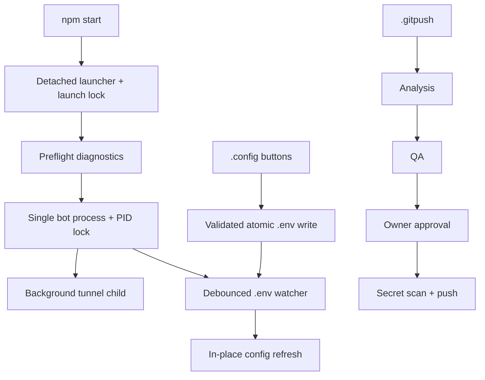
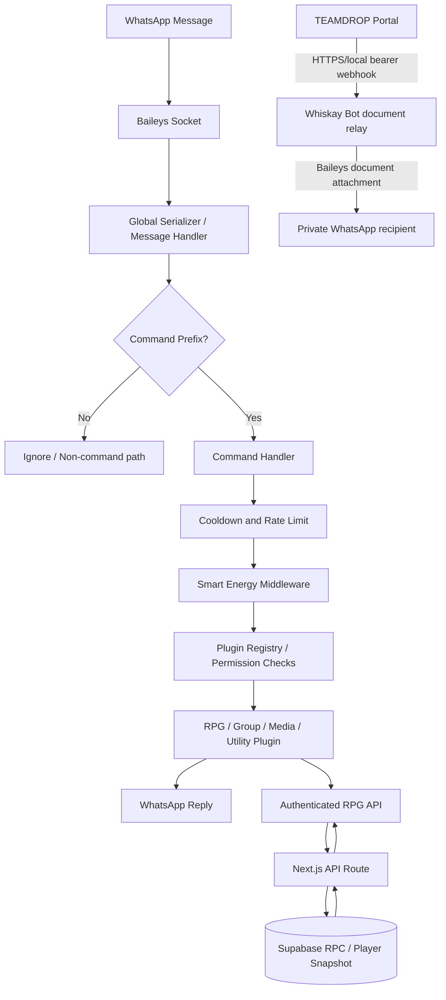
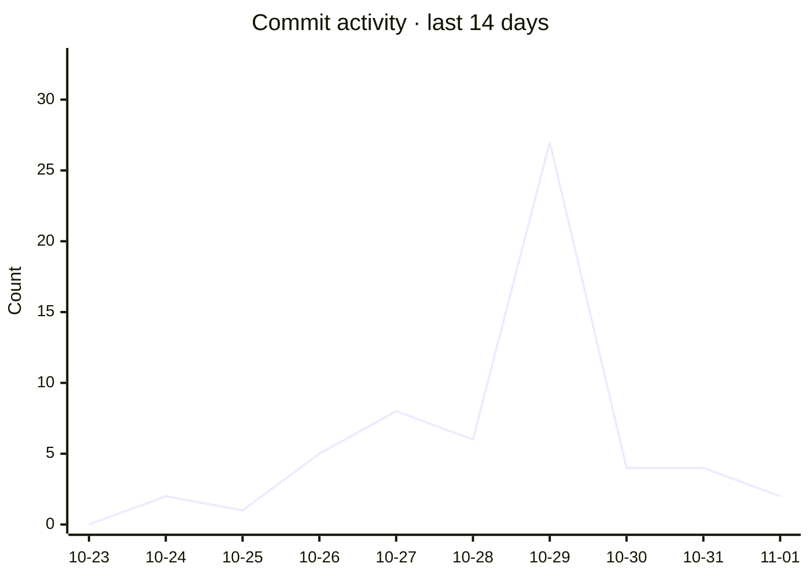
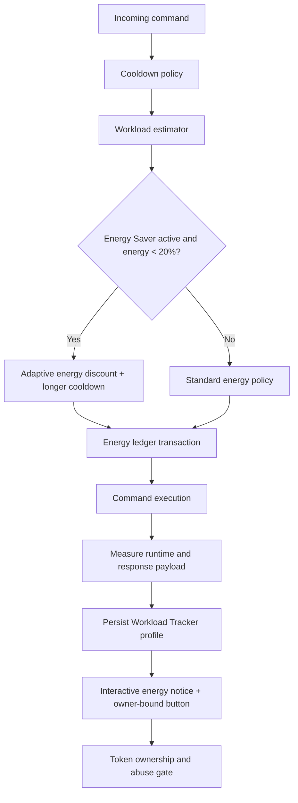
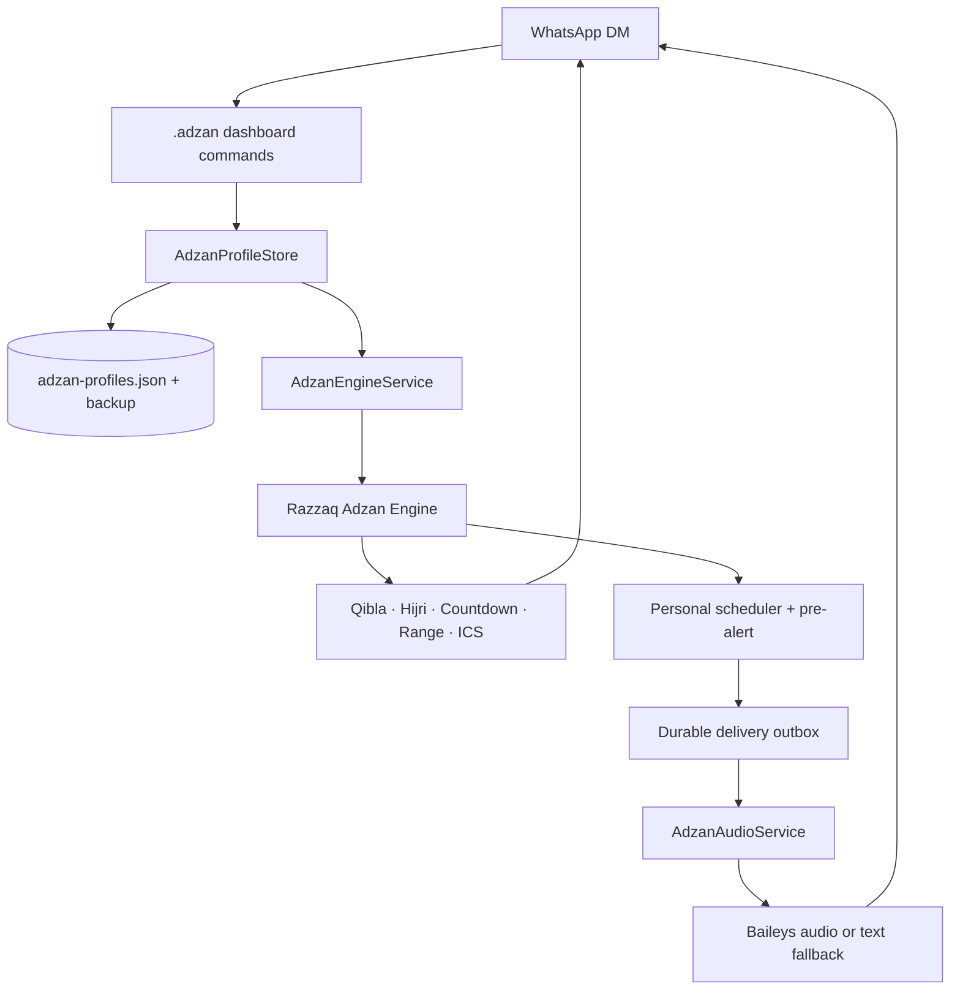

<div align="center">

# ⚡ WHISKAYBOT
### WhatsApp Automation · RPG Economy · Smart Energy Middleware

       

**A separate runtime for WhatsApp. Not bundled with the Next.js RPG website.**

**Developer:** Arifi Razzaq · **Repository:** [razzaqinspires/whiskay-bot](https://github.com/razzaqinspires/whiskay-bot)

</div>

```text
██╗    ██╗██╗  ██╗██╗███████╗██╗  ██╗ █████╗ ██╗   ██╗
██║    ██║██║  ██║██║██╔════╝██║ ██╔╝██╔══██╗╚██╗ ██╔╝
██║ █╗ ██║███████║██║███████╗█████╔╝ ███████║ ╚████╔╝ 
██║███╗██║██╔══██║██║╚════██║██╔═██╗ ██╔══██║  ╚██╔╝  
╚███╔███╔╝██║  ██║██║███████║██║  ██╗██║  ██║   ██║   
 ╚══╝╚══╝ ╚═╝  ╚═╝╚═╝╚══════╝╚═╝  ╚═╝╚═╝  ╚═╝   ╚═╝   
```

> **Runtime contract:** Node.js 20+, ESM, plugin discovery, WhatsApp transport via Baileys, bounded energy ledger, and optional authenticated RPG website APIs. A green local test suite does not imply live WhatsApp or Supabase connectivity.

## 🧭 Contents

- [Identity & responsibilities](#-identity--responsibilities)
- [Stage 46 — Startup, config & GitHub control](#stage-46--startup-config--github-control)
- [Stage 49 — Runtime & Group Cache Foundations](#stage-49--runtime--group-cache-foundations)
- [Stage 50 — Leveling Data Integrity & Recovery](#stage-50--leveling-data-integrity--recovery)
- [Stage 51 — Adzan Personal Region Profiles](#stage-51--adzan-personal-region-profiles)
- [Stage 52 — Repository Structure Cleanup](#stage-52--repository-structure-cleanup)
- [Stage 55 — Plugin & Command Intelligence](#stage-55--plugin--command-intelligence)
- [Stage 56 — Git History & Move Intelligence](#stage-56--git-history--move-intelligence)
- [Repository layout](#repository-layout)
- [Stage 49 Part 4 — XP Intelligence & Energy Canvas](#stage-49-part-4--xp-intelligence--energy-canvas)
- [Architecture map](#-architecture-map)
- [Smart Energy Middleware](#-smart-energy-middleware)
- [Worker status & runtime statistics](#-worker-status--runtime-statistics)
- [Command catalog](#-command-catalog)
- [Global Auction House](#-global-auction-house)
- [World Boss webhook](#-world-boss-webhook)
- [TEAMDROP document relay](#-teamdrop-document-relay)
- [Jadibot secure pairing portal](#-jadibot-secure-pairing-portal)
- [GitHub metrics and automation](#-github-metrics-and-automation)
- [Install & configure](#-install--configure)
- [Security and operations](#-security-and-operations)
- [📚 Documentation & Archives](#-documentation--archives)
- [Stage 40 — Source/Downloader Parity Audit](#stage-40--sourcedownloader-parity-audit-iteration-1–10)


## Stage 53 — GitHub-Safe Upload & Runtime Data Isolation (v2.35.16)

- `.gitignore` now excludes every `data/`, `sessions/` and `session/` directory, WhatsApp auth stores, private environment/credential files, database sidecars, keys, caches and local QA output. Static dungeon seed moved to `assets/dungeon/floors.json`.
- `scripts/protect-runtime-data.mjs` untracks legacy database/session/credential files from Git index in bounded batches without deleting local files; blocked security checks still create a local-only diagnostic ZIP.
- `git upload` runs clean `npm ci`, syntax checks, full `npm test`, and creates a redacted local diagnostics ZIP plus a Markdown report. QA failures are still submitted in an upload branch for review; secret/session/database checks remain hard blockers.
- Uploads go only to `upload/*`; GitHub Actions opens/updates a Pull Request to `main`, validates again, uploads full logs as workflow artifacts, and creates detailed GitHub Issues on validation failure. No direct push to `main` is used.
- Commit messages and timestamps use Asia/Jakarta local date/time.

## Stage 52 — Repository Structure Cleanup

**Version:** `2.35.15` · **Date:** 2026-11-01

- Root-level regular files are limited to `package.json`, `package-lock.json`, `README.md`, and `LICENSE`; required hidden files and directories remain in place.
- Project history and working memory live in `docs/project/`; third-party notices live in `docs/legal/`.
- Runtime and pairing entrypoints live in `scripts/`; PM2 configuration lives in `config/`. Use `npm run pair -- --help` for pairing-helper usage.
- `.github/` is the only active GitHub Actions directory. The former `github/` copy and the local patch are preserved under `docs/archive/`.
- Obsolete duplicate templates/ignore files, unreferenced source backups, and old generated QA bundles were removed. Active tests, source modules, runtime data, and historical stage documentation were retained.
- Verification: `npm run verify:stage52`, `npm test`, and `npm run verify:all`. Passing local tests do not prove live WhatsApp delivery or deployment connectivity.

## Repository layout

| Path | Responsibility |
|---|---|
| `src/` | Bot runtime, services, handlers, plugins, middleware and workers |
| `scripts/` | Startup, daemon, pairing, Git upload, QA and maintenance utilities |
| `config/` | Repository and process-manager configuration |
| `data/` (private runtime only; never committed) | Runtime state and static data required by the bot |
| `test/` | Automated unit, integration-mock and regression tests |
| `docs/` | Architecture, stage records, reports, project memory and archives |
| `.github/` | Active GitHub Actions workflows and automation scripts |
| `vendor/` | Vendored project-owned integration modules |

## Owner QA Control Center — live test progress (v2.35.4)

- Owner-only commands: `.testcommands run`, `.testcommands status` / `.testcommands progress`, `.testcommands report`, and `.testcommands download`. Bare `.testcommands` displays help and does not start a long run.
- QA runs in a disposable sandbox. It reports syntax files checked, per-test discovered/completed/pass/fail counters, phase start/end, and a final release verdict. WhatsApp progress updates are sent after the first test, every five completed tests, and immediately on a failure.
- Do not collect/package a candidate version while the card says `PROSES MASIH BERJALAN`. A phase-level PASS is not the full release verdict; wait for `FULL TEST LULUS`.
- Missing `sessions/pre-key-<id>.json` is classified separately as a Baileys session/runtime reference; QA never creates fake pre-keys or copies production sessions into its sandbox.
- Implementation and operator guide: [`docs/OWNER-TESTCOMMAND-VERIFICATION.md`](docs/OWNER-TESTCOMMAND-VERIFICATION.md).

## Stage 50 — Leveling Data Integrity & Recovery (v2.35.5)

- Leveling writes now validate the current primary and preserve it through an atomic `.bak` write before replacing it. If the backup write fails, the mutation aborts and the primary remains unchanged.
- Corrupt-primary recovery preserves the original file under a unique `.corrupt-*` name before using a valid backup/archive. Manual `.leveldb restore` follows the same preservation rule.
- `.leveldb status` reports primary/backup health, both file sizes, aggregate XP, profile count, and archive count.
- Stage 35 tests now use a unique OS-temp `WHISKAY_DATA_DIR` before importing the leveling module. Direct `npm run verify:stage35` / `npm run verify:all` no longer write synthetic players to production leveling data.
- `npm run protect:runtime-data` removes every tracked `data/` (private runtime only; never committed), `sessions/`, environment-secret and database file from the Git index without deleting local bytes. All `data/` (private runtime only; never committed) is private and ignored; the static dungeon seed is maintained at `assets/dungeon/floors.json`. The guarded `scripts/auto-push.sh --push` path applies this protection before staging.
- Implementation and test report: [`docs/STAGE-50-LEVELING-DATA-INTEGRITY.md`](docs/STAGE-50-LEVELING-DATA-INTEGRITY.md) · [`docs/TEST-REPORT-STAGE-50-LEVELING-DATA-INTEGRITY.md`](docs/TEST-REPORT-STAGE-50-LEVELING-DATA-INTEGRITY.md).

Historical XP recovery is deliberately not automatic. A source snapshot must be matched to the exact group/user profile key and chosen as authoritative before restoring; this release does not rewrite production `data/leveling.json`.

## Stage 51 — Adzan Personal Region Profiles, Delivery & Intelligence (v2.35.12 · Part 8)

- `.adzan lokasi` asks the sender to share a static WhatsApp Current Location in a private chat. Coordinates are stored only after an explicit, expiring request; location messages are not silently harvested.
- `.adzan default` is owner-only and sets the deployment-wide fallback region for users who have not configured a personal location. `.adzan status` shows the effective region and map link.
- `.adzan timezone Asia/Jakarta` sets a personal IANA time zone; `.adzan default-timezone Asia/Jakarta` changes the owner default. The engine does not infer a time zone from GPS coordinates, so users must verify/set the correct IANA zone when their region differs from the owner default.
- `.adzan clear` removes the personal override and falls back to the owner default. `.adzan clear-default` is owner-only.
- Personal profiles and legacy group reminder settings now share `data/adzan-profiles.json`, with schema validation, atomic replace, fsync, cross-process lock, verified `.bak`, corruption quarantine and backup recovery. A valid old `data/adzan-settings.json` is migrated once and renamed with a `.migrated-*` suffix.
- The supplied `@razzaq-ventures/adzan-engine` v1.3.0 is vendored under `vendor/razzaq-adzan-engine/` with its MIT license and upstream documentation. `.adzan jadwal` calculates five prayer times from the effective personal region; `.adzan on/off` controls opt-in personal DM notifications.
- The 15-second scheduler persists each due prayer in a durable outbox before sending. Failed WhatsApp sends retry after 1, 5, 15, and 30 minutes, up to five attempts; terminal failures remain visible in the dead-letter count. The delivery model is at-least-once: a crash after WhatsApp accepts a message but before the local success record is saved can cause a duplicate on retry.
- Stage 51 Part 4 adds local WhatsApp MP3 delivery with per-user audio preferences and automatic text fallback.
- Stage 51 Part 5 adds retryable delivery outbox, bounded retry policy, delivery metrics, and owner-only `.adzan admin` control center. `.adzan audio check` checks local audio readiness.
- Stage 51 Part 6 adds the personal dashboard, calculation method selection, per-prayer minute corrections, audio-pack preferences and delivery history.
- Stage 51 Part 7 adds `.adzan kiblat`, `.adzan hijriah`, `.adzan berikutnya`, `.adzan mingguan`, `.adzan bulanan`, `.adzan ics`, and `.adzan pengingat 0..30`. Qibla is a true-north bearing; Hijri is tabular-civil and not official rukyat; schedules remain approximate and should be checked locally. Pre-alerts are text-only and use the durable delivery outbox.
- Stage 51 Part 8 adds `.adzan automasi`, `.adzan jumat on|off|HH:mm`, `.adzan ramadan on|off`, `.adzan sahur 0..120`, and `.adzan iftar on|off|0..60`. Friday reminders use each user's IANA local time; Sahur and Iftar reminders are scheduled from the calculated Fajr/Maghrib only when the engine's tabular-civil date estimate is in Hijri month 9. All reminders are personal, text-only, opt-in DM notifications. Location/timezone/profile changes cancel queued stale events and the 15-second worker recalculates from the latest profile. The Hijri month estimate is not an official rukyat decision. See [`docs/STAGE-51-ADZAN-AUTOMATION.md`](docs/STAGE-51-ADZAN-AUTOMATION.md).
- Existing manual group reminder controls remain compatible.
- Private-chat-only location setup prevents GPS coordinates from being echoed into a group. Location data is not posted to a third-party geocoder.
- Implementation and verification: [`docs/STAGE-51-ADZAN-PROFILES.md`](docs/STAGE-51-ADZAN-PROFILES.md) · [`docs/STAGE-51-ADZAN-ENGINE-INTEGRATION.md`](docs/STAGE-51-ADZAN-ENGINE-INTEGRATION.md) · [`docs/TEST-REPORT-STAGE-51-ADZAN-ENGINE.md`](docs/TEST-REPORT-STAGE-51-ADZAN-ENGINE.md) · [`docs/STAGE-51-ADZAN-RELIABILITY.md`](docs/STAGE-51-ADZAN-RELIABILITY.md) · [`docs/TEST-REPORT-STAGE-51-ADZAN-RELIABILITY.md`](docs/TEST-REPORT-STAGE-51-ADZAN-RELIABILITY.md) · [`docs/STAGE-51-ADZAN-AUTOMATION.md`](docs/STAGE-51-ADZAN-AUTOMATION.md) · [`docs/TEST-REPORT-STAGE-51-ADZAN-AUTOMATION.md`](docs/TEST-REPORT-STAGE-51-ADZAN-AUTOMATION.md).

## Stage 43 — Canvas and Leveling Storage Reliability

- Official Menu Canvas V1 and V2 are now distinct landscape designs. V2 includes a circular identity area for a user-specific avatar/logo.
- Avatar setup is button-first: `.setmenu image` → **Ganti Avatar / Logo V2** → **Unggah Avatar Canvas V2** → reply to that exact bot message with an image. The image is automatically stored and applied; no caption or follow-up command is needed. JPG/PNG/WEBP, max 8 MB, 15-minute upload window.
- Leveling storage uses a project-root-stable data path, atomic snapshots, backup generations, cross-process writer locking, corruption quarantine, and backup/archive recovery. `.leveldb status` is owner-only diagnostics; `.leveldb restore` restores the latest valid backup/archive.
- At 1 GiB by default, a dated gzip snapshot with SHA-256 sidecar is written to `data/archives/leveling/`. Set `WHISKAY_DB_ARCHIVE_BYTES` to change the threshold. Active leveling data is intentionally retained in `leveling.json`; archives are recovery snapshots, not yet cold-storage shards.
- Details and validation: [`STAGE-43-ITERATION-1.md`](docs/stages/STAGE-43-ITERATION-1.md) · [`TEST-REPORT-STAGE-43-ITERATION-1.md`](docs/stages/TEST-REPORT-STAGE-43-ITERATION-1.md).

## Stage 37 — Experimental-Bell parity transplant

- The command-family parity inventory is tracked in [`STAGE-37.md`](docs/stages/STAGE-37.md) and [`STAGE-37-EXPERIMENTAL-BELL-PARITY.json`](docs/stages/STAGE-37-EXPERIMENTAL-BELL-PARITY.json). Parity remains explicitly incomplete until every family has command-by-command evidence.

## Stage 41 — Game Transplant and Menu Visibility (Iteration 1)

- Added the ten quiz families from the supplied game-module excerpt: `.tebakgambar`, `.susunkata`, `.family100`, `.tebakanime`, `.caklontong`, `.asahotak`, `.tebakjenaka`, `.tebakbendera`, `.tebaktebakan`, and `.tebaklirik`. Use `.jawab <jawaban>` to submit, `.hint` for a clue, `.nyerah` to give up, and `.cleargame` to stop a round. `.cek <kategori>` provides a random entertainment result.
- Group commands now have individual `menuCommands` entries, so the dynamic menu lists commands such as `.grouphelp`, `.groupinfo`, `.tagall`, `.antilink`, `.groupschedule`, `.absen`, and `.blacklist` instead of showing only the plugin’s first command. `.grouphelp` opens a categorized interactive command picker rather than a long text dump, and has one authoritative handler.
- Quiz JSON endpoints use a timeout and bounded response reading with local fallback questions. Prize values are informational only in this iteration; automatic energy payouts, arbitrary plain-text answer interception, the supplied multiplayer Snake-and-Ladders implementation, and the Termai minigames API are not yet transplanted.

## Stage 40 — Source/Downloader Parity Audit (Iteration 1–10)

- Machine-readable source-family audit: [`STAGE-40-SOURCE-PARITY-AUDIT.json`](docs/stages/STAGE-40-SOURCE-PARITY-AUDIT.json). Exact command-by-command parity is not claimed; see the Iteration 10 report for confirmed gaps and offline audit limitations.

- Iteration 3 details and test report: [`STAGE-40-ITERATION-3.md`](docs/stages/STAGE-40-ITERATION-3.md) · [`TEST-REPORT-STAGE-40-ITERATION-3.md`](docs/stages/TEST-REPORT-STAGE-40-ITERATION-3.md). Iteration 4 alias audit and format-picker parity: [`STAGE-40-ITERATION-4.md`](docs/stages/STAGE-40-ITERATION-4.md) · [`TEST-REPORT-STAGE-40-ITERATION-4.md`](docs/stages/TEST-REPORT-STAGE-40-ITERATION-4.md). Iteration 5 provider URL hardening: [`STAGE-40-ITERATION-5.md`](docs/stages/STAGE-40-ITERATION-5.md) · [`TEST-REPORT-STAGE-40-ITERATION-5.md`](docs/stages/TEST-REPORT-STAGE-40-ITERATION-5.md). Iteration 6 hardens provider response validation and makes downloader selection tokens sender/chat-safe and bounded: [`STAGE-40-ITERATION-6.md`](docs/stages/STAGE-40-ITERATION-6.md) · [`TEST-REPORT-STAGE-40-ITERATION-6.md`](docs/stages/TEST-REPORT-STAGE-40-ITERATION-6.md). Iteration 7 adds a 1 MiB provider response cap and prevents unavailable format attempts from burning valid tokens: [`STAGE-40-ITERATION-7.md`](docs/stages/STAGE-40-ITERATION-7.md) · [`TEST-REPORT-STAGE-40-ITERATION-7.md`](docs/stages/TEST-REPORT-STAGE-40-ITERATION-7.md).

- Added shared-provider downloader command adapters for Pinterest, MediaFire, Spotify, YouTube URL downloads, and RedNote/Xiaohongshu. Existing TikTok, Instagram, Facebook, and format selection are retained. Provider APIs must be configured externally using `MEDIA_DOWNLOADER_API_URLS` / `MEDIA_DOWNLOADER_API_URL`.
- YouTube search/play commands include `.ytsearch` / `.yts` and `.ytplay` / `.play`, with paginated results, video preview, and explicit MP3/MP4 selection. They require `yt-dlp`; MP3/M4A/Opus conversion requires FFmpeg. Stage 40 Iteration 3 adds `.ytm4a`, `.playvn` (Opus voice note), `.dlvlink` (format picker), and `.youtube` / `.yt` search aliases. Iteration 4 adds the MP4 option to `.dlvlink` and fills in missing downloader aliases from the source command inventory. Iterations 5–7 harden provider URL validation, response-size limits, and format-selection tokens. Iteration 8 adds owner-only `.saveimg [nama-file]` (aliases `.saveimage`, `.saveimagepath`, `.imgsave`): reply to an image or send an image with the command as its caption; the image is saved under `data/saved-images/` and the bot returns the relative and absolute path. Supported formats: JPEG, PNG, WebP, GIF; max 15 MiB; existing files are not overwritten. Iteration 9 limits YouTube search queries to 200 characters, expires inactive search sessions after 30 minutes, and adds tests against lookalike platform domains.
- Added `.gitclone owner/repo`, `.gitclone https://github.com/owner/repo`, and optional `owner/repo#branch` for public GitHub repository ZIP downloads. Archives are capped at 24 MB and the bot never executes repository code.
- Tests verify URL validation, aliases, repo parsing, size/host guardrails, and plugin inventory. Provider downloads and live WhatsApp delivery still require deployment-level validation.

## Stage 39 — Group Administration Parity (Iteration 1–6)

- Group moderation: `.bancmd`, `.unbancmd`, `.ephemeral`, `.groupschedule`, `.absen`, `.pinchat`, `.pinpesan`.
- Group aliases: `.open`, `.close`, `.locked`, `.unlocked`, `.linkgc`, `.resetlink`, `.setname`, `.setdescription`.
- Unified settings shortcut: `.group open|close|link|resetlink|locked|unlocked|setname <nama>|setdesc <deskripsi>`.
- Media/member tools: `.totag`, `.tohidetag`, `.inviteinfo <link>`, `.setppgc`, `.getpp [mention/reply]`, `.getppgc`, `.setwelcometext`, `.setleavetext`.
- Per-group blacklist: `.blacklist @anggota` / `.unblacklist @anggota`; subsequent messages from blacklisted non-admin/non-owner members are suppressed and deleted when bot permissions allow.
- Info alias: `.infogc` / `.infogroup` maps to `.groupinfo`.
- Live WhatsApp compatibility depends on the installed Baileys version and actual group permissions; test in a non-production group before enabling moderation automation.

## Stage 47 — WhatsApp connection recovery & startup preflight (v2.35.2)

- Fixed startup preflight so absent optional bundled Cloudflared binaries are reported as informational; a valid system binary such as `/usr/local/bin/cloudflared` is verified with `--version` and remains usable.
- Baileys reconnect is single-flight and socket-generation guarded. Old socket close events cannot spawn competing sockets; transient disconnects use capped exponential backoff with jitter and do not terminate the daemon after an arbitrary retry count.
- `npm run status` continues to describe the daemon process, not WhatsApp connectivity. Inspect `.runtime/logs/whiskay-bot.log` for `Online`, `Connection closed`, and `WhatsApp reconnect scheduled` events.
- Logged-out or invalid-auth states stop automatic reconnect and require owner re-pair/session repair; credentials are never deleted unless the existing explicit auto-clear setting is enabled.
- Live WhatsApp recovery still requires verification on the owner's host and account.

## Stage 46 — Startup, Config & GitHub Control (v2.35.1)

- Iteration 2 binds the GitHub approval fingerprint to the exact `HEAD` commit and allows a previously committed local commit to be pushed after a failed transport attempt, even when the working tree is clean.

- **Developer:** Arifi Razzaq · **Repository:** [razzaqinspires/whiskay-bot](https://github.com/razzaqinspires/whiskay-bot).
- `npm start` now launches one detached bot process through `scripts/daemon.mjs`. The child startup prints `uname -m`, `which cloudflared`, and `ls -lah bin/cloudflared-linux-arm64 data/bin/cloudflared-linux-arm64`; Cloudflared and Jadibot run as managed children with retry. Logs are stored in `.runtime/logs/whiskay-bot.log`.
- Cloudflared relative paths resolve from the repository root. If `spawn` returns `ENOENT`, the failed child reference is cleared so the retry worker can resolve the binary again rather than treating a dead child as active.
- `.config` is an owner-only, full-button environment control center. Select a category and key, then reply to the prompt message with the new value. Secret/token values are masked and can only be entered from a private chat.
- The `.env.example` / `.config` catalog currently covers 90 whitelisted keys in nine categories, including RPG URLs, Cloudflared/Jadibot mode, GitHub repositories, media-downloader provider endpoints, and runtime controls. Provider endpoints are treated as secrets because they may contain embedded credentials.
- `.env` hot reload is debounced and serialized. Runtime-compatible values update in place; port, path, binary, and other boot-bound values are labeled restart-required. It never creates a second webhook or bot server.
- `.gitpush` opens the GitHub Control Center: repository analysis → syntax + `npm test` QA → owner-bound **Commit & Push** button. Approval expires after 20 minutes and is invalidated if the content fingerprint changes. The shell script does not use `git reset --hard`, auto-stash, or automatic rebase.
- If the terminal reports `cannot exec .../scripts/git-upload.sh: Permission denied` for `git upload`, run `bash scripts/install-git-upload-alias.sh` once (or `npm run fix:git-upload`). This restores `scripts/git-upload.sh` mode `0755` and configures the repository-local alias to invoke it through Bash.
- `.owner` now uses `OWNER_NAME` from `.env` for the contact card. `OWNERS`/`OWNER_LIDS` remain the actual authorization sources.
- Start with `cp .env.example .env`; fill `OWNERS`, WhatsApp owner phone, AI/API credentials, integration tokens and deployment-specific URLs. `.env` is ignored by Git and must not be uploaded.
- Iteration 2 binds approvals to the exact `HEAD` commit and safely retries already-committed changes after a failed push, even when the working tree is clean. See [`STAGE-46-ITERATION-1.md`](docs/stages/STAGE-46-ITERATION-1.md), [`STAGE-46-ITERATION-2.md`](docs/stages/STAGE-46-ITERATION-2.md), and the corresponding test reports.

### Stage 46 architecture



## 🧩 Identity & responsibilities

WHISKAYBOT owns WhatsApp message intake, command parsing, permission checks, energy accounting, group moderation, and the bot-side integration boundary. The RPG website owns the authoritative inventory/Gold transactions when its Supabase RPC endpoints are configured. The bot should never infer a successful database transaction from a timeout.

| Layer | Responsibility | Persistence / boundary |
|---|---|---|
| Baileys transport | Receive/send WhatsApp messages | WhatsApp session credentials must remain private |
| Global message handler | Serialize messages, recognize command prefixes, route commands | Per-message; no business state should be inferred from RAM |
| Plugin registry | Discover command modules and metadata | Source files under `src/plugins/` |
| Middleware | Cooldown, rate-limit and energy accounting | Energy ledger is a local JSON file; back it up and do not confuse it with RPG player persistence |
| RPG economy client | Call protected web endpoints | `DUNGEON_WEBSITE_URL` + shared sync token |
| Supabase | Player snapshot, guild and auction RPC transactions | Server-side service role only, configured in website project |

## 🗺️ Architecture map



## 🔋 Smart Energy Middleware

The energy estimator is a deterministic heuristic, not an LLM request. `energyMode: 'free'`, explicitly declared zero-cost plugins, and the recovery/control allowlist are exempt. `energyMode: 'static'` uses the declared cost (bounded to **0.05–10 energy points**); other commands receive a bounded workload estimate based on input size, network/AI/heavy classification, observed command latency, response size, and runtime pressure. Dynamic estimates are clamped to **0.15–9.75 points**. Energy Saver can reduce the charged estimate below its unlock threshold, while adding a cooldown multiplier.

```text
base = 0.18 + min(input_chars, 1600) × 0.0011
             + min(tokens, 180) × 0.004
cost = clamp(base + network_cost + ai_cost + heavy_cost + pressure_cost,
             0.15, 9.75)
```

Before a paid command reaches its plugin, middleware verifies that the ledger balance covers the adjusted cost. A zero/insufficient balance blocks execution; malformed balance values and ledger read/write errors fail closed. Recovery/free commands remain available so users can inspect status or recharge. Ledger mutations are serialized within one Node.js process and written using temporary-file + rename. This protects concurrent writes in that process, but **does not provide distributed locking across multiple bot replicas**. The ledger is bounded to 5,000 users.

## 📊 Worker status & runtime statistics

The implementation exposes runtime metrics through `getEnergyRuntimeInfo()` and owner command `.worker`. Metrics include Node version, platform/architecture, RSS, heap use, worker implementation label, and an approximate pending-write indicator. Command hits and audit events are file-backed and are not a live distributed monitoring system.

| Metric | Meaning | Caveat |
|---|---|---|
| `rssMB` | Resident process memory | Runtime snapshot, not historical chart |
| `heapUsedMB` | Current JS heap in use | Changes with garbage collection |
| `node` / `platform` | Runtime version and host | Useful for deployment diagnostics |
| `worker` | Current implementation descriptor | `inline-bounded-O(n)` is a label, not a separate worker thread |
| `commands` / `totalSpent` | Per-user energy counters | Backed by local ledger JSON |
| command hit totals | Recorded command usage | Not guaranteed cross-replica consistent |

## 🧰 Command catalog

Commands are sourced from plugin metadata under `src/plugins/`. Prefix defaults are `.`, `!`, `/`, and `#`; aliases depend on the registered plugin. Group moderation requires group context, caller permissions, and bot admin rights for most mutations. Some media commands require FFmpeg or provider credentials.

### RPG

| Perintah | Fungsi |
|---|---|
| `.auction` | Pasar lelang global untuk menjual dan membeli loot menggunakan Gold |
| `.buy` | Beli item RPG dari toko dashboard |
| `.craft` | Craft item dari material dungeon |
| `.daily` | Klaim hadiah harian WHISKAY RPG (+100 Gold) |
| `.inventory, .inv, .equip, .unequip, .use, .usepotion, .buff, .guild, .quest, .weather, .map, .dungeon, .adventure, .spiritgacha` | Inventory, equipment, potion, gacha summon, spirit collection, dungeon, adventure, guild, quest, weather, map |
| `.explore, .enterdungeon` | Jelajahi dunia dan sinkronkan checkpoint dungeon |
| `.gacha` | Summon equipment acak dengan Gold |
| `.guild` | Buat guild, bergabung, mengeluarkan anggota, dan donasi Gold |
| `.rpgsync` | Periksa koneksi dashboard WHISKAY RPG |
| `.trade` | Transfer Gold atau item kepada pemain lain di grup |
| `.rpg, .dungeon, .adventure` | Aksi RPG |

### Group

| Perintah | Fungsi |
|---|---|
| `.kick, .add, .promote, .demote, .linkgroup` | Moderasi grup WhatsApp: kick, add, promote, demote, linkgroup |
| `.grouphelp, .groupinfo, .admins, .tagall, .hidetag, .revoke, .setsubject, .setdesc, .closegroup, .opengroup` | Informasi, mention anggota, tautan undangan, nama/deskripsi, buka/tutup grup |
| `.ephemeral off|24h|7d|90d|status` | Atur pesan sementara grup (bergantung dukungan Baileys/WhatsApp) |
| `.bancmd <command>, .unbancmd <command>, .bancmd --list` | Blokir/buka blokir command untuk anggota non-admin pada grup ini; command pemulihan dilindungi |

### Media

| Perintah | Fungsi |
|---|---|
| `.meme, .captionimg` | Tambahkan caption meme atas/bawah pada gambar yang direply |

### Utility

| Perintah | Fungsi |
|---|---|
| `.leveling, .profile, .rank, .rankmatrix, .levelnotify, .leaderboard, .setpp` | Level, XP, rank, profile card dan notifikasi kenaikan level |
| `.menu, .help` | Font, widget, template, border, spasi, gambar, urutan dan ketebalan font |
| `.setmenu` | Pengaturan kategori: template (16 tema + random dengan konfirmasi), font, widget, simbol, kutipan, gambar/kanvas dan reset tampilan |
| `.telur, .kalkulatortelur, .hitungtelur` | Kalkulator telur via daftar preset, input manual, kartu hasil Canvas dan tautan website |
| `.ping, .p` | Lihat bantuan perintah |
| `.dlselect` | Kirim format downloader yang dipilih |
| `.fb` | Pilih format unduhan facebook melalui tombol interaktif |
| `.ig` | Pilih format unduhan instagram melalui tombol interaktif |
| `.tiktok` | Pilih format unduhan tiktok melalui tombol interaktif |
| `.charge, .hit, .setpayment, .bukti, .status, .premium` | Smart Energy, dashboard hit, premium, pembayaran dan status worker |
| `.jadibot, .jadibotstatus, .jadibotlogin, .jadibotlogout, .perpanjang` | Sewa sub-bot 30 hari, QR/Pairing Portal, status, login/logout, dan perpanjangan |
| `.listjadibot, .jadibotapprove, .stopjadibot, .setjadibotharga, .setjadibotdurasi` | Kontrol jadibot khusus owner: daftar sesi, verifikasi perpanjangan, penghentian, harga dan durasi |

### Premium / Owner

| Perintah | Fungsi |
|---|---|
| `.autoclean, .cleaner, .clean` | Auto-hapus .bak/.tmp/.swp files |
| `.bc, .broadcast` | Pengumuman owner ke grup atau pengguna terdaftar |
| `.console, .consolef` | Konsol owner: async eval, shell exec, Python dan source filter |
| `.hotreload, .hr` | Toggle auto hot-reload runtime |
| `.hrlog, .watchlog, .changelog` | Entri terbaru |
| `.reload, .rl` | Lihat bantuan perintah |
| `.sourcereload, .sreload` | Auto-restart pada perubahan core files |
| `.webstatus, .webpush, .webreport, .webhelp, .webset, .websale, .webexpense, .webproduct` | Integrasi website Razzaq Ventures |
| `.worker` | Worker monitor, audit log dan matriks rank |
| `.zip, .backup` | Kirim backup source (tanpa sessions & node_modules) |

### AI & Tools

| Perintah | Fungsi |
|---|---|
| `.ask, .ai` | Percakapan asisten AI melalui OpenAI atau Gemini |
| `.vipgen` | Generator ide berbasis template, memakai Limit |
| `.berita, .news` | Berita terbaru dari RSS publik |
| `.scrape` | Ambil metadata dan teks utama dari halaman web publik |
| `.s, .sticker` | Ubah gambar atau video pendek yang direply menjadi stiker WebP |
| `.ytmp3` | Unduh audio YouTube menjadi MP3 |
| `.ytm4a` | Unduh audio YouTube menjadi M4A |
| `.playvn` | Kirim audio YouTube sebagai voice note Opus |
| `.dlvlink` | Tampilkan pilihan format untuk URL YouTube |
| `.github, .githubstats` | Statistik repository dan traffic GitHub (jika token berizin tersedia) |
| `.github commits, .github issues, .github workflows` | Commit terakhir, issue terbuka, dan status GitHub Actions |


### Stage 18: auction commands

| Command | Function |
|---|---|
| `.auction sell <item-id> <price>` | Removes one item from inventory and lists it for sale |
| `.auction list` | Lists active global listings |
| `.auction buy <listing-id>` | Atomically charges buyer Gold, transfers item, and credits seller |
| `.auction help` | Shows command format |

Auction RPCs run server-side in Supabase. Listings are active until purchased; this stage does not yet provide cancellation, expiry, or a listing fee. Item IDs must match the inventory's `id`.

## 🚨 World Boss webhook

The bot exposes `POST /webhooks/world-boss` on `WHISKAY_BOT_WEBHOOK_PORT` (default `8787`). The website's `/api/world-boss/announce` route verifies the signed game access token and forwards a fixed event to the bot. The bot checks the shared bearer secret, validates `event: world_boss_spawned`, then sends the fixed announcement to groups the bot currently participates in.

```text
WHISKAY_BOT_WEBHOOK_URL=https://<your-bot-host>/webhooks/world-boss
WHISKAY_BOSS_WEBHOOK_SECRET=<long-random-secret>
WHISKAY_BOT_WEBHOOK_PORT=8787
```

Do not expose the webhook on the public internet without HTTPS, firewall restrictions, and a long random secret. The same secret must be configured on both services. If the bot runs only on a phone/Termux behind NAT, the website cannot call its private localhost; use a secured public reverse proxy or disable the integration.


## Stage 48 — TEAMDROP private document relay (2026-10-30)

- Integrated the TEAMDROP upload portal with the existing Baileys session.
- Added a dedicated bearer-authenticated raw-file endpoint, safe filename metadata, file-size/type validation, per-source rate limiting, and in-process idempotency.
- Added recipient selection through `TEAMDROP_WHATSAPP_TO` with owner/session fallback; the target phone is never exposed to the browser.
- Verification: `npm run verify:stage48` plus the existing Stage 46 environment tests.

## 📁 TEAMDROP document relay

Whiskay Bot exposes an authenticated `POST /webhooks/teamdrop/document` endpoint on `WHISKAY_BOT_WEBHOOK_PORT` (default `8787`). TEAMDROP posts the raw document bytes and safe metadata using a bearer token. The bot validates the submission ID, document extension, size, rate limit, and then sends the file to one configured recipient using Baileys `sendMessage()` with the `document` payload.

Configure the bot `.env`:

```dotenv
TEAMDROP_WEBHOOK_SECRET=<long-random-shared-secret>
TEAMDROP_WHATSAPP_TO=628xxxxxxxxxx
TEAMDROP_MAX_FILE_MB=50
TEAMDROP_WEBHOOK_RATE_LIMIT=18
```

Configure the TEAMDROP portal `.env` with the same secret:

```dotenv
WHISKAY_BOT_WEBHOOK_URL=http://127.0.0.1:8787/webhooks/teamdrop/document
WHISKAY_BOT_WEBHOOK_TOKEN=<same-long-random-shared-secret>
```

`TEAMDROP_WHATSAPP_TO` is optional; when empty, the bot falls back to `OWNER_PHONE`, the first `OWNERS` entry, then the WhatsApp account connected to the bot. Set an explicit destination when the document must be delivered to a different number. Keep the webhook reachable only from the portal server; prefer loopback on a shared VPS, otherwise use HTTPS, firewall allowlisting, and a high-entropy shared secret. The existing Whiskay Quick Tunnel forwards the full webhook listener, so a separate portal host can use the latest `WHISKAY_BOT_WEBHOOK_PUBLIC_URL` base plus `/webhooks/teamdrop/document`; update the portal endpoint when a temporary TryCloudflare URL changes. The phone number and secret are never sent to team members' browsers.

The relay uses the already-running Baileys socket; it does not create another WhatsApp login or a second listener. Uploaded documents are sent as WhatsApp document attachments, not as public links.

## 🚀 Install & configure

```bash
node --version   # Node.js 20+
cp .env.example .env
npm ci
npm test
npm start                 # start one detached bot process
npm run status             # check PID / runtime state
npm run logs               # tail background log
npm stop                   # graceful shutdown
npm run restart            # graceful restart
npm run start:foreground  # same bootstrap, attached to terminal
npm run start:diagnostics  # run host checks only
```

Set `OWNERS`, `OWNER_PHONE`, `TEAMDROP_WEBHOOK_SECRET` and (when needed) `TEAMDROP_WHATSAPP_TO`, the API credentials for the selected AI provider, `DUNGEON_WEBSITE_URL`, `DUNGEON_SYNC_TOKEN`, `WHISKAY_BOSS_WEBHOOK_PORT`, and `WHISKAY_BOSS_WEBHOOK_SECRET`. The owner can review supported settings using `.config`. For `.gitpush`, configure Git identity once with `git config user.name "Arifi Razzaq"` and `git config user.email "<your verified GitHub email or noreply address>"`; also configure the host Git remote credentials (SSH or a credential helper). The bot does not silently use `.env` tokens as Git transport credentials. Keep `.env`, Baileys auth state, and any service-role key out of Git. The bot does not need the Supabase service-role key; the website API owns database access.

## 🛡️ Security and operations

- Keep bot and website as separate deployables with separate ZIPs and separate environment variables.
- Never trust a browser-supplied Gold, item count, price, or seller identity. Auction state changes run inside SQL RPC transactions.
- The World Boss webhook broadcasts only a fixed, validated announcement; TEAMDROP has a separate bearer secret and sends only validated document attachments to the configured recipient.
- Test group moderation in a private test group before using real groups.
- Use backups before applying `schema.sql`; review SQL migrations before running them in production.
- A successful unit test does not prove WhatsApp login, public webhook reachability, or Supabase credentials work.

## 🧰 Stage 19 — Menu Canvas & Timed Energy

### Menu markers and spacing

- `⚡` marks commands using dynamic energy estimation; `📌` marks plugins declaring a static energy cost. `🎟️` marks Limit usage and `💎` marks Premium-only commands.
- A blank line is inserted before every category header. Use `.setmenu spacing 0|1|2|3` to control command-row spacing.
- `.setmenu template <name>` applies a theme-specific font and widget layout. `.setmenu template random` randomizes the visual preset, font, widget selection, borders, order and spacing.

### Dynamic menu widgets

| Command | Effect |
|---|---|
| `.setmenu widget rpgstatus on` | Show Level, XP and Coin/Gold summary when the profile data is available |
| `.setmenu widget leaderboard on` | Show a short leaderboard preview |
| `.setmenu widget commandhits on` | Show the persisted total command-hit counter |
| `.setmenu widget <name> off` | Hide a widget |
| `.setmenu image official` | Enable landscape Menu Card V2 |
| `.profile` | Send the portrait Profile Card V2 with progress and player stats |
| `.setpp` (reply to an image) | Save that image as the circular avatar injected into Profile Card V2 |

### Timed charging

| Command | Effect |
|---|---|
| `.charge` | Start timed charging; progress is derived from persisted timestamps |
| `.statusbaterai` | Display current energy and estimated completion time |
| `.charge stop` | Manually unplug while preserving accrued progress |
| `.setenergy auto on` | **Owner only:** enable passive regen of 0.01 percentage points per second |
| `.setenergy auto off` | **Owner only:** disable passive regen |
| `.raidboss` | High-energy simulation; blocked during charging with a CPU warning |

Charging is modeled at 1 percentage point per 252 seconds (420 minutes from 0% to 100%). It completes automatically at 100%. Persist `data/energy-ledger.json` and `data/runtime-switches.json` between restarts. The optional native `canvas` module is used when installed; FFmpeg SVG rendering remains the fallback. See [Stage 19 Audit](docs/STAGE-19-AUDIT.md) for limitations and verification details.

## 🤖 Jadibot secure pairing portal

The `.jadibot` rental plugin supports QR and phone-number pairing, 30-day default access, status/logout/reconnect, manual payment review, and owner-controlled pricing/duration. The recommended `.jadibot pairing` path sends a time-limited CTA URL to a mini-web page. The page accepts an international-format phone number, then opens WhatsApp to the main bot with `.jadibotconfirm <one-time-token>` prefilled. The user must still press **Send** in WhatsApp; a website cannot silently send a WhatsApp message on the user's behalf. The pairing code is sent only by the bot in the original private chat, not rendered on the public web page.

- `.jadibot` — choose QR or pairing.
- `.jadibot pairing` — create a single-use portal link (10-minute expiry); `.jadibot pairing 628xxxxxxxxxx` remains as a manual fallback.
- `.jadibotconfirm <token>` — verifies the ticket owner and starts pairing after the user sends the prefilled WhatsApp message.
- `.jadibotstatus`, `.jadibotlogin`, `.jadibotlogout` — view status, reconnect saved auth, or clear the sub-bot session.
- `.perpanjang [days]`, `.buktijadibot <ref>`, `.jadibotapprove <user-key>` — request renewal and have the owner manually verify payment before extending access.
- `.setjadibotharga <IDR>`, `.setjadibotdurasi <days>`, `.listjadibot`, `.stopjadibot <user-key>` — owner controls.

Settings are in `.env.example` under `JADIBOT_*`. Local development automatically tries to launch a temporary TryCloudflare quick tunnel if no known server/deployment marker or public URL is configured. If a public URL or deployment environment is detected, the tunnel is disabled; set `JADIBOT_PUBLIC_URL` to the HTTPS address routed to the configured `JADIBOT_PORT`. Quick tunnels are for testing/development, not production, and the URL changes when the tunnel is restarted. See [pairing portal deployment and security](docs/JADIBOT-MINI-PORTAL.md) and [implementation/testing report](docs/TEST-REPORT-2026-10-25.md).

## 🐙 GitHub metrics and automation

Use `.github` or `.githubstats` for repository stars, forks, open issues/PR, last push timestamp, and—when a repository traffic token is configured—page views, unique visitors and clones for the **last 14 days**. Additional commands: `.github commits`, `.github issues`, and `.github workflows`. Configure `WHISKAY_GITHUB_REPO`, and set `WHISKAY_GITHUB_TRAFFIC_TOKEN` if the running bot should read private traffic data. GitHub's traffic API does **not** provide a lifetime visitor total.

The workflows [`github-metrics.yml`](.github/workflows/github-metrics.yml) and [`repo-update-history.yml`](.github/workflows/repo-update-history.yml) are read-only: their generated workspace changes are not committed. The only bot writer is `automation-autopilot.yml`, which writes its state to the `automation` branch. `main` remains human-owned. Manual source uploads use `git upload`: it validates and commits to an `upload/*` branch, then opens a Pull Request for review. The local uploader never pushes directly to `main`. See [GitHub automation isolation](docs/GITHUB-AUTOMATION-ISOLATION.md) and [Git upload + QA reports](docs/GIT-UPLOAD-AND-QA-REPORTS.md).

**Documentation maintenance contract:** every feature, fix, removal or test change must add a dated change record under `docs/`, update the `docs/README.md` index, and update this root `README.md` without deleting unrelated existing information. Mermaid architecture diagrams and explicit test reports are expected for substantial changes.

<!-- GITHUB_METRICS_START -->
> Snapshot terakhir: **2026-11-01T21:23:39+00:00** (UTC). GitHub Actions dijadwalkan menyegarkan data setiap 6 jam dan saat ada push yang relevan.

| Metrik | Nilai |
|---|---:|
| Repository | [`razzaqinspires/whiskay-bot`](https://github.com/razzaqinspires/whiskay-bot) |
| ⭐ Stars | 2 |
| 🍴 Forks | 0 |
| 🧩 Open issues / PR | 0 |
| 👥 Pengunjung unik (14 hari terakhir) | Belum tersedia — token traffic belum punya akses |
| 👁️ Tampilan halaman (14 hari terakhir) | Belum tersedia |
| 📦 Clone (14 hari terakhir) | Belum tersedia |

**Catatan:** data traffic GitHub hanya tersedia untuk 14 hari terakhir melalui API, bukan jumlah pengunjung sepanjang masa. Untuk statistik itu, berikan secret `WHISKAY_GITHUB_TRAFFIC_TOKEN` dengan permission *Administration: Read* pada repository. Jika token tidak tersedia/ditolak, README tidak mengarang angka. [Dokumentasi API traffic](https://docs.github.com/en/rest/metrics/traffic).

### Grafik traffic dan laju pembaruan

> Grafik **GitHub page views · rolling 14-day total** akan muncul setelah metrik tersedia dari GitHub Actions.



Riwayat snapshot tersimpan: **13** (maksimum 90 snapshot lokal di berkas metrik). Buka [Insights → Traffic](https://github.com/razzaqinspires/whiskay-bot/graphs/traffic) untuk tampilan paling mutakhir langsung dari GitHub.
<!-- GITHUB_METRICS_END -->

## 🛡️ Stage 2 — Pairing Portal Hardening (2026-10-26)

- Pairing form submissions are limited to 8 attempts per 10 minutes per source address; excess attempts receive HTTP `429` and `Retry-After`.
- The endpoint requires JSON and rejects declared bodies over 4 KiB before parsing; JSON responses include security headers (`nosniff`, frame protection, no-referrer, restrictive CSP).
- A GitHub Actions CI workflow runs `npm ci`, JavaScript syntax checks, and the full regression suite on pushes and pull requests.
- Rate limiting is process-local; multi-instance deployments should enforce shared throttling at the trusted reverse proxy. See [security hardening](docs/SECURITY-HARDENING-2026-10-26.md), [changelog](docs/CHANGELOG-2026-10-26.md), and [test report](docs/TEST-REPORT-2026-10-26.md).


## 🚀 Stage 26 — Reliability & Event Integrity

Stage 26 adds per-message correlation metadata and privacy-safe event counters. `src/core/serializer.js` attaches `ctx.event`, `ctx.correlationId`, and `ctx.receivedAt`; `src/handlers/message.js` emits typed `message:received` and `command:recognized` events. The compatibility serializer remains unchanged.

- Stage plan: [`docs/stages/STAGE-26.md`](docs/stages/STAGE-26.md)
- Verification: `npm run verify:stage26`
- Scope: telemetry/event foundations only; live webhook delivery and distributed persistence require separate integration tests.

## 📚 Documentation & Archives

| Document | Path |
|---|---|
| [Jadibot mini-web pairing and deployment](docs/JADIBOT-MINI-PORTAL.md) | `docs/JADIBOT-MINI-PORTAL.md` |
| [Stage 2 — Jadibot security hardening](docs/SECURITY-HARDENING-2026-10-26.md) | `docs/SECURITY-HARDENING-2026-10-26.md` |
| [Changelog — 2026-10-26](docs/CHANGELOG-2026-10-26.md) | `docs/CHANGELOG-2026-10-26.md` |
| [Test report — 2026-10-26](docs/TEST-REPORT-2026-10-26.md) | `docs/TEST-REPORT-2026-10-26.md` |
| [GitHub metrics and automation](docs/GITHUB-AUTOMATION.md) | `docs/GITHUB-AUTOMATION.md` |
| [Architecture map — pairing portal and GitHub flow](docs/ARCHITECTURE-MAP.md) | `docs/ARCHITECTURE-MAP.md` |
| [Change log — 2026-10-25](docs/CHANGELOG-2026-10-25.md) | `docs/CHANGELOG-2026-10-25.md` |
| [Testing and verification report — 2026-10-25](docs/TEST-REPORT-2026-10-25.md) | `docs/TEST-REPORT-2026-10-25.md` |


The table below lists Markdown documentation present in this repository; paths are relative and GitHub-compatible.

| Dokumen | Path |
|---|---|
| [Documentation index](docs/README.md) | `docs/README.md` |
| [Tahap 16 — Guild dan AI Short-Term Memory](docs/STAGE-16-GUILD-AI-MEMORY.md) | `docs/STAGE-16-GUILD-AI-MEMORY.md` |
| [Stage 17 — Bot WhatsApp audit](docs/STAGE-17-AUDIT.md) | `docs/STAGE-17-AUDIT.md` |
| [Stage 18 — Bot implementation & audit](docs/STAGE-18-AUDIT.md) | `docs/STAGE-18-AUDIT.md` |
| [WhiskayBot Menu Update](docs/archive/bot/README-MENU-UPDATE.md) | `docs/archive/bot/README-MENU-UPDATE.md` |
| [WhiskayBot — Menu, Profile & Dungeon Upgrade](docs/archive/bot/README-REWORK.md) | `docs/archive/bot/README-REWORK.md` |
| [WhiskayBot v2.3.4 — Profile/Menu Image + Scrape](docs/archive/bot/README-UPDATE-2.3.4.md) | `docs/archive/bot/README-UPDATE-2.3.4.md` |
| [WhiskayBot v2.3.5 — YouTube tools](docs/archive/bot/README-YOUTUBE-2.3.5.md) | `docs/archive/bot/README-YOUTUBE-2.3.5.md` |
| [WHISKAYBOT](docs/archive/bot/ROOT-README.md) | `docs/archive/bot/ROOT-README.md` |
| [Stage 9 — RPG Economy (Bot)](docs/archive/bot/STAGE-9-ECONOMY.md) | `docs/archive/bot/STAGE-9-ECONOMY.md` |
| [Operational history, audit, and visitor analytics](docs/archive/bot/docs/ANALYTICS-AND-AUDIT.md) | `docs/archive/bot/docs/ANALYTICS-AND-AUDIT.md` |
| [Razzaq Ventures Website Integration](docs/archive/bot/docs/RAZZAQ-WEBSITE-INTEGRATION.md) | `docs/archive/bot/docs/RAZZAQ-WEBSITE-INTEGRATION.md` |
| [WhiskayBot Menu Update](docs/archive/bot/docs/README-MENU-UPDATE.md) | `docs/archive/bot/docs/README-MENU-UPDATE.md` |
| [WhiskayBot v2.3.4 — Profile/Menu Image + Scrape](docs/archive/bot/docs/README-UPDATE-2.3.4.md) | `docs/archive/bot/docs/README-UPDATE-2.3.4.md` |
| [WhiskayBot v2.3.5 — YouTube tools](docs/archive/bot/docs/README-YOUTUBE-2.3.5.md) | `docs/archive/bot/docs/README-YOUTUBE-2.3.5.md` |
| [WhiskayBot v2.3.6 — Documentation, RPG, Ping and Repository Audit](docs/archive/bot/docs/RELEASE-2.3.6.md) | `docs/archive/bot/docs/RELEASE-2.3.6.md` |
| [WhiskayBot v2.3.7 — YouTube Preview & Profile Canvas](docs/archive/bot/docs/RELEASE-2.3.7.md) | `docs/archive/bot/docs/RELEASE-2.3.7.md` |
| [WhiskayBot v2.3.8](docs/archive/bot/docs/RELEASE-2.3.8.md) | `docs/archive/bot/docs/RELEASE-2.3.8.md` |
| [WhiskayBot v2.3.9](docs/archive/bot/docs/RELEASE-2.3.9.md) | `docs/archive/bot/docs/RELEASE-2.3.9.md` |
| [WhiskayBot 2.4.0 — RPG Gacha and shared inventory metadata](docs/archive/bot/docs/RELEASE-2.4.0-RPG-GACHA.md) | `docs/archive/bot/docs/RELEASE-2.4.0-RPG-GACHA.md` |
| [Stage 7 — Interactive downloader](docs/archive/bot/docs/STAGE-7-DOWNLOADER.md) | `docs/archive/bot/docs/STAGE-7-DOWNLOADER.md` |
| [Stage 9 — RPG Economy](docs/archive/bot/docs/STAGE-9-ECONOMY.md) | `docs/archive/bot/docs/STAGE-9-ECONOMY.md` |
| [Source update history](docs/archive/bot/docs/history/README.md) | `docs/archive/bot/docs/history/README.md` |
| [WhiskayBot Menu Update](docs/archive/complete-bot/docs/archive/bot/README-MENU-UPDATE.md) | `docs/archive/complete-bot/docs/archive/bot/README-MENU-UPDATE.md` |
| [WhiskayBot — Menu, Profile & Dungeon Upgrade](docs/archive/complete-bot/docs/archive/bot/README-REWORK.md) | `docs/archive/complete-bot/docs/archive/bot/README-REWORK.md` |
| [WhiskayBot v2.3.4 — Profile/Menu Image + Scrape](docs/archive/complete-bot/docs/archive/bot/README-UPDATE-2.3.4.md) | `docs/archive/complete-bot/docs/archive/bot/README-UPDATE-2.3.4.md` |
| [WhiskayBot v2.3.5 — YouTube tools](docs/archive/complete-bot/docs/archive/bot/README-YOUTUBE-2.3.5.md) | `docs/archive/complete-bot/docs/archive/bot/README-YOUTUBE-2.3.5.md` |
| [WHISKAYBOT](docs/archive/complete-bot/docs/archive/bot/ROOT-README.md) | `docs/archive/complete-bot/docs/archive/bot/ROOT-README.md` |
| [Stage 9 — RPG Economy (Bot)](docs/archive/complete-bot/docs/archive/bot/STAGE-9-ECONOMY.md) | `docs/archive/complete-bot/docs/archive/bot/STAGE-9-ECONOMY.md` |
| [Operational history, audit, and visitor analytics](docs/archive/complete-bot/docs/archive/bot/docs/ANALYTICS-AND-AUDIT.md) | `docs/archive/complete-bot/docs/archive/bot/docs/ANALYTICS-AND-AUDIT.md` |
| [Razzaq Ventures Website Integration](docs/archive/complete-bot/docs/archive/bot/docs/RAZZAQ-WEBSITE-INTEGRATION.md) | `docs/archive/complete-bot/docs/archive/bot/docs/RAZZAQ-WEBSITE-INTEGRATION.md` |
| [WhiskayBot Menu Update](docs/archive/complete-bot/docs/archive/bot/docs/README-MENU-UPDATE.md) | `docs/archive/complete-bot/docs/archive/bot/docs/README-MENU-UPDATE.md` |
| [WhiskayBot v2.3.4 — Profile/Menu Image + Scrape](docs/archive/complete-bot/docs/archive/bot/docs/README-UPDATE-2.3.4.md) | `docs/archive/complete-bot/docs/archive/bot/docs/README-UPDATE-2.3.4.md` |
| [WhiskayBot v2.3.5 — YouTube tools](docs/archive/complete-bot/docs/archive/bot/docs/README-YOUTUBE-2.3.5.md) | `docs/archive/complete-bot/docs/archive/bot/docs/README-YOUTUBE-2.3.5.md` |
| [WhiskayBot v2.3.6 — Documentation, RPG, Ping and Repository Audit](docs/archive/complete-bot/docs/archive/bot/docs/RELEASE-2.3.6.md) | `docs/archive/complete-bot/docs/archive/bot/docs/RELEASE-2.3.6.md` |
| [WhiskayBot v2.3.7 — YouTube Preview & Profile Canvas](docs/archive/complete-bot/docs/archive/bot/docs/RELEASE-2.3.7.md) | `docs/archive/complete-bot/docs/archive/bot/docs/RELEASE-2.3.7.md` |
| [WhiskayBot v2.3.8](docs/archive/complete-bot/docs/archive/bot/docs/RELEASE-2.3.8.md) | `docs/archive/complete-bot/docs/archive/bot/docs/RELEASE-2.3.8.md` |
| [WhiskayBot v2.3.9](docs/archive/complete-bot/docs/archive/bot/docs/RELEASE-2.3.9.md) | `docs/archive/complete-bot/docs/archive/bot/docs/RELEASE-2.3.9.md` |
| [WhiskayBot 2.4.0 — RPG Gacha and shared inventory metadata](docs/archive/complete-bot/docs/archive/bot/docs/RELEASE-2.4.0-RPG-GACHA.md) | `docs/archive/complete-bot/docs/archive/bot/docs/RELEASE-2.4.0-RPG-GACHA.md` |
| [Stage 7 — Interactive downloader](docs/archive/complete-bot/docs/archive/bot/docs/STAGE-7-DOWNLOADER.md) | `docs/archive/complete-bot/docs/archive/bot/docs/STAGE-7-DOWNLOADER.md` |
| [Stage 9 — RPG Economy](docs/archive/complete-bot/docs/archive/bot/docs/STAGE-9-ECONOMY.md) | `docs/archive/complete-bot/docs/archive/bot/docs/STAGE-9-ECONOMY.md` |
| [Source update history](docs/archive/complete-bot/docs/archive/bot/docs/history/README.md) | `docs/archive/complete-bot/docs/archive/bot/docs/history/README.md` |
| [Changelog — Whiskay RPG Next.js update](docs/archive/complete-bot/docs/archive/web/CHANGELOG.md) | `docs/archive/complete-bot/docs/archive/web/CHANGELOG.md` |
| [WHISKAY RPG Open World Action Update v2](docs/archive/complete-bot/docs/archive/web/OPEN-WORLD-ACTION-UPDATE-V2.md) | `docs/archive/complete-bot/docs/archive/web/OPEN-WORLD-ACTION-UPDATE-V2.md` |
| [WHISKAY RPG — Open World Action Update](docs/archive/complete-bot/docs/archive/web/OPEN-WORLD-ACTION-UPDATE.md) | `docs/archive/complete-bot/docs/archive/web/OPEN-WORLD-ACTION-UPDATE.md` |
| [Whiskay RPG — Next.js 3D Arena Scaffold](docs/archive/complete-bot/docs/archive/web/ROOT-README.md) | `docs/archive/complete-bot/docs/archive/web/ROOT-README.md` |
| [Whiskay RPG — Seed, Template & Spirit Sheet](docs/archive/complete-bot/docs/archive/web/SEED-TEMPLATE-SPIRIT-SHEET.md) | `docs/archive/complete-bot/docs/archive/web/SEED-TEMPLATE-SPIRIT-SHEET.md` |
| [Stage 1 — Story Lore UI & Dungeon Mechanics](docs/archive/complete-bot/docs/archive/web/STAGE-1-LORE-DUNGEON.md) | `docs/archive/complete-bot/docs/archive/web/STAGE-1-LORE-DUNGEON.md` |
| [Stage 11 — World Environment](docs/archive/complete-bot/docs/archive/web/STAGE-11-SETUP.md) | `docs/archive/complete-bot/docs/archive/web/STAGE-11-SETUP.md` |
| [WHISKAY RPG — Stage 12–13](docs/archive/complete-bot/docs/archive/web/STAGE-12-13-SETUP.md) | `docs/archive/complete-bot/docs/archive/web/STAGE-12-13-SETUP.md` |
| [Stage 2 — Player Snapshot API (Corrected)](docs/archive/complete-bot/docs/archive/web/STAGE-2-PLAYER-SYNC-API.md) | `docs/archive/complete-bot/docs/archive/web/STAGE-2-PLAYER-SYNC-API.md` |
| [Stage 4 — Quick Use Potion + Floor 5 Elite Boss](docs/archive/complete-bot/docs/archive/web/STAGE-4-BOSS-QUICK-USE.md) | `docs/archive/complete-bot/docs/archive/web/STAGE-4-BOSS-QUICK-USE.md` |
| [WHISKAY RPG — Tahap 5 & 6](docs/archive/complete-bot/docs/archive/web/STAGE-5-6-SETUP.md) | `docs/archive/complete-bot/docs/archive/web/STAGE-5-6-SETUP.md` |
| [WHISKAY RPG — Stage 9 & 10](docs/archive/complete-bot/docs/archive/web/STAGE-9-10-SETUP.md) | `docs/archive/complete-bot/docs/archive/web/STAGE-9-10-SETUP.md` |
| [Perbaikan deployment Vercel](docs/archive/complete-bot/docs/archive/web/VERCEL-DEPLOY-FIX.md) | `docs/archive/complete-bot/docs/archive/web/VERCEL-DEPLOY-FIX.md` |
| [Source update history](docs/archive/complete-bot/docs/history/README.md) | `docs/archive/complete-bot/docs/history/README.md` |
| [Tahap 14 — Implementation & Verification Report](docs/archive/complete-bot/docs/stage14/IMPLEMENTATION-REPORT.md) | `docs/archive/complete-bot/docs/stage14/IMPLEMENTATION-REPORT.md` |
| [Smart Energy Worker — Tahap 14](docs/archive/complete-bot/docs/stage14/SMART-ENERGY-WORKER.md) | `docs/archive/complete-bot/docs/stage14/SMART-ENERGY-WORKER.md` |
| [Tahap 14 — Setup dan verifikasi](docs/archive/complete-bot/docs/stage14/STAGE-14-SETUP.md) | `docs/archive/complete-bot/docs/stage14/STAGE-14-SETUP.md` |
| [WhiskayBot Menu Update](docs/archive/complete-bot/docs/stages/README-MENU-UPDATE.md) | `docs/archive/complete-bot/docs/stages/README-MENU-UPDATE.md` |
| [WhiskayBot — Menu, Profile & Dungeon Upgrade](docs/archive/complete-bot/docs/stages/README-REWORK.md) | `docs/archive/complete-bot/docs/stages/README-REWORK.md` |
| [WhiskayBot v2.3.4 — Profile/Menu Image + Scrape](docs/archive/complete-bot/docs/stages/README-UPDATE-2.3.4.md) | `docs/archive/complete-bot/docs/stages/README-UPDATE-2.3.4.md` |
| [WhiskayBot v2.3.5 — YouTube tools](docs/archive/complete-bot/docs/stages/README-YOUTUBE-2.3.5.md) | `docs/archive/complete-bot/docs/stages/README-YOUTUBE-2.3.5.md` |
| [Stage 9 — RPG Economy (Bot)](docs/archive/complete-bot/docs/stages/STAGE-9-ECONOMY.md) | `docs/archive/complete-bot/docs/stages/STAGE-9-ECONOMY.md` |
| [WhiskayBot Menu Update](docs/archive/complete-web/docs/archive/bot/README-MENU-UPDATE.md) | `docs/archive/complete-web/docs/archive/bot/README-MENU-UPDATE.md` |
| [WhiskayBot — Menu, Profile & Dungeon Upgrade](docs/archive/complete-web/docs/archive/bot/README-REWORK.md) | `docs/archive/complete-web/docs/archive/bot/README-REWORK.md` |
| [WhiskayBot v2.3.4 — Profile/Menu Image + Scrape](docs/archive/complete-web/docs/archive/bot/README-UPDATE-2.3.4.md) | `docs/archive/complete-web/docs/archive/bot/README-UPDATE-2.3.4.md` |
| [WhiskayBot v2.3.5 — YouTube tools](docs/archive/complete-web/docs/archive/bot/README-YOUTUBE-2.3.5.md) | `docs/archive/complete-web/docs/archive/bot/README-YOUTUBE-2.3.5.md` |
| [WHISKAYBOT](docs/archive/complete-web/docs/archive/bot/ROOT-README.md) | `docs/archive/complete-web/docs/archive/bot/ROOT-README.md` |
| [Stage 9 — RPG Economy (Bot)](docs/archive/complete-web/docs/archive/bot/STAGE-9-ECONOMY.md) | `docs/archive/complete-web/docs/archive/bot/STAGE-9-ECONOMY.md` |
| [Operational history, audit, and visitor analytics](docs/archive/complete-web/docs/archive/bot/docs/ANALYTICS-AND-AUDIT.md) | `docs/archive/complete-web/docs/archive/bot/docs/ANALYTICS-AND-AUDIT.md` |
| [Razzaq Ventures Website Integration](docs/archive/complete-web/docs/archive/bot/docs/RAZZAQ-WEBSITE-INTEGRATION.md) | `docs/archive/complete-web/docs/archive/bot/docs/RAZZAQ-WEBSITE-INTEGRATION.md` |
| [WhiskayBot Menu Update](docs/archive/complete-web/docs/archive/bot/docs/README-MENU-UPDATE.md) | `docs/archive/complete-web/docs/archive/bot/docs/README-MENU-UPDATE.md` |
| [WhiskayBot v2.3.4 — Profile/Menu Image + Scrape](docs/archive/complete-web/docs/archive/bot/docs/README-UPDATE-2.3.4.md) | `docs/archive/complete-web/docs/archive/bot/docs/README-UPDATE-2.3.4.md` |
| [WhiskayBot v2.3.5 — YouTube tools](docs/archive/complete-web/docs/archive/bot/docs/README-YOUTUBE-2.3.5.md) | `docs/archive/complete-web/docs/archive/bot/docs/README-YOUTUBE-2.3.5.md` |
| [WhiskayBot v2.3.6 — Documentation, RPG, Ping and Repository Audit](docs/archive/complete-web/docs/archive/bot/docs/RELEASE-2.3.6.md) | `docs/archive/complete-web/docs/archive/bot/docs/RELEASE-2.3.6.md` |
| [WhiskayBot v2.3.7 — YouTube Preview & Profile Canvas](docs/archive/complete-web/docs/archive/bot/docs/RELEASE-2.3.7.md) | `docs/archive/complete-web/docs/archive/bot/docs/RELEASE-2.3.7.md` |
| [WhiskayBot v2.3.8](docs/archive/complete-web/docs/archive/bot/docs/RELEASE-2.3.8.md) | `docs/archive/complete-web/docs/archive/bot/docs/RELEASE-2.3.8.md` |
| [WhiskayBot v2.3.9](docs/archive/complete-web/docs/archive/bot/docs/RELEASE-2.3.9.md) | `docs/archive/complete-web/docs/archive/bot/docs/RELEASE-2.3.9.md` |
| [WhiskayBot 2.4.0 — RPG Gacha and shared inventory metadata](docs/archive/complete-web/docs/archive/bot/docs/RELEASE-2.4.0-RPG-GACHA.md) | `docs/archive/complete-web/docs/archive/bot/docs/RELEASE-2.4.0-RPG-GACHA.md` |
| [Stage 7 — Interactive downloader](docs/archive/complete-web/docs/archive/bot/docs/STAGE-7-DOWNLOADER.md) | `docs/archive/complete-web/docs/archive/bot/docs/STAGE-7-DOWNLOADER.md` |
| [Stage 9 — RPG Economy](docs/archive/complete-web/docs/archive/bot/docs/STAGE-9-ECONOMY.md) | `docs/archive/complete-web/docs/archive/bot/docs/STAGE-9-ECONOMY.md` |
| [Source update history](docs/archive/complete-web/docs/archive/bot/docs/history/README.md) | `docs/archive/complete-web/docs/archive/bot/docs/history/README.md` |
| [Changelog — Whiskay RPG Next.js update](docs/archive/complete-web/docs/archive/web/CHANGELOG.md) | `docs/archive/complete-web/docs/archive/web/CHANGELOG.md` |
| [WHISKAY RPG Open World Action Update v2](docs/archive/complete-web/docs/archive/web/OPEN-WORLD-ACTION-UPDATE-V2.md) | `docs/archive/complete-web/docs/archive/web/OPEN-WORLD-ACTION-UPDATE-V2.md` |
| [WHISKAY RPG — Open World Action Update](docs/archive/complete-web/docs/archive/web/OPEN-WORLD-ACTION-UPDATE.md) | `docs/archive/complete-web/docs/archive/web/OPEN-WORLD-ACTION-UPDATE.md` |
| [Whiskay RPG — Next.js 3D Arena Scaffold](docs/archive/complete-web/docs/archive/web/ROOT-README.md) | `docs/archive/complete-web/docs/archive/web/ROOT-README.md` |
| [Whiskay RPG — Seed, Template & Spirit Sheet](docs/archive/complete-web/docs/archive/web/SEED-TEMPLATE-SPIRIT-SHEET.md) | `docs/archive/complete-web/docs/archive/web/SEED-TEMPLATE-SPIRIT-SHEET.md` |
| [Stage 1 — Story Lore UI & Dungeon Mechanics](docs/archive/complete-web/docs/archive/web/STAGE-1-LORE-DUNGEON.md) | `docs/archive/complete-web/docs/archive/web/STAGE-1-LORE-DUNGEON.md` |
| [Stage 11 — World Environment](docs/archive/complete-web/docs/archive/web/STAGE-11-SETUP.md) | `docs/archive/complete-web/docs/archive/web/STAGE-11-SETUP.md` |
| [WHISKAY RPG — Stage 12–13](docs/archive/complete-web/docs/archive/web/STAGE-12-13-SETUP.md) | `docs/archive/complete-web/docs/archive/web/STAGE-12-13-SETUP.md` |
| [Stage 2 — Player Snapshot API (Corrected)](docs/archive/complete-web/docs/archive/web/STAGE-2-PLAYER-SYNC-API.md) | `docs/archive/complete-web/docs/archive/web/STAGE-2-PLAYER-SYNC-API.md` |
| [Stage 4 — Quick Use Potion + Floor 5 Elite Boss](docs/archive/complete-web/docs/archive/web/STAGE-4-BOSS-QUICK-USE.md) | `docs/archive/complete-web/docs/archive/web/STAGE-4-BOSS-QUICK-USE.md` |
| [WHISKAY RPG — Tahap 5 & 6](docs/archive/complete-web/docs/archive/web/STAGE-5-6-SETUP.md) | `docs/archive/complete-web/docs/archive/web/STAGE-5-6-SETUP.md` |
| [WHISKAY RPG — Stage 9 & 10](docs/archive/complete-web/docs/archive/web/STAGE-9-10-SETUP.md) | `docs/archive/complete-web/docs/archive/web/STAGE-9-10-SETUP.md` |
| [Perbaikan deployment Vercel](docs/archive/complete-web/docs/archive/web/VERCEL-DEPLOY-FIX.md) | `docs/archive/complete-web/docs/archive/web/VERCEL-DEPLOY-FIX.md` |
| [Source update history](docs/archive/complete-web/docs/history/README.md) | `docs/archive/complete-web/docs/history/README.md` |
| [Tahap 14 — Implementation & Verification Report](docs/archive/complete-web/docs/stage14/IMPLEMENTATION-REPORT.md) | `docs/archive/complete-web/docs/stage14/IMPLEMENTATION-REPORT.md` |
| [Smart Energy Worker — Tahap 14](docs/archive/complete-web/docs/stage14/SMART-ENERGY-WORKER.md) | `docs/archive/complete-web/docs/stage14/SMART-ENERGY-WORKER.md` |
| [Tahap 14 — Setup dan verifikasi](docs/archive/complete-web/docs/stage14/STAGE-14-SETUP.md) | `docs/archive/complete-web/docs/stage14/STAGE-14-SETUP.md` |
| [Changelog — Whiskay RPG Next.js update](docs/archive/complete-web/docs/stages/CHANGELOG.md) | `docs/archive/complete-web/docs/stages/CHANGELOG.md` |
| [WHISKAY RPG Open World Action Update v2](docs/archive/complete-web/docs/stages/OPEN-WORLD-ACTION-UPDATE-V2.md) | `docs/archive/complete-web/docs/stages/OPEN-WORLD-ACTION-UPDATE-V2.md` |
| [WHISKAY RPG — Open World Action Update](docs/archive/complete-web/docs/stages/OPEN-WORLD-ACTION-UPDATE.md) | `docs/archive/complete-web/docs/stages/OPEN-WORLD-ACTION-UPDATE.md` |
| [Whiskay RPG — Seed, Template & Spirit Sheet](docs/archive/complete-web/docs/stages/SEED-TEMPLATE-SPIRIT-SHEET.md) | `docs/archive/complete-web/docs/stages/SEED-TEMPLATE-SPIRIT-SHEET.md` |
| [Stage 1 — Story Lore UI & Dungeon Mechanics](docs/archive/complete-web/docs/stages/STAGE-1-LORE-DUNGEON.md) | `docs/archive/complete-web/docs/stages/STAGE-1-LORE-DUNGEON.md` |
| [Stage 11 — World Environment](docs/archive/complete-web/docs/stages/STAGE-11-SETUP.md) | `docs/archive/complete-web/docs/stages/STAGE-11-SETUP.md` |
| [WHISKAY RPG — Stage 12–13](docs/archive/complete-web/docs/stages/STAGE-12-13-SETUP.md) | `docs/archive/complete-web/docs/stages/STAGE-12-13-SETUP.md` |
| [Stage 2 — Player Snapshot API (Corrected)](docs/archive/complete-web/docs/stages/STAGE-2-PLAYER-SYNC-API.md) | `docs/archive/complete-web/docs/stages/STAGE-2-PLAYER-SYNC-API.md` |
| [Stage 4 — Quick Use Potion + Floor 5 Elite Boss](docs/archive/complete-web/docs/stages/STAGE-4-BOSS-QUICK-USE.md) | `docs/archive/complete-web/docs/stages/STAGE-4-BOSS-QUICK-USE.md` |
| [WHISKAY RPG — Tahap 5 & 6](docs/archive/complete-web/docs/stages/STAGE-5-6-SETUP.md) | `docs/archive/complete-web/docs/stages/STAGE-5-6-SETUP.md` |
| [WHISKAY RPG — Stage 9 & 10](docs/archive/complete-web/docs/stages/STAGE-9-10-SETUP.md) | `docs/archive/complete-web/docs/stages/STAGE-9-10-SETUP.md` |
| [Perbaikan deployment Vercel](docs/archive/complete-web/docs/stages/VERCEL-DEPLOY-FIX.md) | `docs/archive/complete-web/docs/stages/VERCEL-DEPLOY-FIX.md` |
| [Changelog — Whiskay RPG Next.js update](docs/archive/web/CHANGELOG.md) | `docs/archive/web/CHANGELOG.md` |
| [WHISKAY RPG Open World Action Update v2](docs/archive/web/OPEN-WORLD-ACTION-UPDATE-V2.md) | `docs/archive/web/OPEN-WORLD-ACTION-UPDATE-V2.md` |
| [WHISKAY RPG — Open World Action Update](docs/archive/web/OPEN-WORLD-ACTION-UPDATE.md) | `docs/archive/web/OPEN-WORLD-ACTION-UPDATE.md` |
| [Whiskay RPG — Next.js 3D Arena Scaffold](docs/archive/web/ROOT-README.md) | `docs/archive/web/ROOT-README.md` |
| [Whiskay RPG — Seed, Template & Spirit Sheet](docs/archive/web/SEED-TEMPLATE-SPIRIT-SHEET.md) | `docs/archive/web/SEED-TEMPLATE-SPIRIT-SHEET.md` |
| [Stage 1 — Story Lore UI & Dungeon Mechanics](docs/archive/web/STAGE-1-LORE-DUNGEON.md) | `docs/archive/web/STAGE-1-LORE-DUNGEON.md` |
| [Stage 11 — World Environment](docs/archive/web/STAGE-11-SETUP.md) | `docs/archive/web/STAGE-11-SETUP.md` |
| [WHISKAY RPG — Stage 12–13](docs/archive/web/STAGE-12-13-SETUP.md) | `docs/archive/web/STAGE-12-13-SETUP.md` |
| [Stage 2 — Player Snapshot API (Corrected)](docs/archive/web/STAGE-2-PLAYER-SYNC-API.md) | `docs/archive/web/STAGE-2-PLAYER-SYNC-API.md` |
| [Stage 4 — Quick Use Potion + Floor 5 Elite Boss](docs/archive/web/STAGE-4-BOSS-QUICK-USE.md) | `docs/archive/web/STAGE-4-BOSS-QUICK-USE.md` |
| [WHISKAY RPG — Tahap 5 & 6](docs/archive/web/STAGE-5-6-SETUP.md) | `docs/archive/web/STAGE-5-6-SETUP.md` |
| [WHISKAY RPG — Stage 9 & 10](docs/archive/web/STAGE-9-10-SETUP.md) | `docs/archive/web/STAGE-9-10-SETUP.md` |
| [Perbaikan deployment Vercel](docs/archive/web/VERCEL-DEPLOY-FIX.md) | `docs/archive/web/VERCEL-DEPLOY-FIX.md` |
| [Source update history](docs/history/README.md) | `docs/history/README.md` |
| [Tahap 14 — Implementation & Verification Report](docs/stage14/IMPLEMENTATION-REPORT.md) | `docs/stage14/IMPLEMENTATION-REPORT.md` |
| [Smart Energy Worker — Tahap 14](docs/stage14/SMART-ENERGY-WORKER.md) | `docs/stage14/SMART-ENERGY-WORKER.md` |
| [Tahap 14 — Setup dan verifikasi](docs/stage14/STAGE-14-SETUP.md) | `docs/stage14/STAGE-14-SETUP.md` |
| [Stage 15 Implementation Report](docs/stage15/IMPLEMENTATION-REPORT.md) | `docs/stage15/IMPLEMENTATION-REPORT.md` |
| [Stage 15 Setup](docs/stage15/SETUP.md) | `docs/stage15/SETUP.md` |
| [Tahap 16 — Guild & Short-Term AI Memory](docs/stage16/GUILD-AND-AI-MEMORY.md) | `docs/stage16/GUILD-AND-AI-MEMORY.md` |
| [WhiskayBot Menu Update](docs/stages/README-MENU-UPDATE.md) | `docs/stages/README-MENU-UPDATE.md` |
| [WhiskayBot — Menu, Profile & Dungeon Upgrade](docs/stages/README-REWORK.md) | `docs/stages/README-REWORK.md` |
| [WhiskayBot v2.3.4 — Profile/Menu Image + Scrape](docs/stages/README-UPDATE-2.3.4.md) | `docs/stages/README-UPDATE-2.3.4.md` |
| [WhiskayBot v2.3.5 — YouTube tools](docs/stages/README-YOUTUBE-2.3.5.md) | `docs/stages/README-YOUTUBE-2.3.5.md` |
| [Stage 9 — RPG Economy (Bot)](docs/stages/STAGE-9-ECONOMY.md) | `docs/stages/STAGE-9-ECONOMY.md` |
---

<div align="center">

**WHISKAYBOT · Your command bridge to the world.**

</div>


## 🆕 v2.5.5 — Calculator Canvas, Menu Presets & Serializer Compatibility

### Egg calculator
- `.telur` opens a native-flow single-select list of common cash/price combinations.
- `Input Manual` shows `.telur hitung <uang> <harga>`; example: `.telur hitung 10000 1700`.
- Results include whole eggs, total, change/shortfall and an optional Canvas receipt image.
- `EGG_CALCULATOR_URL` controls the optional HTTPS website CTA. The bot-side calculation remains usable if the Canvas renderer is unavailable.

### Structured menu settings
- `.setmenu` now groups options into explicit categories: templates, typography/symbols, widgets/content, energy/layout, image/canvas and maintenance.
- Six additional themes: `ocean`, `sunset`, `emerald`, `sakura`, `monochrome`, `royal`.
- Selecting a template or Random opens a confirmation step. Confirming replaces presentation settings only; it does not erase account, payment, or RPG data.
- Widget symbols can be controlled through `.setmenu symbols` and the menu quote mode through `.setmenu quote`.
- `bot-preview` quotes are labelled as bot previews and never impersonate another user.

### Baileys compatibility notes
- Serializer records `responseType` and `selectedButtonData` for native-flow responses, with tolerant parsing of `paramsJson` key variants.
- Interactive list support is not guaranteed across all WhatsApp clients/releases. Keep the plain-text fallback path enabled.
- See [Baileys issue #2465](https://github.com/WhiskeySockets/Baileys/issues/2465) for a 2026 report about list messages not being delivered/rendered consistently and the [current upstream README](https://github.com/WhiskeySockets/Baileys/blob/master/README.md) for the documented `sendMessage(..., { quoted })` contract.

### Verification
- Added `test/egg-calculator-calculation.test.js` and `test/setmenu-templates-structure.test.js`.
- The final test report must distinguish local unit/syntax checks from WhatsApp live-client tests; no live WhatsApp send is claimed by this release.


### v2.5.5 verification record

See [`docs/TEST-REPORT-2026-10-26-MENU-EGG-CANVAS.md`](docs/TEST-REPORT-2026-10-26-MENU-EGG-CANVAS.md) for exact local checks, the dependency-install timeout, and live-client tests not performed.


## v2.6 — Nexora, Anonymous Chat, User Registry & Balance

- **Nexora AI layer:** non-prefixed private messages can reach the AI after registration; group replies require a bot mention or reply by default. Configure `AI_CHAT_MODE`.
- **Anonymous chat:** `.anon start|next|status|stop`; pairs only registered users, forwards messages without intentionally exposing partner JIDs, and ends both sides when stopped.
- **Registration gate:** users are observed automatically but `registered` stays `false` until `.daftar`. The central `CommandHandler` gates commands, avoiding edits to every plugin.
- **Balance and top-up:** `.saldo`, `.topup 10000`; owner commands `.topuppending` and `.topupapprove REF`. Pending top-up is not credited until verified.
- **Jadibot billing:** non-owner premium users need enough balance before a new rental; renewals charge balance. Pairing portal now explains `Failed to fetch` and requires the configured URL to route `/pair/*` and `/api/pair/*` to the bot process.
- **Fun games:** `.truth`, `.dare`, `.tod`; `.catur @opponent` starts an experimental button-driven chess session. Chess engine limitations are documented.
- **Persistence:** `data/app-database.json` uses serialized writes, temp-file + rename, and `.bak` recovery. Keep `data/` (private runtime only; never committed) on persistent disk.
- **Menu widgets:** balance, all observed users, and registered users are independently toggleable in `.setmenu widget`.
- **Validation:** new tests are under `test/app-database-anonymous.test.js`, `test/ai-trigger-and-registration.test.js`, and `test/chess-rules.test.js`.

Detailed notes: [`docs/ANONYMOUS-NEXORA-REGISTRATION-BALANCE.md`](docs/ANONYMOUS-NEXORA-REGISTRATION-BALANCE.md).

### Known limitations in v2.6

- Chess is an experimental training mode with basic piece movement and button ownership validation; it is not a complete chess engine.
- Anonymous chat is opt-in and requires registered accounts; do not share personal information with strangers.
- Nexora is an AI assistant, not evidence of artificial consciousness or self-training.
- The pairing portal requires an HTTPS reverse proxy to the Node portal process on hosted deployments.
- The JSON database is designed for one running bot process and persistent local storage; multi-instance deployments should use a transactional database.

## Media downloader requirements

- YouTube commands use the external `yt-dlp` executable or Python module (`python3 -m yt_dlp`) and require FFmpeg for audio conversion. Install/update `yt-dlp` and FFmpeg on the host; they are system tools, not bundled npm dependencies.
- TikTok, Instagram, Facebook, Pinterest, MediaFire, Spotify, YouTube, and RedNote commands use the shared `MEDIA_DOWNLOADER_API_URL` provider contract. Configure one or more providers with `MEDIA_DOWNLOADER_API_URLS` (comma-separated fallback list) and/or `MEDIA_DOWNLOADER_API_URL`; the first successful provider is used. Each must return JSON with `videoHD`, `videoSD`, `audio`, and optional `thumbnail` URLs. The bot validates HTTP(S) media URLs, rejects obvious localhost/local-domain and private/reserved IP-literal media targets, sanitizes provider-supplied titles, and binds format selection tokens to the requesting sender/chat. This URL check does not resolve DNS; network-level egress controls are still recommended for untrusted providers. Provider-specific coverage depends on your configured service; no downloader API is bundled.
- Do not use these tools to download private, paywalled, or copyrighted media without permission.
- Upstream Baileys issue #2850 warns about bulk-message account restrictions; avoid stealthy bulk messaging or automation intended to evade platform anti-spam controls.

- GitHub update history: `.github/workflows/repo-update-history.yml` now reads the commit timestamp for workflow dispatches when the event payload lacks a timestamp, then falls back to UTC runner time.


## Stage 20 — Virtual Pet, Canvas Mini-Games & Group Safety
- `npm start` startup fix: `attachSerializerRuntime` is now exported from `src/core/serializer.js`.
- Nexora system instructions are prefilled in `.env.example` under `AI_SYSTEM_PROMPT`; copy the sample to `.env` and add your private API keys.
- Virtual pet: `.hatch`, `.feed [item-id]`, `.mypet`; data lives in the web RPG database and requires `DUNGEON_SYNC_TOKEN` plus the `/api/player/pet` route.
- Visual slot: `.slot` or `.casino`; it is a no-stakes mini-game and sends a generated image when `canvas` or FFmpeg is available.
- `.welcome on` enables Canvas V2 member cards for joins/leaves. `.antilink on` checks WhatsApp group invite links only. Default behavior is warning; automatic kick is opt-in and disabled by default.
- See [`docs/STAGE-20-MILESTONE.md`](docs/STAGE-20-MILESTONE.md) for deployment notes. Never distribute `.env`, session credentials, or `data/` (private runtime only; never committed).


## Update 2.8.1 — Setmenu, Menu Card V2 & Owner Full Testcommand

- `.testcommands`, `.testcommand`, `.testcmd`, dan `.testcmds` tetap owner-only. Pemanggilan tanpa argumen membuka kartu WhatsApp native-flow Control Center dengan tombol Mulai Full QA, Status QA, dan Laporan Sukses; hanya `.testcommands run` yang memulai full QA orchestrator: `npm ci` → audit sintaks `node --check` → `npm run verify:all` → `npm test`.
- Dependency installation dan seluruh suite dijalankan di salinan sandbox sementara. Bot aktif tidak kehilangan `node_modules`, `.env`, sesi WhatsApp, atau database runtime; data sandbox dipisahkan dan hanya aset statis dungeon yang disalin.
- Jika seluruh fase lulus, satu laporan sukses khusus ditulis/ditimpa di `test/reports/WHISKAY-VERIFY-SUCCESS.md`. Laporan ini hanya diperbarui setelah semua fase exit code 0.
- Jika fase mana pun gagal, runner otomatis membuat `test/reports/diagnostics/WHISKAY-VERIFY-FAILURE-<run-id>.zip`. Arsip mencakup manifest, log stdout/stderr tiap fase, deteksi error TAP, file/line/column dari stack, cuplikan source bernomor, serta metadata package yang diperlukan untuk reproduksi.
- Arsip diagnostik tidak memuat `.env`, `.npmrc`, `node_modules`, sesi/auth WhatsApp, user database, atau runtime state. Credential patterns umum juga disensor dari log.
- Perintah pendukung: `.testcommands run`, `.testcommands status`, `.testcommands report`, dan `.testcommands help`; alias `.testcommand`, `.testcmd`, dan `.testcmds` tersedia. Help, status, report, start acknowledgement, duplicate-run notice, dan hasil akhir menggunakan tombol native-flow kontekstual dengan fallback teks. Runner mengirim acknowledgement langsung, berjalan di latar belakang, memberi update fase utama, dan menolak run duplikat. Command bisnis hanya diinventaris; command tidak dieksekusi massal karena dapat mengirim pesan, mengubah saldo, atau memicu aksi eksternal.
- Runner dapat dipanggil juga dari terminal: `node scripts/testcommand-runner.mjs`. Pengujian helper runner masuk ke `npm run verify:testcommand` dan `npm run verify:all`.
- Desain, format ZIP diagnostik, sandbox dan batasan QA: [`docs/OWNER-TESTCOMMAND-VERIFICATION.md`](docs/OWNER-TESTCOMMAND-VERIFICATION.md).
- `.setmenu order` now opens an interactive selector for `category`, `az`, and `za`.
- Two templates added: `neon` and `zen`.
- Added five optional operational widgets: `biocore` (runtime/plugin registry status), `events` (recorded command-hit counter), `messages` (sum of locally recorded user message counts), `uptime`, and `database` (local user count and last update time). The bio-core label is a runtime status label, not a claim that the bot is conscious.
- Widget symbols can be set before/after each widget, and `.setmenu symbols count` toggles sequential numbering for widget lines.
- Command rows now render as `1. /command 🎟️ ⚡ 1,30%`: count first, command next, access/premium symbols after the command, and at most one energy symbol at the end before the optional percentage.
- Quote menu now exposes standard quote, no quote, bot preview, and synthetic fake-quote experiments. Synthetic previews are labelled as bot-authored and do not select a fake third-party/verified persona. WhatsApp rendering can vary by client and Baileys version.
- Menu Card V2 uses a landscape 1200×675 (16:9) canvas fallback and attaches it to the interactive message when Baileys media upload is available.
- Added structural regression tests in `test/setmenu-owner-audit-and-energy-order.test.js`.


See also: [Setmenu, Quoted Messages, Card V2, and Owner Command Tester](docs/SETMENU-QUOTED-CARD-TESTER.md).

## 2026-10-29 — YouTube downloader reliability and documentation archive

The YouTube MP3/MP4 sender now uses the project's Baileys serializer contract (`ctx.sock.sendMessage`) rather than the nonexistent `ctx.send` method. MP4 extraction supports separate video/audio streams, a 720p ceiling and generic format fallback. The reported `Requested format is not available` condition now has a clearer diagnostic. See [YouTube downloader fix](docs/YOUTUBE-DOWNLOADER-FIX-2026-10-29.md) and [unit test report](docs/TEST-REPORT-2026-10-29-YOUTUBE.md).

Run `npm test` to include the new tests for format selection and media sending. They are unit tests; they do not claim that arbitrary YouTube URLs or live WhatsApp uploads were tested.

## Documentation archive — stages 1–22

The original setup reports, audit reports, release notes and archived README copies remain preserved. The [master stage archive](docs/STAGE-1-22-MASTER-ARCHIVE.md) provides a chronological register and explains which systems are prototypes versus production-verified. The [documentation index](docs/README.md) lists active and archived Markdown files. The documentation maintenance rule is additive: append corrections and new reports; do not delete historical records or overwrite unrelated README sections.


### Test environment note — 2026-10-29

The focused YouTube unit tests pass (3/3), and syntax checks pass for all JavaScript files under `src/`, `test/`, and `scripts/`. The complete `npm test` run found 90 tests: 86 passed and 4 errored because the workspace does not have installed dependencies (`dotenv` missing). Install dependencies and rerun before treating the full suite as green.

## Stage 23 — Integration foundation (2026-10-29)
- See `docs/STAGE-23-IMPLEMENTATION-2026-10-29.md` for scope, command syntax, security caveats, tests, and deferred live-integration items.
- Preserve previous stage notes and archives; Stage 23 supplements rather than replaces historical documentation.
### Stage 23 commands
- `.setmenu battery match_menu|default` — battery display font.
- `.setmenu notification hide|merge|separate` — energy footer behavior.
- `.charge` — choose standard 5V or Premium fast-charge voltages.
- `.charge upgrade` — capacity +50 for 100 Mod Coins.
- `.statusbaterai` — energy progress, voltage and Mod Coin status.
- `.buy modcoin 100` — quote an invoice; owner must verify payment before crediting coins.
- `.modcoin add <nomor/JID> <jumlah>` — owner-only manual credit after payment verification.
- `.newcmd`, `.batterydashboard [page]`, `.menu [page]` — new-command countdown and 100-row pagination.

Payment verification and Web Companion snapshot synchronization must be configured and verified separately; do not treat an invoice or webhook response alone as proof of payment.

Documentation archive: `docs/STAGE-1-23-MASTER-ARCHIVE.md` and `docs/README.md`. Historical stage documents remain preserved.

## Stage 23+ Rev. 2 (29 Oktober 2026)
- `ctx.reply(text)` khusus teks; `ctx.send(options)` untuk text/media/interactive/list/rich/table. Compatibility layer `serializer-compat.cjs` tetap tidak diubah.
- Preferensi `.setmenu battery match_menu|default` hanya mengubah status energi pada menu, bukan font command lain. `.setmenu notification hide|merge|separate` mengatur bubble status energi.
- Pilihan gambar mencakup Menu V1/V2 dan Profile RPG V1/V2. Owner dapat menjalankan `.setenergy reset [nomor-user/@tag]`; tanpa target mengarah ke akun owner yang menjalankan.
- Detail dan batasan: `docs/STAGE-23-LITERACY-UPDATE-2026-10-29-REV2.md`.

## Stage 24 — Terminal & RPG World Depth

- Terminal theme engine: `src/utils/logger.js`; owner command `.setlog 1-5`.
- Stage 24 design/test record: `docs/stages/STAGE-24.md`.
- Five log themes and typed event methods; no added color dependency.
- Web Companion companion package includes seeded world generation, combat FX overlay, loading screen and world-coordinate schema.
- Stage 24 structural verification: `npm run verify:stage24`.
- Some large systems (live WebSocket relay, production post-processing, dynamic AI events, auction escrow, gacha ticketing and economy ledger) remain integration work; see stage docs. Do not treat design contracts as deployed services.


## Stage 25 — Repository Identity, Menfess & World Integration

- Stage 25 implementation notes: [`docs/stages/STAGE-25.md`](docs/stages/STAGE-25.md).
- Optional PM2: `npm run start:pm2`, `npm run logs:pm2`, `npm run restart:pm2`, `npm run stop:pm2`. PM2 must be installed on the host.
- Menfess foundation: `.menfess help`, `.menfess send <nomor> <pesan>`, `.menfess end <id-sesi>`. Automatic quoted-reply interception is not claimed complete until central middleware wiring is verified.
- Tests: `npm run verify:stage25`.
- Never commit `.env`, GitHub tokens, WhatsApp sessions, or Supabase service-role credentials. Configure repository identity placeholders before release.


## Stage 27 — Durable Event Outbox & Idempotent Processing

- Version: 2.13.0
- Stage 27 specification: `docs/stages/STAGE-27.md`.
- Bot event processing now has a durable/idempotent foundation: bounded event types, event IDs, retries, and duplicate suppression.
- Verification: `npm run verify:stage27`; full configured checks: `npm run verify:all`.
- The Bot file-backed queue is single-process/persistent-disk only. For replicas or serverless deployments, use a database-backed transactional outbox.
- Event ingestion is not a completed business-effect worker: currency/inventory mutations still require atomic transactions, and live Supabase deployment/testing must be performed separately.
- Preserve Stage 1–26 documentation and historical records; Stage 27 supplements rather than replaces them.

- Master archive index through Stage 27: `docs/stages/STAGE-1-27-MASTER-ARCHIVE.md`.


## Stage 28 — Durable Event Processing & Transaction Safety

- Version: 2.14.0
- Scope: event envelope validation, idempotency primitives, retry strategy, and transaction-safety requirements.
- Stage documentation: `docs/stages/STAGE-28.md`.
- Verification: `npm run verify:stage28` and `npm run verify:all`.
- Archive policy: all prior stage documentation is retained; this section extends rather than replaces the history.
- Production caveat: multi-instance deduplication and atomic business transactions require database-backed implementation and integration testing.


## Stage 29 — Menu Studio & Contextual Explore (2026-10-29)

Stage 29 extends menu customization with independent widget-symbol visibility, complete saved-settings summary, additional Kawaii/Boxed/Japanese/Developer templates, configurable synthetic contact/product quote previews, forwarded-label modes, recommendation controls, `.explore`, `.imagine`, and `.character`. Battery dashboard excludes group/broadcast/newsletter identifiers from displayed rows. `.status` now includes runtime, memory, uptime, PID, OS and energy/economy detail. See [`docs/stages/STAGE-29.md`](docs/stages/STAGE-29.md) and [`docs/stages/TEST-REPORT-STAGE-29.md`](docs/stages/TEST-REPORT-STAGE-29.md).

The AI menu mode is a configuration switch only until an AI provider integration is configured and validated; registry/permission data remains authoritative. Stage 29 preserves previous stage documentation and does not claim durable event processing beyond Stage 28's documented limits.


## Stage 30 — Context-Aware Recommendations (2026-10-29)

- Version: 2.16.0.
- Stage specification: [`docs/stages/STAGE-30.md`](docs/stages/STAGE-30.md).
- Added bounded input/recommendation policy helpers and focused Stage 30 verification.
- Run `npm run verify:stage30` or `npm run verify:all`.
- The checks are local/static tests; they do not replace live WhatsApp, database, or deployed end-to-end verification.


## Stage 31 — Coin Mod Audit, Energy Contract & Work Memory

- Bot version: `2.17.0`. Detail: [`docs/stages/STAGE-31.md`](docs/stages/STAGE-31.md).
- Coin Mod adalah saldo virtual internal pada `data/energy-ledger.json`, terpisah dari Gold RPG dan uang fiat. `.modcoin history` menampilkan 10 transaksi terbaru akun sendiri; target lain hanya dapat dilihat owner. Riwayat disimpan bersama saldo dan dibatasi 100 entri per akun.
- `.modcoin add <nomor/JID> <jumlah>` hanya untuk owner setelah verifikasi manual; `.buy modcoin [jumlah]` saat ini menampilkan instruksi pembayaran manual dan belum mengkredit otomatis.
- Fast Charge di atas 5V memerlukan Premium dan biaya `(volt - 5) × 10` Coin Mod; kegagalan memulai charge mengembalikan biaya. `.charge upgrade` menambah kapasitas 50 dengan biaya 100 Coin Mod, maksimum kapasitas 10.000.
- Energi dinamis dihitung dari teks command dengan `complexityScore`, dibatasi `0,25–8,75` poin; fixed plugin cost dibatasi `0,05–10`. Konsumsi aktual adalah nilai minimum antara estimasi dan energi tersisa. Regenerasi pasif opsional adalah `+0,01` poin persentase per tick 1 detik sampai kapasitas, kecuali saat charging. Cooldown dan Limit adalah mekanisme terpisah.
- Ledger file memiliki lock dalam proses, tetapi tidak memberikan transaksi lintas replica. Payment gateway otomatis, webhook signature, dan settlement live belum diimplementasikan.
- QA: `npm run verify:stage31` atau `npm run verify:all`. Laporan: [`TEST-REPORT-STAGE-31.md`](docs/stages/TEST-REPORT-STAGE-31.md). Tes lokal bukan bukti konektivitas WhatsApp/payment gateway live.
- Troubleshooting: jika history kosong, record lama mungkin belum pernah memiliki transaksi tercatat; jika ledger JSON rusak, hentikan bot dan backup file sebelum restore; jangan edit saldo produksi tanpa audit.
- Memori arahan lintas stage: [`docs/project/MEMORY.md`](docs/project/MEMORY.md).


## Stage 32 — Menu UX, energi, profile, dan leveling

- **Desain widget** (`.setmenu widgetdesign`): `classic`, `minimal`, `cyberpunk`, `kawaii`, `boxed`, `elegant`, `japanese`, `developer`. Desain isi widget terpisah dari template menu dan simbol sebelum/sesudah.
- **Simbol** (`.setmenu symbols`): pilih preset melalui list, tampil/sembunyi, reset; simbol tidak mengganti desain widget.
- **Widget energi** (`.setmenu energywidget on|off`): sembunyikan baris energi pada menu tanpa mengubah penghitungan baterai.
- **Pagination** (`.setmenu pages`): 100–500 command per halaman; `unlimited` mematikan pagination dan tidak direkomendasikan untuk daftar sangat panjang. `showNextPageInfo` menyimpan preferensi tampilan info halaman.
- **Profile card** (`.profile widgets`): widget profile diatur terpisah; menu profile menyediakan list pengaturan dan pilihan kanvas. Gambar manual disimpan per chat+user agar tidak berbagi path antarakun.
- **Reset pabrik** (`.setmenu reset`): pilih reset menu, status, profile, atau semua tampilan. Progres RPG dan ekonomi tidak dihapus.
- **Default global owner** (`.setmenu global-default apply`): menyimpan baseline konfigurasi menu/status/profile canvas owner. Per-user override yang ada tetap dipertahankan; reset memakai baseline global.
- **Coin Mod** (`.modcoin`): menu interaktif menampilkan saldo, riwayat, beli koin, status baterai, dan upgrade. Coin Mod adalah saldo virtual internal, bukan uang fiat atau Gold RPG.
- **Energi habis**: command berbiaya dihentikan sebelum plugin berjalan jika saldo tidak cukup untuk biaya yang telah disesuaikan. Command kontrol/pemulihan yang di-allowlist antara lain `menu`, `help`, `setmenu`, `status`, `statusbaterai`, `statusenergi`, `battery`, `batteryinfo`, `setenergy`, `resetenergy`, `profile`, `charge`, `modcoin`, `ping`, `owner`, `energy`, `cortex`, `typo`, `memory`, `reminder`, `reminders`, `reminder-audit`, `nsfw`, dan `energysaverbutton`; plugin `energyMode: 'free'` atau biaya numerik eksplisit `0` juga bebas. Ledger yang gagal dibaca/ditulis dan nilai saldo tidak valid menggunakan fail-closed: command berbayar tidak diteruskan.
- **Leveling**: operasi write XP/profile/group diserialisasi dalam satu proses agar pesan paralel tidak menimpa perubahan XP. Penyimpanan tetap JSON lokal dan bukan transaksi lintas-instance.
- **Serializer**: entrypoint adalah `src/core/serializer.js` yang menggunakan `src/core/serializer-compat.cjs`. File bernama `serializer-compact.cjs` tidak ditemukan dalam arsip yang diaudit.
- **Verifikasi**: `npm run verify:stage32` dan `npm run verify:all`. Hasil tes lokal bukan bukti pengujian WhatsApp live.

- **Stage 32 work record:** [`docs/stages/STAGE-32.md`](docs/stages/STAGE-32.md), [`docs/stages/TEST-REPORT-STAGE-32.md`](docs/stages/TEST-REPORT-STAGE-32.md), [`docs/stages/STAGE-32-250-SUBCATEGORIES.md`](docs/stages/STAGE-32-250-SUBCATEGORIES.md).


## Stage 33 — Feature parity dari audit Knightbot-MD (2026-10-29)

- Audit referensi: [mruniquehacker/Knightbot-MD `commands/`](https://github.com/mruniquehacker/Knightbot-MD/tree/main/commands), inventaris 106 file pada saat pemeriksaan. Fitur dibandingkan dengan registry Whiskay; source tidak disalin baris demi baris. Lisensi root referensi tidak berhasil ditemukan melalui endpoint GitHub, jadi implementasi baru ditulis ulang dari perilaku/ide umum dan tidak mendistribusikan source referensi.
- **Hiburan lokal**: `.funhelp`, `.eightball`, `.fact`, `.joke`, `.compliment`, `.flirt`, `.insult`, `.quote`, `.shayari`, `.roseday`; konten lokal, tidak membutuhkan API key. `.insult` hanya roasting ringan non-targeting; fakta trivia tetap perlu diverifikasi untuk kebutuhan penting.
- **Trivia interaktif**: `.trivia` membuat satu ronde dengan pilihan jawaban dan batas sesi dua menit. Status sesi berada di memori proses dan hilang setelah restart; tidak memberikan poin/Gold RPG.
- **Tic-Tac-Toe**: `.tictactoe` atau `.ttt`, permainan solo melawan bot dengan langkah via list, validasi kotak, win/block dasar, dan kedaluwarsa 10 menit. Sesi lokal hanya in-memory.
- **Cuaca**: `.cuaca <kota>` memakai geocoding dan kondisi saat ini dari Open-Meteo, tanpa API key. Hasil adalah kondisi saat ini, bukan prakiraan jangka panjang.
- **Terjemahan**: `.translate <bahasa-asal> <bahasa-tujuan> <teks>` / `.terjemah ...` melalui MyMemory. Contoh: `.translate id en Selamat pagi`. Teks dikirim ke provider pihak ketiga; jangan mengirim rahasia, password, data pribadi, atau dokumen sensitif.
- **Pencarian anime/manga**: `.anime <judul>` dan `.manga <judul>` melalui Jikan API; hasil memuat judul, jenis/status, skor, ringkasan pendek, dan URL sumber. Layanan publik dapat menerapkan rate limit.
- **Sudah ada dan tidak diduplikasi**: `.github`, `.imagine`, `.character`, `.s/.sticker`, downloader TikTok/Instagram/Facebook, AI chat, group tools, news, menfess, dan command RPG.
- **Sengaja tidak diport secara otomatis**: pembuka pesan view-once/anti-delete yang dapat mengekspos pesan privat, eskalasi sudo, API key tertanam, pengaturan autoread/autotyping yang butuh runtime hook, serta remove-background/remini/gif/Spotify yang memerlukan provider/token/service berbeda. Kandidat ini dicatat untuk penilaian per fitur, bukan dianggap hilang tanpa audit.
- **Konfigurasi**: tidak ada secret baru. `.cuaca`, `.translate`, `.anime`, dan `.manga` memerlukan akses internet keluar. Perubahan endpoint eksternal, timeout, dan fallback sudah dibatasi.
- **QA**: `npm run verify:stage33` menjalankan tujuh regression tests; `npm run verify:all` juga mencakup semua verifikasi terdahulu. Tes provider live tidak dijalankan oleh unit test lokal.
- Work record: [`docs/stages/STAGE-33.md`](docs/stages/STAGE-33.md), [`docs/stages/TEST-REPORT-STAGE-33.md`](docs/stages/TEST-REPORT-STAGE-33.md), [`docs/stages/STAGE-33-250-SUBCATEGORIES.md`](docs/stages/STAGE-33-250-SUBCATEGORIES.md). Memori kerja: [`docs/project/MEMORY.md`](docs/project/MEMORY.md).


## Stage 34 — Energy Intelligence, Chronos & Safe Autonomy (2026-10-29)

- Independent widget symbols: `.setmenu symbols visible before on|off` and `.setmenu symbols visible after on|off`; hide/show retains stored values and is independent from widget design/template.
- Workload-aware energy middleware classifies recovery/free, static and dynamic commands. A command is rejected before execution if its estimated cost exceeds available energy. Ledger failures fail closed for command execution.
- `.energy status|saver on|off`: Saver unlocks only below 20%, reduces eligible cost by workload class (40% simple, 48% network, 55% AI, 62% heavy), and applies a workload-aware cooldown multiplier (base 1.35×; higher for network/AI/heavy jobs). Explicit free commands keep zero cost and use a 1.5× saver cooldown. Active saver renders only the first five sorted menu categories while energy is below 20%.
- `.typo on|off|threshold 68` provides owner-controlled command typo suggestions with edit-distance similarity percentage.
- Background `JobLoader` + `ChronosCortex` loads explicit interval jobs with duplicate rejection and bounded concurrency. `.reminder` persists reminders; `.adzan` supports legacy admin-controlled manual group schedules and personal/owner-default region profiles; the latter capture WhatsApp shared coordinates only after an explicit private-chat request.
- Three failures within 15 minutes logically quarantine a command for 30 minutes; `.quarantine list|reset` is owner-only and never edits source code.
- `.nsfw` currently controls the master switch, pause and token policy only. No NSFW content generators are enabled; group opt-in/provider audit remain a gap.
- `.bc --preview pesan` counts targets without sending. RPG `WorldManager` supports bounded render radius/tree density and emits `whiskay:world-telemetry`; it still uses procedural low-poly trees rather than a new photorealistic asset pack.
- Verification: `npm run verify:stage34`; local tests do not replace live WhatsApp/API checks.


## Stage 35 — Chess, XP and command assistance

- `.catur @lawan` / `.catur 628xxxx@s.whatsapp.net`: legal chess powered by `chess.js`, challenge buttons, suggested move, selectable legal moves, PGN/FEN and leaderboard (`.catur leaderboard`).
- Successfully executed commands award 3–5 XP with a 15-second per-command anti-farming cooldown; level-up notifications link to profile and leaderboard.
- Unknown commands can display typo suggestions with similarity percentages; configure with `.typo`.
- Low-energy and insufficient-energy flows expose interactive actions for energy status, charging and Energy Saver.
- See `docs/STAGE-35-CHESS-XP.md` for the feature-gap ledger and deployment caveats. Install dependencies with `npm install`; optional Canvas PNG rendering can be enabled with `npm install @napi-rs/canvas`.


## Stage 39 — Group administration parity (Iteration 4)

- Added persistent `.absen buka [judul]`, `.absen`, `.absen list`, `.absen tutup`, and `.absen reset`. Admin/owner opens, closes, and resets; members can register once while active. Attendance records are capped at 1,000 per group and stored in `data/group-settings.json`.
- Added `.pinchat` / `.pinpesan` for replying to a message and requesting a pin duration of `24h`, `7d`, or `30d`. Requires group-admin authorization and catches API errors; exact support depends on the deployed Baileys/WhatsApp version.
- Validation: Stage 39 mocked tests cover duplicate attendance, lifecycle permissions, persisted entries, and pin payload construction. Live pin behavior is not yet confirmed.
- Detail: [`docs/stages/STAGE-39-GROUP-ADMIN-ITERATION-4.md`](docs/stages/STAGE-39-GROUP-ADMIN-ITERATION-4.md).

## Stage 39 — Group administration parity (Iteration 3)

- Added `.totag` and `.tohidetag` for relaying a replied-to text or supported media into the current group; `.totag` displays member handles, while `.tohidetag` mentions members without displaying the handles. Media relays are capped at 15 MB.
- Added `.inviteinfo <WhatsApp invite link>` with strict `chat.whatsapp.com` URL validation and a capability guard for `groupGetInviteInfo`.
- Added `.setppgc` to update a group profile picture by replying to JPEG/PNG/WebP media; checks MIME, 5 MB size limit, bot-admin permission, and socket method availability.
- Validation: `npm run verify:stage39` includes mocked socket coverage; live WhatsApp behavior and exact Baileys API support must still be checked on a real group.
- Detail: [`docs/stages/STAGE-39-GROUP-ADMIN-ITERATION-3.md`](docs/stages/STAGE-39-GROUP-ADMIN-ITERATION-3.md).

## Stage 39 — Group administration parity (Iteration 2)

- Added `.groupschedule close HH:MM` and `.groupschedule open HH:MM` to schedule group closure/opening in WIB; `.groupschedule list` shows settings and `.groupschedule off` disables both times.
- A Chronos background job checks every 30 seconds, persists independent close/open execution dates, and records failures in logs. The bot must be online at the scheduled minute, the socket API must be available, and the bot must have group-admin permissions. Missed schedules are not replayed automatically.
- Added `.setleavetext <text>` to complement `.setwelcometext <text>`; `{user}` and `{group}` placeholders are rendered by the existing participant update handler.
- Validation: `npm run verify:stage39` covers schedule persistence, valid time syntax, once-per-date execution, missing socket handling, and the existing Iteration 1 tests. Mock sockets do not prove live WhatsApp permissions.
- Detail: [`docs/stages/STAGE-39-GROUP-ADMIN-ITERATION-2.md`](docs/stages/STAGE-39-GROUP-ADMIN-ITERATION-2.md).

## Stage 39 — Group administration parity (Iteration 1)

- Ditambahkan daftar blokir command per grup melalui `.bancmd` / `.unbancmd`, persisten, dengan command pemulihan yang dilindungi. Command yang diblokir hanya dicegah bagi anggota non-admin; admin grup dan owner tetap dapat mengelola kebijakan.
- Ditambahkan `.ephemeral off|24h|7d|90d|status`; aksi memakai `groupToggleEphemeral` jika tersedia dan tidak mengaku berhasil jika transport tidak mendukungnya.
- Belum dipindahkan pada iterasi ini: jadwal buka/tutup otomatis, template welcome/leave berbasis media, `totag` forwarding, invite-info lookup, dan perubahan foto grup. Perlu kontrak API, batasan keamanan, serta pengujian terpisah.

## Stage 38 — Owner parity transplant (Iterations 1–4)

- Iteration 1: owner-only `.listgc [halaman]` / `.listgroup [halaman]`, `.join <tautan-undangan>` / `.masuk`, `.leave confirm` / `.keluar confirm`, `.listuser [halaman]`, and `.cekapikey`.
- Iteration 2: `.banned` / `.banuser` with timed or permanent bans, `.unbanned` / `.unbanuser`, `.addenergy` / `.kurangenergy` with a bounded energy-admin audit trail, `.getdata stats|user`, scoped `.setdata` / `.deldata` for owner nickname/note only, `.listbans`, and `.listenergy`.
- Timed bans are cleared by the command gate on a target's first command after expiry; legacy bans without `banUntil` remain permanent. Owners cannot ban themselves or configured owners through this plugin; unverified LID targets are rejected for ban actions.
- `.setdata` and `.deldata` do not accept arbitrary database paths/fields. Secret values and raw database exports are never included in responses. Existing `.bc`, `.opsstatus`, `.console`, `.eval`, `.reload`, `.testcommands`, `.groupbot`, `.setenergy`, `.saluran`, `.zip`, and related owner controls remain in place.
- Iteration 3: `.addowner`, `.delowner`, `.listowners` backed by `data/owner-access.json`; only the primary owner from `OWNERS` may alter owner grants. `.blockuser` / `.unblockuser` call the native Baileys blocklist only after explicit `confirm`, accept PN JIDs only, and refuse self/owner targets. `.sessionstatus` reports session file metadata only; no session deletion or credential content access is exposed. See [`STAGE-38-OWNER-ACCESS-ITERATION-3.md`](docs/stages/STAGE-38-OWNER-ACCESS-ITERATION-3.md).
- Iteration 4: `.offline <alasan>`, `.online`, and `.offlinestatus` persist a maintenance mode in runtime state. Non-owner commands are gated while the mode is active, essential help/registration/status commands remain available, and owner commands still work. Notices are rate-limited per sender in the current process. Remote auto-update is intentionally deferred until a trusted source and integrity/rollback contract are configured. See [`STAGE-38-OFFLINE-MODE-ITERATION-4.md`](docs/stages/STAGE-38-OFFLINE-MODE-ITERATION-4.md).
- Owner operations reference: [`docs/OWNER-OPERATIONS.md`](docs/OWNER-OPERATIONS.md).
- Verify: `npm run verify:stage38`; full regression: `npm run verify:all`. Mock tests do not replace live WhatsApp validation.


## Stage 41 Iteration 3 — Quiz Multiple Choice

Quiz families (`tebakgambar`, `susunkata`, `family100`, `tebakanime`, `caklontong`, `asahotak`, `tebakjenaka`, `tebakbendera`, `tebaktebakan`, and `tebaklirik`) now generate four answer options labeled A–D and use a native WhatsApp single-select poll. Poll votes are processed by the message handler before ordinary command parsing. The first vote per player is counted once per active round; Family100 refreshes its A–D poll from the remaining answers after a correct response; `.jawab <jawaban>` remains available as a text fallback. See `docs/stages/STAGE-41-ITERATION-3.md` for the limitations and verification scope.


## Stage 41 Iteration 4 — Poll User Authorization

Every built-in quiz database row generates four distinct A–D options. Native polls accept only one choice and only the user who started the session is authorized; other participants' votes are ignored. Regular quiz rounds close after that user's first selection, and `.jawab` cannot bypass an active poll. Family 100 continues as multiple rounds with one authorized selection per poll. Polls use the project's serializer JID aliases and Baileys `messages.update` aggregation. Live WhatsApp delivery and poll decryption still require connected-device validation. See `docs/stages/STAGE-41-ITERATION-4.md`.


## Stage 42 Iteration 1 — Runtime tunnel and Baileys diagnostics

- World Boss tunnel now validates `CLOUDFLARED_BIN` and falls back to the architecture-matched `data/bin` binary, `./bin`, or `cloudflared` on PATH.
- A stale absolute path no longer causes repeated `spawn ... ENOENT` when a working fallback exists.
- Baileys LID identity changes and missing Signal sender-key/app-state sync errors are documented with safe recovery steps. Do not delete or mix session key files to silence these protocol logs.
- Run `npm run verify:stage42` for tunnel resolver regression tests.


## Stage 44 — Quiz Session Isolation and Poll Serializer

- Classic quiz sessions are keyed by chat + game type; multiple different quiz modes can run at once in the same chat.
- Use `.hint tebakgambar`, `.nyerah tebakgambar`, or `.cleargame tebakgambar` to target a specific active game. Without a type, these commands target the latest active quiz created by the sender.
- Global game rankings: `.toptebakgambar` and `.toptebakanime`.
- Each win persists game-specific XP/win statistics and credits XP/coins into the Stage 43 leveling database.
- Poll vote upserts are normalized in `src/core/serializer.js`. `src/core/serializer-compat.cjs` is a protected, unchanged compatibility layer.
- Verify with `npm run verify:stage44`.

## Stage 45 — Adaptive Energy Intelligence (v2.34.0)
- Dynamic command energy estimates combine command class, input complexity, historical p95 execution time, observed response payload size, process CPU/heap pressure, event-loop delay, and concurrent async workload.
- Explicitly free commands remain at `0.00%`; static commands retain their declared fixed cost; other eligible commands use the adaptive workload model.
- Energy consumption notices are sent once after command completion as interactive messages with quick-reply buttons and a measured runtime/payload/cooldown breakdown.
- Energy Saver unlocks only below 20%, auto-disables at or above 20%, and applies command-class energy reductions plus adaptive cooldown multipliers. Free commands remain free but receive the saver cooldown multiplier while the mode is active.
- Saver buttons use persistent owner-bound tokens. A different user gets one warning; a repeated attempt persistently blocks that user from future saver-button actions.
- Workload telemetry is persisted in `data/workload-tracker.json`; it tracks concurrent asynchronous tasks and event-loop pressure. This is not a CPU-parallel `worker_threads` pool.




## Stage 49 — Runtime & Group Cache Foundations (v2.35.4 · Part 1/5)

Part 1 establishes the durable infrastructure used by later Stage 49 work. It deliberately does not include bulk participant extraction or automated mass invitations.

### TryCloudflare URL persistence

- The World Boss webhook tunnel now writes its detected Quick Tunnel URL to the active `ENV_FILE` (or `.env` by default) after the URL is detected.
- Saved values: `WHISKAY_BOT_WEBHOOK_URL` and `WHISKAY_BOT_WEBHOOK_PUBLIC_URL`.
- The Jadibot portal stores its latest temporary URL under `JADIBOT_LAST_TRYCLOUDFLARE_URL`. This is informational only and is not used as a static public URL on the next boot, so an expired Quick Tunnel URL does not disable auto-tunnel discovery.
- Both tunnel workers use the same serialized, atomic environment-file writer to prevent simultaneous `.env` updates from overwriting each other. GitHub URL manifest sync is opt-in (`WHISKAY_TUNNEL_GITHUB_SYNC=false` by default).
- Terminal output includes the detected base URL, webhook endpoint, and whether `.env` persistence succeeded. If persistence fails, the tunnel reports a warning and prints the value that must be copied manually.

### Persistent group metadata

- New service: `src/services/groupMetadataStore.js`; durable cache: `data/group-metadata.json` (runtime data, not committed).
- On first connection with no completed snapshot, the bot calls `groupFetchAllParticipating()` once and stores the returned group metadata. The snapshot completion marker prevents repeating that full fetch on every restart.
- Later group changes are applied incrementally from `groups.upsert`, `groups.update`, `group-participants.update`, and `chats.delete`; participant add/remove/promote/demote/modify updates do not trigger a fresh metadata query.
- `cachedGroupMetadata` is wired into the primary Baileys socket as recommended by the current Baileys README. Serializer, group guard, and group tools now consult the persistent cache before considering a one-time fallback lookup.
- When the bot is removed from a group or a group chat is deleted locally, that group record is removed from the cache. `.joingc <invite-link>` fetches metadata once for the newly joined group and stores it.

### Owner group commands

- `.joingc <url>` — owner-only group invite join; `.join` remains as a compatibility alias.
- `.listgc` — interactive selectable list, sourced from the local JSON cache without an API fetch for each command.
- `.listgc detail <GROUP_ID>` — group name, JID, owner mention (when exposed by metadata), creation time, member/admin counts, group settings, description, and a member preview.
- `.listgc members <GROUP_ID> [page]` — paginated participant details from the same cache.
- `.groupbot list` reads the cache instead of requesting the full group list again. World Boss webhook target resolution also reads the current cache.

### Stage 49 — Part 2: Group collaboration and consent-based invitations

- Added owner-only `.copymember <GROUP_ID>` and `.copyptpt <GROUP_ID>` as cached source-group previews (name, cached participant count, and admin count). These commands do not harvest/export participant contacts or silently add members.
- Added owner-only `.groupinvite <GROUP_ID_TUJUAN>` to create a destination-group invite link from cached metadata. It is private-chat-only to reduce accidental disclosure; share the link only with people who explicitly requested to join.
- Group IDs and invite codes are validated. No bulk-add operation, unsolicited invitation, or anti-abuse evasion is included.
- Verification: `npm run verify:stage49-part2` (3/3 automated tests; mocked socket, not a live WhatsApp test).
- Full notes: [`docs/STAGE-49-PART-2.md`](docs/STAGE-49-PART-2.md) and [`test/STAGE-49-PART-2-TEST-REPORT.md`](test/STAGE-49-PART-2-TEST-REPORT.md).

### Stage 49 delivery plan

1. **Part 1 — Runtime foundations:** TryCloudflare `.env` persistence, durable group metadata events, `.joingc`, and cache-backed `.listgc`. Completed in v2.35.4.
2. **Part 2 — Group collaboration controls:** review-safe group membership workflows with clear owner approval and participant consent; no covert extraction or indiscriminate bulk adding.
3. **Part 3 — WorkloadTracker:** bounded queues, fairness, concurrency limits, backoff, observability, and explicit platform-compliant cooldowns.
4. **Part 4 — XP and notification experience:** quality-aware XP ledger, user-level display preferences, energy/XP cards, and setmenu defaults/overrides.
5. **Part 5 — Polling and release consolidation:** poll/serializer regression fixes, documentation normalization, and the complete cross-stage regression suite.

### Verification

- `npm run verify:stage49-part1` — 8 tests covering persistence, partial metadata merge, incremental participant updates, bot/group removal, listgc/joingc command contracts, socket event wiring, and concurrent `.env` writers.
- Syntax checks: group cache service, bot runtime, serializer, group guard, group tools, owner parity plugin, both tunnel services, and webhook entrypoint.
- Live WhatsApp delivery and an actual Cloudflare-issued URL are deployment-time checks; these are not simulated or claimed as live-tested here.
- Baileys implementation reference: [Caching group metadata in the official README](https://github.com/WhiskeySockets/Baileys#caching-group-metadata) and [official event documentation](https://github.com/WhiskeySockets/docs/blob/main/concepts/events.mdx).

Full implementation notes: [`docs/STAGE-49-PART-1.md`](docs/STAGE-49-PART-1.md).

## Stage 49 Part 3 — Workload Scheduler

Whiskay now includes a bounded, fair Workload Scheduler for network/background jobs. It applies global and per-lane concurrency limits, a configurable minimum interval, bounded queue backpressure, and owner pause/resume controls (`.workload status`, `.workload pause`, `.workload resume`). Runtime limits are configured with `WHISKAY_WORKER_CONCURRENCY`, `WHISKAY_WORKER_LANE_CONCURRENCY`, `WHISKAY_WORKER_MIN_INTERVAL_MS`, and `WHISKAY_WORKER_MAX_QUEUE`. See `docs/STAGE-49-PART-3.md`. Pending closures are intentionally not replayed after restart; only telemetry is persisted. This protects reliability and respects platform rate limits rather than attempting anti-abuse evasion.

## Stage 49 Part 4 — XP Intelligence & Energy Canvas

- XP for successful commands and successful Nexora passive conversations is credited to the existing `data/leveling.json` ledger; quiz wins and RPG profiles remain on the same store. Command/conversation XP uses activity-class weights, a 15-second same-command cooldown, and a 300 XP UTC-day cap per profile.
- Leveling persistence now writes schema version 3 consistently and reports profile/group/quiz counts plus aggregate XP through `getLevelingStorageStatus()`.
- `Energy Canvas V1` renders a local 1200×675 PNG with remaining capacity, circular progress, command energy cost, XP gain, workload class, runtime, and payload size.
- `.setmenu notification` supports `hide`, `merge`, `separate`, and `card`. `merge` appends to text replies only; image/video/document messages are never rewritten as caption objects. `card` includes quick actions to disable notifications or reopen `.setmenu`.
- `.setmenu energy-notice on|off`, `.setmenu xp-notice on|off`, and `.setmenu xp-widget on|off` control each user's preferences independently.
- Owner global defaults become the baseline for new users. Existing user preference records are preserved; applying a new global default clears only the owner's own override so the owner follows the new baseline.
- `src/core/BioCore.js` exposes a deterministic, local telemetry-driven runtime policy. It does not claim sentience and does not require an external model API key.
- Verification: `npm run verify:stage49-part4`; implementation and test details: [`docs/STAGE-49-PART-4.md`](docs/STAGE-49-PART-4.md) and [`test/STAGE-49-PART-4-TEST-REPORT.md`](test/STAGE-49-PART-4-TEST-REPORT.md).

## Stage 49 Part 5 — Polling & Serializer Reliability

- Baileys `getMessage` now resolves retained poll-creation messages from the bounded message store.
- Outgoing poll WAMessages are stored with their message context secret so encrypted votes can be decrypted by Baileys.
- Poll aggregation consumes Baileys-decrypted `messages.update` payloads; encrypted upsert payloads are not treated as plaintext votes.
- Run `npm run verify:stage49-part5` after `npm ci` for the Part 5 regression suite.
- A live WhatsApp group test is still required to certify end-to-end vote delivery.


## QA diagnostics — 2026-10-31
- [Testcommand diagnostic delivery and full-suite regression repair](docs/TESTCOMMAND-DIAGNOSTIC-DELIVERY-AND-REGRESSION-FIX-2026-10-31.md)
- [Test report — Testcommand diagnostic delivery and 15 regression fixes](docs/TEST-REPORT-TESTCOMMAND-DIAGNOSTIC-FIX-2026-10-31.md)

## npm test ZIP reports and Git upload safety

- [Implementation and verification report (2026-11-01)](docs/TEST-REPORT-GIT-UPLOAD-NPM-TEST-2026-11-01.md).
- Every `npm test` run writes a detailed ZIP report to `data/test-reports/`; `data/test-reports/LATEST.txt` identifies the newest report. The terminal shows a compact summary instead of the full per-test log. Attach the ZIP when asking for failure analysis.
- The archive contains test counts, discovered file names, per-test event data, failure stack/expected/actual details when available, source excerpts, and redacted full reporter logs. A failed `npm ci` is also archived as a dependency-failure ZIP before QA aborts.
- `scripts/auto-push.sh --qa` checks the npm lockfile metadata and runs `npm ci --no-audit --no-fund` only when `node_modules/` is missing or stale. It then runs `npm test` and creates the QA fingerprint.
- `scripts/git-upload.sh --dry-run` performs ANALYZE and QA, including dependency installation and report creation, but does not stage, commit, or push.
- All shell entrypoints are under `scripts/`; no `.sh` files should remain in the repository root. The owner plugin, package scripts, tests, and `git upload` alias all invoke the relocated paths.
- `main` is human-owned; GitHub autopilot writes only to `automation`. Metrics/history workflows are read-only and must not commit or push.
- Details and the Mermaid phase diagram: [Git upload pipeline and QA reports](docs/GIT-UPLOAD-AND-QA-REPORTS.md).

## npm test discovery and filesystem isolation

- `npm test` now runs through `scripts/run-tests.mjs` instead of unrestricted `node --test` discovery from the repository root.
- The runner selects only JavaScript test files physically located under `test/`, passes the discovered file list explicitly to `node --test`, and never follows symlinks.
- `.testignore` is the maintained exclusion list. `sessions/`, `node_modules/`, `.git/`, runtime/cache/build directories and generated test reports are excluded from discovery.
- `SESSION_DIR`, `WHISKAY_DATA_DIR`, `JADIBOT_DATA_DIR`, `TMPDIR`, `TMP` and `TEMP` are redirected to a disposable OS temp directory for the test process; the directory is removed when the child process exits.
- Tests that are also exposed as direct `verify:*` commands must isolate their own state before importing runtime modules. Stage 35 now creates a dedicated temp leveling store even outside `npm test`.
- Run `npm run protect:runtime-data` once after installing this release to remove legacy tracked runtime files under `data/` (private runtime only; never committed) from Git while keeping local database files; `npm run protect:leveling-data` remains as an alias.
- Important distinction: `node_modules/` is never scanned, selected as a test path, copied, cleaned, installed into, or modified by `npm test`. Node.js still reads installed package files when tests import dependencies; completely forbidding reads would make dependency-backed tests impossible.
- The full `.testcommands` QA pipeline performs `npm ci` only in its temporary sandbox, then runs syntax checks, all `verify:all` gates, and `npm test`. It does not replace the live bot's `node_modules/` or read the live WhatsApp session directory.
- If `npm test` reports a missing `sessions/pre-key-*.json`, inspect the failing test's import/runtime path. The runner itself does not enumerate or create test targets in `sessions/` and never fabricates Baileys pre-keys.


## Stage 51 Part 4 — WhatsApp Adzan Audio

Scheduler personal kini mengirim MP3 sebagai pesan audio WhatsApp bila file lokal tersedia. Siapkan `media/adzan/subuh.mp3` dan `media/adzan/umum.mp3` (atau atur `ADZAN_AUDIO_DIR`). Subuh memakai file khusus; Zuhur, Asar, Magrib, dan Isya memakai file umum. Maksimum 20 MB per file. Jika file tidak ada atau pengiriman audio gagal, bot mengirim pengingat teks. Pengguna dapat memilih `.adzan audio on/off/status` melalui DM. Detail pemasangan ada di `docs/media/adzan/README.md`.

## Stage 51 Part 5 — Adzan Delivery Reliability & Control Center

Personal prayer notifications are first persisted to `personalAdzanEvents` as a durable outbox item, then sent to the opted-in user's DM. Transient send failures retry after 1, 5, 15, and 30 minutes (five total attempts). After the fifth failure, the event is marked `dead` and remains visible in owner diagnostics. Use `.adzan admin` as owner to inspect database, audio files, and outbox counts; `.adzan audio check` checks audio readiness. Delivery is at-least-once, so an extremely narrow crash window after WhatsApp accepts a message but before local success is persisted may produce a duplicate. See `docs/STAGE-51-ADZAN-RELIABILITY.md`.

### Stage 51 Part 6 — Adzan Dashboard

Personal controls: `.adzan status`, `.adzan jadwal`, `.adzan metode indonesia|mwl|egyptian`, `.adzan koreksi <salat> <menit>`, `.adzan audio pack default|custom`, and `.adzan riwayat`. See [`docs/STAGE-51-ADZAN-DASHBOARD.md`](docs/STAGE-51-ADZAN-DASHBOARD.md) for audio file names, supported calculation presets, correction limits, and verification.

### Stage 51 Part 7 — Advanced Adzan Intelligence

- `.adzan berikutnya` shows the next prayer and countdown using the user's effective location, IANA timezone, calculation method, and configured corrections.
- `.adzan kiblat` returns the initial bearing to the Kaaba measured clockwise from true north. It is not a live compass; calibrate the phone and account for magnetic declination when using a magnetic compass.
- `.adzan hijriah` returns a tabular-civil estimate only; it does not replace local rukyat or official government announcements.
- `.adzan mingguan` and `.adzan bulanan` show seven-day and rolling 30-day schedules. `.adzan ics` sends a one-day iCalendar attachment that can be imported into a calendar application.
- `.adzan pengingat 0..30` sets a personal text reminder before each prayer. `0` disables the pre-alert; `1–30` is the lead time in minutes. Main Adzan notification still requires `.adzan on`.
- All personal intelligence commands are private-chat-only. Calculation outputs are estimates and should be compared with the local mosque/authority timetable.
- Implementation and focused QA: [`docs/STAGE-51-ADZAN-INTELLIGENCE.md`](docs/STAGE-51-ADZAN-INTELLIGENCE.md) · [`docs/TEST-REPORT-STAGE-51-ADZAN-INTELLIGENCE.md`](docs/TEST-REPORT-STAGE-51-ADZAN-INTELLIGENCE.md).



## QA regression hotfix — v2.35.13

The v2.35.13 hotfix removes the duplicate `grouphelp` handler from `group-safety` (the interactive handler in `group-tools` is authoritative, with legacy safety tests updated to match) and makes Stage 46/47 release checks validate current semantic-version consistency instead of hard-coding the historical `2.35.4` value. See `docs/project/CHANGELOG.md` for the exact verification scope. The full test run must be repeated on the owner host after dependencies are installed; the previously supplied TAP excerpt omits one of its four failure details.

## Repository integrity audit (Stage 54)

Run `npm run audit:repository` to validate relative local imports and ensure `package.json` and `package-lock.json` release metadata match. Run `npm run verify:stage54` for its regression tests. Historical patch files under `docs/archive/patches/*.patch` are local-only because diffs may contain credential-like fixtures; keep any required local copy outside Git. Runtime databases, `data/`, WhatsApp sessions, and credentials remain excluded from uploads.


## Stage 55 — Plugin & Command Intelligence

Run `npm run audit:plugins` to inspect plugin command/alias declarations and receive advisory duplicate candidates. The audit is static and never removes or disables plugins automatically. Git upload halts safely on unresolved base-branch conflicts. See `docs/STAGE-55-PLUGIN-COMMAND-INTELLIGENCE.md`.


## Stage 55 — Plugin & Command Intelligence

Run `npm run audit:plugins` to inspect plugin command/alias declarations and receive advisory duplicate candidates. The audit is static and never removes or disables plugins automatically. Git upload now snapshots approved local changes before base synchronization and halts safely on unresolved conflicts. See `docs/STAGE-55-PLUGIN-COMMAND-INTELLIGENCE.md`.


## Stage 56 — Git History & Move Intelligence

`npm run audit:git-intelligence` inspects commits pending against the base branch, staged/unstaged rename and deletion states, and legacy root shell scripts that may have moved into `scripts/`. Before snapshot and publish, `git upload` compares the root script with its `scripts/` counterpart. A near-identical match (similarity >= 65%) is treated as a confirmed move: the obsolete root index entry and duplicate worktree copy are removed so Git can record one rename. A weaker match is never deleted automatically; upload halts for review. After staging, a second check ensures no tracked root duplicate remains. This is designed to preserve distinct scripts and avoid blind filename-based deletion. Run `npm run verify:stage56` for regression tests.

## Stage 57 — Git Commit Lineage & Recovery Intelligence

`npm run audit:git-recovery` audits commit ancestry, ahead/behind counts, and patch-equivalent commits already represented in the base branch. `npm run git:upload` now resumes an existing `upload/*` branch after an interrupted run instead of rejecting it or creating a duplicate branch. Recovery analysis is read-only: it never resets, rebases, amends, force-pushes, or deletes existing commits. The recovery gate also skips empty PRs when all pending patches already exist in base. The upload QA pipeline now records `npm audit --json` details and blocks a clean QA result when High/Critical vulnerabilities are present or the audit service is unreachable. The Stage 53 dungeon-data test now checks Git tracking state rather than requiring an ignored local legacy file to be physically absent. See [`docs/STAGE-57-GIT-COMMIT-LINEAGE-RECOVERY.md`](docs/STAGE-57-GIT-COMMIT-LINEAGE-RECOVERY.md).


## Upload Whitespace Hotfix — v2.35.21

The upload snapshot and publish whitespace gate reported three existing formatting defects. Removed trailing whitespace from `src/plugins/general/adzan.js:248` and normalized the end-of-file newline in `test/stage48-teamdrop-relay.test.js` and `vendor/razzaq-adzan-engine/src/prayer-times.mjs`. The strict whitespace check remains enabled; it was not bypassed or weakened.
