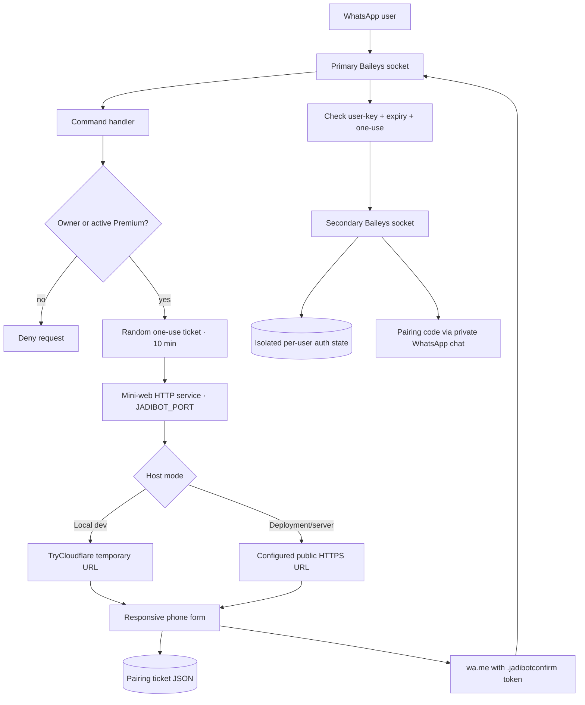
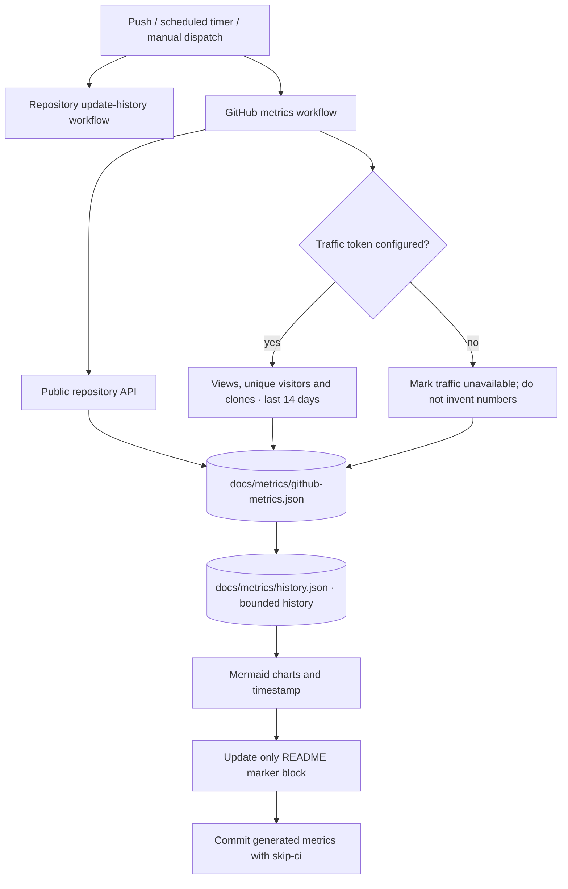

# Architecture map — WhiskayBot pairing and GitHub automation

## Component map

## GitHub update flow

## Runtime ownership boundaries

| Component | Owns | Does not own |
|---|---|---|
| Main WhatsApp socket | Incoming commands, owner/premium check, pairing confirmation, delivery of code | Sub-bot's auth credentials |
| Pairing portal | Short-lived ticket and input form | Pairing-code generation or payment confirmation |
| Sub-bot socket | Its own Baileys connection and credentials | Main bot's primary session |
| Rental JSON | Owner/user rental state, price, expiry, pending manual payments | Bank transfer verification via a payment provider |
| GitHub Actions | Timestamped repository snapshot and generated documentation block | Private visitor identity; lifetime page visitor count |

---

## Documentation continuity note (2026-10-29)

This file is retained as part of the historical implementation record. For the current cross-stage status, recent fixes, test commands and known limitations, see [Master Stage Archive](STAGE-1-22-MASTER-ARCHIVE.md) and the [documentation index](README.md). Newer behavior supersedes earlier implementation details only where the dated update explicitly says so; previous decisions and history are not deleted.
