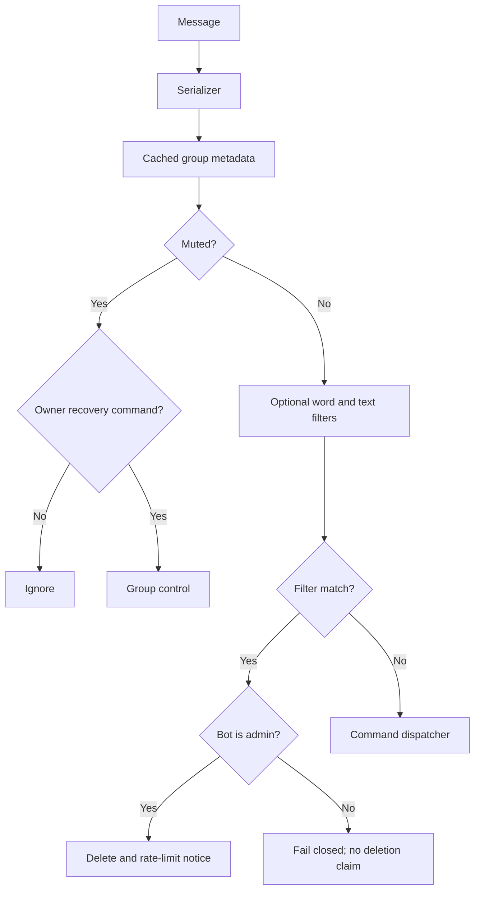

# Group Control & Safety — 2026-10-26

## Owner group policy

- `.groupbot panel` — show contextual control buttons.
- `.groupbot list` — list explicitly muted group IDs and groups muted by `onlyhere` mode when group metadata can be fetched.
- `.groupbot status` — show global mute mode and number of configured groups.
- `.groupbot mute <GROUP_ID>` / `.groupbot unmute <GROUP_ID>` — set a per-group mute.
- `.groupbot onlyhere` — run from the one group that should remain active; every other group is ignored by the bot.
- `.groupbot reset` — clears only global mute/allow-only settings; per-group filters are preserved.

State is stored atomically in `data/group-policy.json` (or under `WHISKAY_DATA_DIR`). The policy affects this bot only; it does not change WhatsApp group permissions, membership, or other bots. Owner recovery commands remain available while a group is muted.

## Group-admin safety controls

- `.antitoxic on|off|add <word>|remove <word>|list`
- `.antibanword on|off|add <word or phrase>|remove <word or phrase>|list`
- `.textguard on|off|status`
- `.groupstatus`, `.grouphelp`

These settings are scoped per group. Filters are off until enabled. Anti-toxic uses a small default Indonesian profanity list when enabled; custom terms are added with `add`. Anti-ban-word uses only explicitly configured words/phrases. Matching is Unicode-normalized and word-boundary based, but language is contextual, so maintainers should test terms and review false positives.

Text Guard blocks text that exceeds 3,500 characters, extreme repeated characters/words, or excessive invisible Unicode control characters. If the bot is not an admin, it cannot delete other members' messages; the guard avoids pretending deletion succeeded. A deletion notice is rate-limited to one per group per 45 seconds.

## Role checks

The serializer now fetches `groupMetadata` with a 30-second cache and resolves sender/bot admin roles across the available JID, PN, and LID identity variants. If metadata lookup fails, admin flags remain false (fail closed). This should be tested in a real test group because Baileys participant shapes and LID mapping can differ across protocol versions.

## Mermaid flow

---

## Documentation continuity note (2026-10-29)

This file is retained as part of the historical implementation record. For the current cross-stage status, recent fixes, test commands and known limitations, see [Master Stage Archive](STAGE-1-22-MASTER-ARCHIVE.md) and the [documentation index](README.md). Newer behavior supersedes earlier implementation details only where the dated update explicitly says so; previous decisions and history are not deleted.
