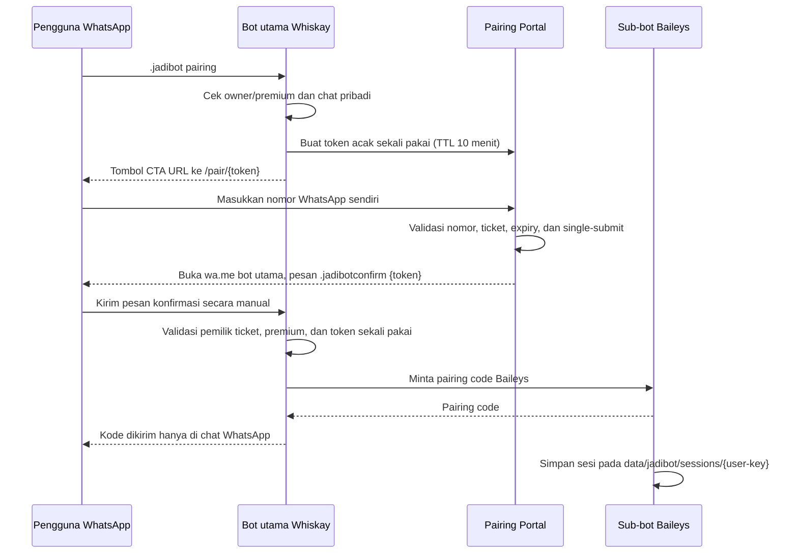

# WHISKAY Jadibot — mini-web pairing portal

**Status dokumen:** 25 Oktober 2026. Dokumen ini merekam implementasi di `src/services/jadibotPortal.js`, `src/plugins/general/jadibot.js`, dan `src/index.js`.

## Tujuan dan alur

Tombol native-flow WhatsApp tidak dapat menampilkan kolom input nomor yang bisa diedit di dalam tombol. Karena itu opsi Pairing Code mengarahkan pengguna ke mini-web responsif. Pairing code tidak ditampilkan pada website; kode dikirim oleh bot ke percakapan WhatsApp setelah identitas pemohon dan token dikonfirmasi.



### Mengapa pengguna tetap perlu menekan Kirim di WhatsApp?

Tautan `wa.me` dapat membuka percakapan dan mengisi pesan awal, tetapi tidak bisa mengirim pesan WhatsApp secara diam-diam atas nama pengguna. Setelah mini-web mengalihkan pengguna, pengguna harus menekan **Kirim** untuk menyampaikan `.jadibotconfirm <token>`. Ini merupakan langkah konfirmasi, bukan kegagalan otomatisasi.

## Lifecycle dan command

| Command | Deskripsi |
|---|---|
| `.jadibot` | Pilihan QR, Pairing Code, atau perpanjangan |
| `.jadibot qr` | QR ditampilkan pada terminal host yang menjalankan sub-bot |
| `.jadibot pairing` | Membuat link portal CTA sekali pakai |
| `.jadibot pairing 628xxxxxxxxxx` | Fallback teks langsung; gunakan hanya untuk troubleshooting |
| `.jadibotconfirm <token>` | Konfirmasi pengguna; pairing code dikirim pada chat ini |
| `.jadibotstatus` | Menampilkan status, nomor, expiry, dan sisa hari |
| `.jadibotlogin` | Memulai kembali sesi yang kredensialnya masih tersimpan dan sewanya masih berlaku |
| `.jadibotlogout` | Logout dan menghapus kredensial lokal sub-bot; sewa tetap berjalan |
| `.perpanjang [hari]` | Membuat referensi pembayaran dengan harga proporsional dari harga/durasi default |
| `.buktijadibot <ref>` | Mengirim bukti (dengan membalas lampiran gambar) ke owner |
| `.jadibotapprove <user-key>` | Owner menandai pembayaran sebagai sudah diverifikasi dan memperpanjang expiry |
| `.setjadibotharga <rupiah>` | Owner mengatur harga dasar sewa |
| `.setjadibotdurasi <hari>` | Owner mengatur durasi default |
| `.listjadibot` / `.stopjadibot <user-key>` | Owner melihat daftar atau memutus sesi sewa |

Default: 30 hari dan Rp10.000 untuk durasi default. Angka ini contoh konfigurasi, bukan harga yang dijanjikan; ubah sesuai kebijakan owner. Status premium dihitung dengan `hasPremium()` yang sudah dimiliki bot. Pembayaran perpanjangan saat ini diverifikasi **manual** oleh owner. Sistem tidak mengklaim dapat mendeteksi pembayaran dari mutasi rekening/QRIS secara otomatis.

## Host mode otomatis

`src/services/jadibotPortal.js` menjalankan HTTP server kecil pada `JADIBOT_PORT` (default `8791`). Endpoint `GET /healthz` hanya mengembalikan status sederhana; `/pair/{token}` menyajikan form; `POST /api/pair/{token}` menyimpan nomor yang tervalidasi dan membangun link konfirmasi WhatsApp.

Resolusi host, urutan ringkas:

1. Jika `JADIBOT_PUBLIC_URL`, `BOT_PUBLIC_URL`, `PUBLIC_BASE_URL`, atau host provider yang didukung tersedia, gunakan URL tersebut dan **jangan jalankan TryCloudflare**.
2. Jika environment server/deployment terdeteksi (antara lain Vercel, Railway, Render, Fly, Koyeb, Docker/container, SSH session, Kubernetes, Codespaces, atau vendor VM yang dikenali), TryCloudflare dinonaktifkan secara default. Untuk URL publik yang benar, atur `JADIBOT_PUBLIC_URL` dan reverse-proxy trafik ke `JADIBOT_PORT`.
3. Jika berjalan sebagai lingkungan lokal dan tidak ada host publik atau indikator server, `JADIBOT_TUNNEL=auto` mencoba menjalankan `cloudflared tunnel --url http://127.0.0.1:8791`. Jika binary belum ada pada Linux yang didukung (amd64/arm64/arm), bot mencoba mengunduh asset binary dari rilis resmi `cloudflared` ke `data/bin/`.
4. `JADIBOT_TUNNEL=on` memaksa percobaan TryCloudflare; `JADIBOT_TUNNEL=off` menonaktifkan tunnel. Pilihan eksplisit sebaiknya digunakan untuk mengatasi salah deteksi host.

**Deteksi host bersifat heuristik.** Pada VPS yang tidak mengekspos environment provider atau metadata mesin, tetapkan `JADIBOT_TUNNEL=off` dan `JADIBOT_PUBLIC_URL=https://subdomain-anda.example`. URL itu harus benar-benar diarahkan ke service/port portal. Mengisi URL website lain tanpa reverse proxy ke portal tidak otomatis meneruskan request ke proses bot.

### Konfigurasi `.env`

```env
JADIBOT_DEFAULT_DAYS=30
JADIBOT_PRICE_30D=10000
JADIBOT_PORT=8791
JADIBOT_HOST=0.0.0.0
JADIBOT_TUNNEL=auto
JADIBOT_TUNNEL_WAIT_MS=8000
JADIBOT_PUBLIC_URL=
JADIBOT_PUBLIC_URL_WAIT_MS=15000
BOT_WHATSAPP_NUMBER=
JADIBOT_BIN_DIR=./data/bin
JADIBOT_DATA_DIR=./data/jadibot
```

`BOT_WHATSAPP_NUMBER` hanyalah fallback untuk startup; saat bot utama tersambung, runtime sebaiknya membaca nomor dari Baileys socket. Jangan menyalin `.env` ke repo atau ZIP yang dibagikan.

## Penyimpanan dan keamanan

- Tiket disimpan dalam `data/jadibot/pairing-tickets.json` dengan permission file `0600` jika didukung sistem berkas. Token memiliki 24 byte random dan expiry 10 menit; tiket dihapus setelah digunakan saat dibersihkan.
- Rental tersimpan di `data/jadibot/rentals.json`; konfigurasi di `settings.json`; sesi autentikasi terisolasi per pengguna di `data/jadibot/sessions/`.
- Form memakai CSP, `no-store`, `no-referrer`, batas body request, validasi nomor, link sekali pakai, dan tidak merender pairing code pada HTML.
- Kode pairing dan kredensial Baileys adalah rahasia. Jangan memasukkannya ke log, chat grup, Git, issue, atau arsip ZIP yang dibagikan.
- Quick Tunnel menghasilkan URL acak sementara yang dapat diakses siapa pun yang memegang URL; URL berubah saat tunnel restart. Cloudflare mendeskripsikannya sebagai alat testing/development tanpa jaminan uptime. Gunakan host dan tunnel permanen terkelola pada produksi. Rujukan: [Cloudflare Quick Tunnels](https://developers.cloudflare.com/tunnel/get-started/quick-tunnels/).
- Proses sewa yang melewati expiry akan dihentikan oleh worker periodik, dan pengguna akan diberi pemberitahuan best-effort. Ini bergantung pada bot utama tetap hidup.
- `useMultiFileAuthState` nyaman untuk setup sederhana. Untuk beban tinggi/multi-replica, evaluasi database session store dan locking yang sesuai.

## Deployment server dan Vercel

Bot WhatsApp yang menjaga koneksi Baileys membutuhkan proses Node.js persisten. Domain deployment baru berfungsi untuk mini-web jika layanan tersebut benar-benar menjalankan portal dan meneruskan path `/pair/*`, `/api/pair/*`, dan `/healthz` ke port portal. Jangan sekadar menggunakan URL website statis atau fungsi serverless yang tidak menjalankan proses ini. Bila website utama di Vercel tetapi bot berjalan di Termux/VPS, gunakan domain subdomain/reverse proxy yang benar-benar menunjuk ke proses bot, atau jalankan portal pada layanan web persisten terpisah.

## Batasan implementasi saat ini

- QR login masih dicetak pada terminal, tidak dipancarkan sebagai gambar QR ke halaman web.
- Konfirmasi harus dikirim manual melalui WhatsApp; web tidak dapat mengirim pesan secara otomatis.
- Pembayaran diverifikasi manual dan disetujui owner.
- Auto-install tunnel dicoba pada Linux; macOS/Windows harus memasang `cloudflared` sendiri atau menggunakan URL publik yang dikonfigurasi.
- Pemeriksaan unit portal tidak menggantikan pengujian end-to-end dengan akun WhatsApp sekunder, jaringan publik, deployment HTTPS, dan konfirmasi pairing nyata.
