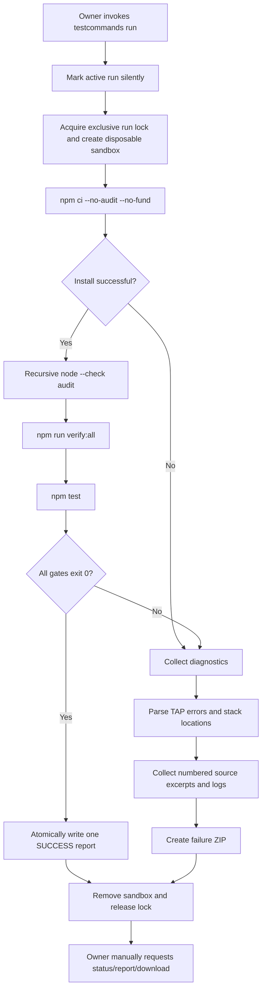

# Owner Full Testcommand — Verification Engine

> **Policy update — v2.35.23 / Stage 58:** the live-progress and automatic WhatsApp notification behavior described in earlier historical sections is retired. `.testcommands run` is now silent; only an explicit `.testcommands status`, `report`, or `download` command can send a response.

## Command surface

The owner-only WhatsApp command and terminal entry point are:

```bash
.testcommands                 # tampilkan bantuan (default, tidak memulai tes)
.testcommand                  # alias bantuan
.testcmd                      # alias bantuan
.testcmds                     # alias bantuan
.testcommands run             # mulai full verification
.testcommands status          # status proses dan laporan terakhir
.testcommands progress        # alias status dengan hitungan progres aktif
.testcommands report          # tampilkan laporan sukses
.testcommands help

node scripts/testcommand-runner.mjs
```

`.testcommands`, `.testcommand`, `.testcmd`, and `.testcmds` are registered command names. Bare invocation defaults to `help`; it never starts a long install/test run accidentally. Only the explicit `run` or `start` subcommand launches the pipeline. The run action returns without sending an acknowledgement. It remains silent for the entire worker lifetime: no stage notices, per-test progress, failure alert, completion message, duplicate-run notice, or automatic command-level XP notification. Duplicate run requests are ignored; poll with `.testcommands status`. The owner-only plugin skips its per-command cooldown so status can be requested immediately, while the global incoming-message rate limiter remains active. Unauthorized users are rejected before the runner is invoked.

## Verification pipeline



### Pipeline phases

1. **Lock and preflight.** Verify that `package.json`, `package-lock.json`, and `scripts.verify:all` exist. An exclusive lock prevents two owner QA runs from racing. A stale lock is recovered when its PID no longer exists.
2. **Disposable sandbox.** Copy project source into a unique OS temporary directory. Exclude `.git`, `node_modules`, `.env` files except `.env.example`, `.npmrc`, `.netrc`, sessions/auth, runtime logs, generated report output, and user data. Keep static `assets/dungeon` assets required by tests. Set test-only data/session directories and `JADIBOT_TUNNEL=off`.
3. **Dependency install.** Execute `npm ci --no-audit --no-fund` in the sandbox. The live bot's dependency directory is not removed or rewritten.
4. **Syntax audit.** Run `node --check` on `.js`, `.mjs`, and `.cjs` files at the project root and under `src/`, `scripts/`, `test/`, `config/`, and `automation/`, using bounded concurrency and per-file results. Per-file progress is written only to local run state; it is never sent to WhatsApp automatically.
5. **Configured release gate.** Execute the project's actual `npm run verify:all`; no parallel rewriting or inferred replacement of its order is performed. The sandbox sets `NODE_OPTIONS=--test-reporter=tap` for this phase so each nested `node --test` emits a stream the progress parser can count consistently across Node versions.
6. **Full Node test discovery.** Execute `npm test` as a second pass so tests not explicitly wired into `verify:all` are also discovered. The `verify:all` phase uses TAP output for streaming; this pass uses `scripts/testcommand-reporter.mjs`, a custom Node.js test reporter that consumes the `node:test` TestsStream events and emits machine-readable JSON progress. It reports discovered, completed, passed, failed, skipped, test name, source file and duration; final counters are taken from the reporter summary.
7. **Result handling.** Only when every phase exits successfully, atomically write `test/reports/WHISKAY-VERIFY-SUCCESS.md`. If any phase fails, create a uniquely named diagnostic ZIP in `test/reports/diagnostics/`.

## Failure archive structure

```text
WHISKAY-VERIFY-FAILURE-<run-id>.zip
├── README-DIAGNOSTIC.md
├── manifest.json
├── failure-locations.json
├── source-excerpts.json
├── failure-lines.txt
├── failed-step-*.json
├── logs/
│   ├── npm-ci.stdout.log
│   ├── npm-ci.stderr.log
│   ├── verify-all.stdout.log
│   ├── verify-all.stderr.log
│   ├── npm-test.stdout.log
│   └── npm-test.stderr.log
├── project-metadata/
│   ├── package.json
│   └── package-lock.json
└── source-context/
    └── <project-relative source files>
```

A stack reference such as `test/example.test.js:53:10` is converted to a project-relative location with line and column. Source context contains line numbers around the reported location, with the failing line marked. TAP failure markers and syntax errors are included even when the runtime does not expose a source position.

Log capture is bounded per stream to avoid unbounded memory/disk usage. Diagnostic ZIP entries are generated using a small built-in ZIP writer; no additional archive dependency is required. Common credential forms are redacted before logs are archived.

## Success artifact

There is one dedicated last-success file:

```text
test/reports/WHISKAY-VERIFY-SUCCESS.md
```

It is atomically replaced only after `npm ci`, the syntax audit, `npm run verify:all`, and `npm test` all pass. A failed run does not write a success report. The report records run ID, timestamp, Node version, duration, per-phase exit status and test counters when emitted by Node's test runner.

## Safety and operational limits

- The tester inventories plugin commands but never invokes all business commands. A command may send WhatsApp messages, alter balances, edit data, add participants, or trigger external services; automated bulk execution would be unsafe and nondeterministic.
- No live WhatsApp login, message delivery, payment, remote AI provider, downloader provider, Cloudflare tunnel, or group mutation is claimed by unit-test results.
- Dependencies are installed in a disposable copy to protect the already-running process. The operation still requires network access to the configured npm registry, disk space, and host permission to spawn npm/Node processes.
- Default timeouts: 30 minutes for `npm ci`, 45 minutes for `verify:all`, and 30 minutes for `npm test`. They may be overridden with `WHISKAY_TESTCOMMAND_INSTALL_TIMEOUT_MS`, `WHISKAY_TESTCOMMAND_VERIFY_TIMEOUT_MS`, and `WHISKAY_TESTCOMMAND_TEST_TIMEOUT_MS` respectively.
- The source project is not altered by tests running in the sandbox. Only report output and the short-lived lock file are written to the project root.
- Failure archives are for private debugging and the newest 20 archives are retained. Review them before sharing outside the project even though known credential strings and private runtime directories are excluded.

## WhatsApp delivery and duplicate protection

The QA worker runs asynchronously, but the WhatsApp transport is not used by its progress callbacks. Syntax counts, test discovery, pass/fail events, and phase summaries remain in local run state. `.testcommands status` (or the `progress` alias) sends the latest snapshot only after the owner explicitly requests it. While a run is active, status deliberately hides the previous run's success report and diagnostic ZIP, and the status card offers only refresh/help actions. This prevents stale artifacts from being mistaken for the active run's result. The run remains `RUNNING` until dependency installation, syntax audit, `verify:all`, and `npm test` have all completed; `SUCCESS` is written only when every required phase exits with code 0. Failure ZIPs and the success report are delivered only after explicit owner requests. This is a silence guarantee for the QA worker, not a global mute of unrelated configured reminders, scheduled notifications, or replies to other user commands.

Supported names: `.testcommands`, `.testcommand`, `.testcmd`, `.testcmds`. Bare invocation and `help` display instructions; use `.testcommands run` to start work.

## Runner self-tests

```bash
npm run verify:testcommand
npm run verify:all
```

The focused regression tests cover stack path normalization, TAP and JSON reporter summary extraction, missing-pre-key classification, sandbox exclusions, credential redaction, reporter event aggregation, silent background execution, manual status polling, active-run report/download protection, and ZIP container integrity. Historical live-progress cards are covered only as archived legacy behavior, not current delivery behavior.

## Interactive command experience

The help/control-center response is a native-flow interactive card, not a text-only reply. It explains the command purpose, preflight, isolated `npm ci`, syntax audit, `verify:all`, `npm test`, success/failure artifacts, security exclusions, and operational constraints. It offers actions to start QA, inspect status, and open the success report. Status, report, unknown-action and explicit download responses expose contextual buttons. There is no start acknowledgement, duplicate-run notice, or automatic final-result message. If native-flow delivery is unavailable, an explicitly requested response falls back to readable text.


## Missing Baileys pre-key diagnostics

A message such as `Could not find '/root/whiskay-bot/sessions/pre-key-3631.json'` is not proof that the test assertions themselves failed. It indicates that some code path attempted to read a local Baileys Signal pre-key file that was not present. The QA runner classifies this signature as `BAILEYS_PREKEY_FILE_MISSING` / `SESSION_RUNTIME_REFERENCE` and includes a remediation hint in the final report. It does not generate a fake key, copy live sessions into the sandbox, delete `sessions/`, or mutate production authentication state. Tests that need authentication must use a mock auth-state implementation and a temporary directory. Baileys documents that credentials and Signal keys must be persisted together; its multi-file helper is a guide rather than the recommended production-grade store.

## Progress semantics

- `RUNNING`: one or more pipeline phases remain active. Do not package the source as verified yet.
- `PASS` for an individual phase: that phase exited successfully; later phases may still be running.
- `FAILED`: at least one phase exited unsuccessfully. The runner still attempts remaining verification phases when safe so the diagnostic archive is more complete.
- `SUCCESS`: every required phase exited successfully and the dedicated success report was atomically written. This is the only release-ready QA status.
- `Ditemukan` is a live discovery count and may increase while test files load. The denominator is final only in the completed summary.

## Implementation references

- [Node.js test runner — custom reporters and TestsStream events](https://nodejs.org/api/test.html#test-reporters): the progress reporter listens for enqueue/pass/fail/diagnostic events and emits structured JSON.
- [nodejs/node-core-test reporter examples](https://github.com/nodejs/node-core-test): upstream examples for custom test reporters.
- [Baileys session management](https://github.com/WhiskeySockets/docs/blob/main/authentication/session-management.mdx): credentials and Signal keys must be persisted together; a multi-file auth helper is not recommended as a production-grade store.

## Test discovery hardening (2026-10-31)

`npm test` is routed through `scripts/run-tests.mjs`. It validates that the project `test/` root is a physical directory, discovers only `*.test.js`, `*.test.mjs`, `*.test.cjs` (and `test-*` equivalents) under that root, skips symlinks, and passes the exact file list to Node's test runner. The `.testignore` directory list is loaded and enforced during discovery. In particular, `sessions/` and `node_modules/` cannot become test discovery roots or explicit test targets.

The runner redirects `SESSION_DIR`, `WHISKAY_DATA_DIR`, `JADIBOT_DATA_DIR`, and temporary-file environment variables to a fresh directory under the operating system temp directory. It removes that directory after the child test process exits, including signal termination. `node_modules/` remains available only for ordinary Node dependency resolution; it is not scanned, copied, deleted, installed into, or modified by this runner. The full `.testcommands` pipeline installs dependencies only in its disposable sandbox.

The WhatsApp status card has a single title source: the interactive message title is `📊 WHISKAY QA STATUS`; the body intentionally does not repeat that heading or the subtitle's `Tidak ada run aktif` line.
