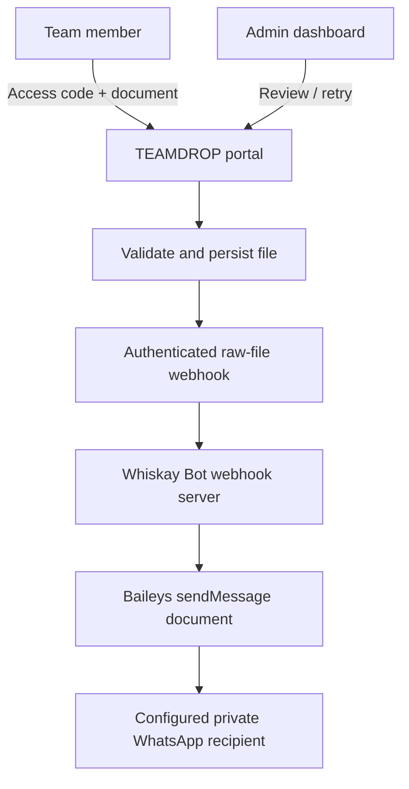

# Stage 48 — TEAMDROP Private Document Relay

**Date:** 2026-10-30  
**Scope:** Forward files submitted through TEAMDROP using the already authenticated Whiskay Bot Baileys session.

## Architecture



## Security and behavior

- The portal and bot share a long random bearer secret, stored only in server-side `.env` files.
- The phone number is configured in the bot environment and is never sent to the browser.
- `TEAMDROP_WHATSAPP_TO` has precedence, followed by `OWNER_PHONE`, the first `OWNERS` entry, and finally the connected WhatsApp account.
- The relay accepts only document extensions already supported by TEAMDROP, validates the size, and applies a per-source request limit.
- A stable submission ID is used for in-process duplicate suppression. A bot restart clears the in-memory deduplication cache, so a retry after a crash close to send completion should still be checked in WhatsApp before resending.
- If the bot is offline or WhatsApp send fails, TEAMDROP keeps the file and exposes a retry action to the administrator.

## Configuration

Whiskay Bot `.env`:

```dotenv
TEAMDROP_WEBHOOK_SECRET=<long-random-secret>
TEAMDROP_WHATSAPP_TO=628xxxxxxxxxx
TEAMDROP_MAX_FILE_MB=50
TEAMDROP_WEBHOOK_RATE_LIMIT=18
WHISKAY_BOT_WEBHOOK_HOST=127.0.0.1
WHISKAY_BOT_WEBHOOK_PORT=8787
```

TEAMDROP `.env`:

```dotenv
WHISKAY_BOT_WEBHOOK_URL=http://127.0.0.1:8787/webhooks/teamdrop/document
WHISKAY_BOT_WEBHOOK_TOKEN=<same-long-random-secret>
```

Use the loopback endpoint when both applications run on the same VPS. For separate hosts, expose only an HTTPS reverse-proxy route restricted by firewall allowlisting and a long secret.

## Verification

```bash
node --check src/index.js
node --test test/stage46-startup-env.test.js test/stage48-teamdrop-relay.test.js
```

The bot source-level test verifies the relay route, authentication, document payload, and environment template. TEAMDROP has its own local integration contract tests (`npm test`). These do not establish a live WhatsApp session or confirm delivery to the configured recipient; send a controlled test document after deployment.
