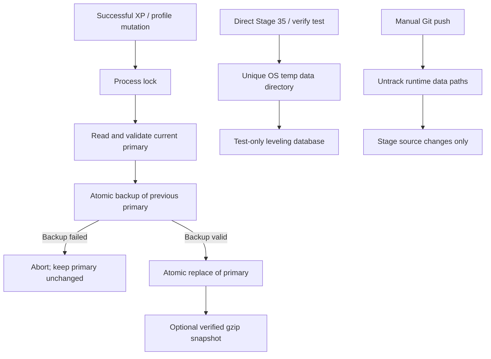

# Stage 50 — Leveling Data Integrity & Recovery (v2.35.5)

Date: 2026-10-31

## Objective

Prevent a failed backup operation, test run, or Git upload from replacing or contaminating the production XP/level database. Keep recovery operator-controlled and preserve the original bytes when corruption is detected.

## Incident evidence reviewed

The supplied source and terminal diagnostics established several independent risks:

1. `src/lib/leveling.js` previously used one `try/catch` around both reading the primary database and writing `leveling.json.bak`. A failure while writing the backup could enter the same recovery branch as a failed primary read, move the primary file to `.corrupt-*`, and continue by writing the new payload. This could replace a healthy primary after a secondary-backup failure.
2. `test/stage35-core.test.js` imported the production leveling module statically and wrote synthetic `stage35-test-*` profiles. `npm test` used a temp data directory, but direct `npm run verify:stage35` / `npm run verify:all` invoked `node --test` without that runner's environment. Such direct verification could write test records into the default production `data/` directory.
3. The operator's Git diagnostics showed `data/leveling.json` was tracked. `.gitignore` does not stop Git from tracking an already tracked file, and `scripts/auto-push.sh` uses `git add -A`. Runtime database snapshots could therefore enter repository commits despite the `/data/` ignore rule.
4. The Git history contained older leveling snapshots with a matching group/user identity and later snapshots with different context scopes. The exact write or deployment action that caused the reported 95-XP-to-zero transition is not provable from the supplied logs alone. This release prevents the identified paths but does not silently choose an old XP snapshot as authoritative.

## Changes

### Transactional primary/backup writes

- Validate the in-memory payload and the existing primary schema before writing.
- Write and fsync the previous valid primary to `leveling.json.bak` first.
- If backup creation fails, abort the save. The previous primary remains in place and is not renamed or overwritten.
- Write the new primary through a unique temporary file, fsync it, then atomically rename it into place.
- Clean up temporary files when a write or rename fails.
- Snapshot/archive failures are reported as warnings and do not turn an already committed primary write into a false command failure.

### Recovery and locking

- Corrupt primary files are quarantined only when a valid backup/archive exists and the quarantine rename succeeds.
- Manual `.leveldb restore` quarantines a corrupt primary before writing a valid backup/archive snapshot.
- Process-lock stale detection checks the recorded PID before removing an old lock, rather than deleting every lock solely because its timestamp is older than ten minutes.
- `.leveldb status` now reports primary health, backup health, their sizes, profile count, aggregate XP, and archive count.

### Test isolation

- Stage 35 tests set a unique OS-temp `WHISKAY_DATA_DIR` before importing `src/lib/leveling.js`.
- The Stage 35 test therefore remains isolated when run by itself or as part of `verify:all`, not only when run through `npm test`.
- Added regression coverage proving a backup write failure rejects the mutation while preserving the original XP/level/coin data.
- Added regression coverage for manual restore from a backup when the primary is corrupt.

### Git runtime-data protection

- Added `npm run protect:runtime-data`, which removes tracked runtime files under `data/` from the Git index only while retaining the canonical static `assets/dungeon/floors.json` seed. It does not delete or rewrite local files. `npm run protect:leveling-data` remains as a backward-compatible alias.
- `scripts/auto-push.sh --push` invokes this guard before `git add -A`, so tracked runtime files cannot be staged again by a bulk add.
- Explicit ignore entries document that leveling databases and recovery archives are runtime data, not source files.

## Data preservation policy

This source update does **not** edit the production `data/leveling.json`, does not import the 26 October snapshot, and does not automatically restore XP 95 or XP 116. Historical snapshots differ in date/context. Recovery must be selected against the live profile key and the operator's authoritative checkpoint. Keep a separate copy of the current database before performing any manual recovery.

## Operator installation

1. Back up the active runtime file before replacing code:

   ```bash
   cd /root/whiskay-bot
   cp -a data/leveling.json "data/leveling.json.pre-stage50-$(date +%Y%m%d-%H%M%S)"
   [ ! -f data/leveling.json.bak ] || cp -a data/leveling.json.bak "data/leveling.json.bak.pre-stage50-$(date +%Y%m%d-%H%M%S)"
   ```

2. Extract the source archive over the project root. This release archive excludes runtime state under `data/` (including user/group/payment databases and saved images), active `.env`, sessions, `.runtime`, and `node_modules`. It retains only the canonical static RPG seed `assets/dungeon/floors.json`.
3. Remove tracked runtime data from Git while keeping the local files and static dungeon seed:

   ```bash
   npm run protect:runtime-data
   ```

4. Verify the focused regressions:

   ```bash
   npm run verify:stage50
   ```

5. Restart the bot during an appropriate maintenance window, then run `.leveldb status`, `.profile`, and `.leaderboard`.

## Verification record for this package

- `node --check` over JavaScript source/scripts/tests: 283 files passed; `bash -n scripts/auto-push.sh` passed.
- Focused leveling, Stage 35 isolation, Git-protection, and auto-push guard tests: 15/15 passed (see the test report).
- Supplemental Stage 43 verification: 8/8 tests passed, including Canvas rendering and upload-flow checks.
- Full `npm test` was not run in the packaging environment because this source archive does not contain `node_modules`; install dependencies on the server with the project's lockfile before running the full suite.
- Live WhatsApp delivery and production restart are deployment checks, not claimed as tested here.

## Data flow


