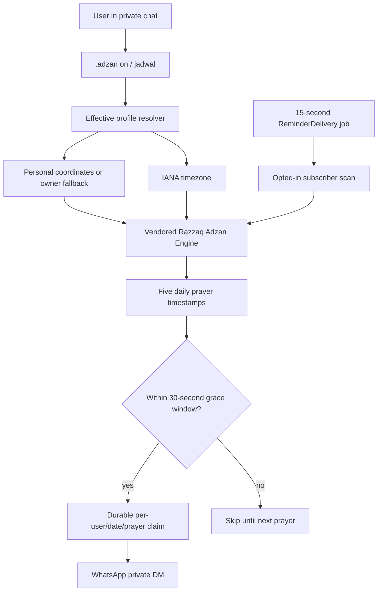

# Stage 51 — Razzaq Adzan Engine Integration (Part 3)

## Scope

This part vendors the user's `@razzaq-ventures/adzan-engine` v1.3.0 source into `vendor/razzaq-adzan-engine/` with its upstream `README.md`, `package.json`, and MIT `LICENSE`. The engine source is kept intact and imported through its public `src/index.mjs` entrypoint. No runtime npm dependency or network lookup is required.

## Commands

- `.adzan jadwal` — calculate today's Subuh, Zuhur, Asar, Magrib and Isya times for the effective personal profile.
- `.adzan on` — opt in to personal prayer-time notifications by private WhatsApp message.
- `.adzan off` — stop personal notifications.
- `.adzan status` — includes personal subscription state and existing location/database details.

Personal subscription commands must be run in a private chat. Existing group `.adzan on/off/set/manual-status` behavior remains the legacy manual group reminder feature; it is not the personal subscription.

## Calculation configuration

- Location: personal WhatsApp-shared coordinates, falling back to the owner default only when the user has no personal location.
- Time zone: personal IANA time zone, then owner default, then `Asia/Jakarta` fallback.
- Method: `METHODS.INDONESIA_KEMENAG_REFERENCE` from the vendored engine.
- Elevation: stored `elevationMeters` if available, otherwise 0 m.

The engine's own metadata reports `officialValidation: false` and describes its Meeus low-order solar calculation as approximate. This is not an official SIHAT/Kemenag clone or certification. Users should compare results with a trusted local mosque/authority schedule and configure the correct IANA time zone. The engine does not infer a time zone from GPS coordinates.

## Scheduler and delivery semantics

`ReminderDelivery` invokes the personal scheduler every 15 seconds. The scheduler scans only opted-in users, calculates their local-day schedule and checks the five prayer event timestamps. Delivery target is the user's private JID, never a group.

Before sending, the scheduler atomically persists a unique `(user, local date, prayer)` claim in `data/adzan-profiles.json`. This is durable **at-most-once** behavior across restarts: a claimed event will not be replayed after restart. Trade-off: if the process crashes after persisting the claim but before WhatsApp accepts the message, that one notification can be missed. A network timeout after WhatsApp acceptance also cannot be distinguished perfectly from a rejected send without platform idempotency support. The event claim history is pruned after 45 days.

Missed events older than the 30-second scan grace window are skipped rather than sent late after a long outage. Audio media delivery and per-user audio preferences remain Part 4.

## Data additions

The existing schema-v1 profile file adds optional `users[<jid>].adzanEnabled` and `personalAdzanEvents` fields. Existing files without these fields remain readable; fields are created on the next write. The same atomic/backup process from Part 2 protects updates.

## Architecture

## Verification

- `npm run verify:stage51-adzan-engine`
- Upstream engine test suite is run separately from `vendor/` source tests.
- Live WhatsApp delivery and real host restart/crash behavior require verification with the owner's connected bot session.
