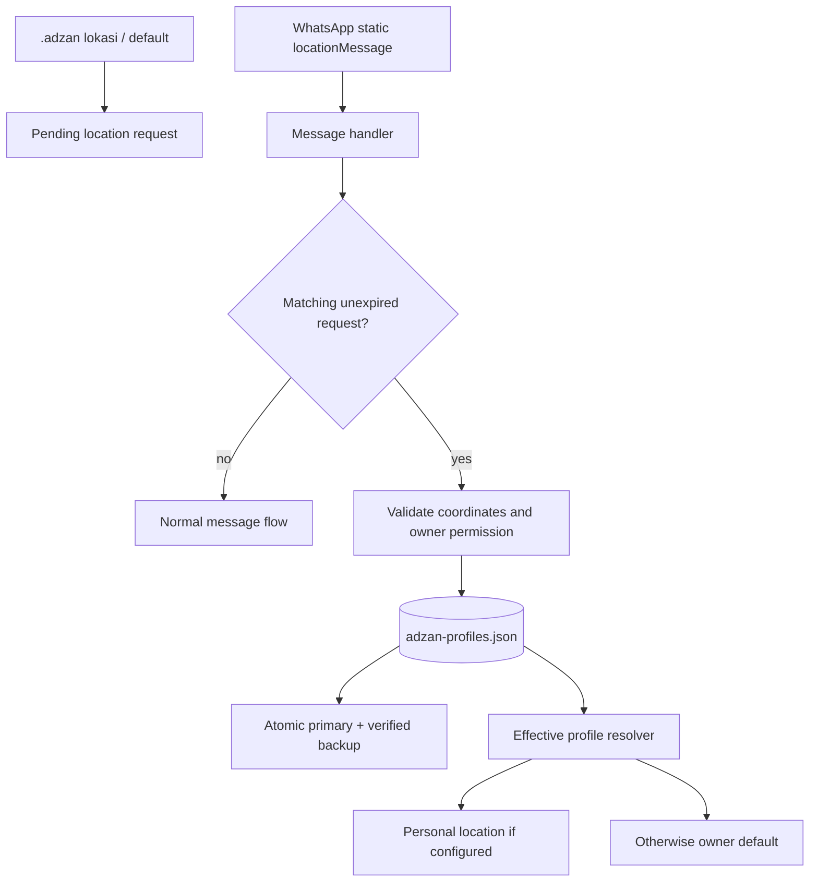

# Stage 51 — Adzan Personal Region Profiles (Part 2)

## Scope

This part implements the persistent location and time-zone preference layer only. It does not yet calculate prayer times or deliver Adzan audio.

## User-facing commands

- `.adzan status` — show the effective location, map URL, time zone, source and database summary.
- `.adzan lokasi` — arm a 10-minute request; the sender must share a static WhatsApp Current Location in a private chat.
- `.adzan default` — owner-only request to set the deployment-wide fallback location. Must be run in a private chat.
- `.adzan timezone <IANA>` — set the sender's time zone, e.g. `Asia/Makassar`.
- `.adzan default-timezone <IANA>` — owner-only default time zone, e.g. `Asia/Jakarta`.
- `.adzan clear` — clear the sender's personal location and time-zone override.
- `.adzan clear-default` — owner-only removal of the fallback location.

## Resolution rules

1. A user's own location wins over the owner default.
2. A user's own IANA time zone wins over the owner default.
3. If the user has no location, the owner default location is used.
4. If the user has a location but no personal time zone, the owner-default time zone is inherited. The bot tells the user how to override it.
5. With no configured location, the profile remains `unconfigured`; no coordinates are fabricated.

The bundled Razzaq Adzan Engine validates IANA time zones but does not map latitude/longitude to a time zone. This stage therefore does not claim automatic timezone detection. An offline timezone lookup or trusted reverse-geocoding integration can be evaluated separately in a later part.

## Location privacy

The bot only consumes `locationMessage` when that sender has a pending, unexpired request. It does not silently inspect/store arbitrary location messages. Setup is private-chat-only so coordinates and map links are not echoed into a group. Coordinates are persisted locally and are not sent to a third-party geocoder.

## Storage

`data/adzan-profiles.json` schema version 1 stores:

- `ownerDefault`: deployment fallback location, timezone and calculation method ID.
- `users`: per-user location and IANA time-zone overrides.
- `groups`: legacy group reminder settings, preserving existing manual reminder behavior.
- `pendingLocations`: expiring, sender-bound location requests.

Persistence behavior:

- validates the complete JSON schema before writes;
- writes a same-directory temporary file with mode `0600`, fsyncs it, atomically renames it and fsyncs the directory;
- obtains an exclusive process lock for mutations;
- verifies the previous-generation `.bak` before replacing the primary;
- aborts a write if backup creation/verification fails;
- quarantines a corrupt primary only when a valid backup is available, then restores from that backup;
- throws and preserves the damaged primary if no valid backup exists instead of silently returning an empty database.

A valid old `data/adzan-settings.json` is migrated once into the new store and renamed to `adzan-settings.json.migrated-<timestamp>`. An invalid legacy file is preserved and migration fails visibly.

## Architecture

## Deferred to next part

- importing/wiring the supplied `@razzaq-ventures/adzan-engine` calculation package;
- per-user daily prayer schedule generation and timezone-aware scheduler;
- restart-safe delivery deduplication;
- actual WhatsApp audio media delivery and per-user audio preferences.
