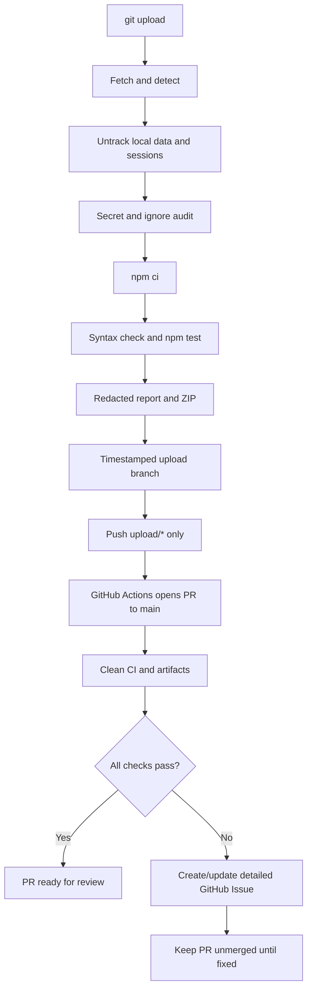

# Stage 53 — GitHub-Safe Upload & Runtime Data Isolation

**Version:** `2.35.16`  
**Date:** 1 November 2026  
**Repository:** `razzaqinspires/whiskay-bot`

## Objective

Harden `.gitignore`, prevent local database/session state from entering GitHub, and replace direct pushes to `main` with a timestamped upload branch plus an automatically created Pull Request. Uploads must retain actionable diagnostics even when local QA fails, while secrets and private runtime files remain hard-blocked.

## File policy

| Path/category | Git policy | Reason |
|---|---|---|
| Every `data/` directory, root or nested | Ignore and untrack | Contains mutable databases, profile records, payment state, user/group settings, cache and sub-bot sessions |
| Every `sessions/` or `session/` directory, root or nested | Ignore and untrack | Contains WhatsApp/Baileys credentials and authentication state |
| Baileys / WhatsApp Web auth directories | Ignore and untrack | Covers `auth_info_baileys`, `baileys_auth_info`, `.wwebjs_auth`, `.wwebjs_cache`, and common WhatsApp session folders |
| `.env`, `.env.*`, `.npmrc`, `.netrc` | Ignore and untrack | Deployment secrets and package registry credentials |
| Database files and sidecars (`*.db`, `*.sqlite*`, `*.db-wal`, `*.sqlite-wal`, `*.sqlite-shm`, `*.ldb`, `*.sst`, etc.) | Ignore and untrack | Prevent accidental database or backup commits outside `data/` |
| Credential exports (`credentials.json`, `token.json`, service-account JSON, private keys) | Ignore and untrack | Catch common exported cloud/API credentials outside `.env` |
| Local logs, reports, caches, node_modules | Ignore | Generated/operator-specific artifacts |
| `.env.example` | Keep tracked | Safe configuration template only; values must be placeholders |
| `assets/dungeon/floors.json` | Keep tracked | Public/static source asset, not mutable runtime database |

The static dungeon floor definition was moved from `data/dungeon/floors.json` to `assets/dungeon/floors.json`; the RPG plugin now resolves that asset relative to its own module. Consequently, **no file under `data/` is needed in the repository**.

## Runtime protection

`scripts/protect-runtime-data.mjs` inventories tracked files and uses `git rm --cached` for private paths. It does not delete or overwrite local file bytes. It covers:

- any path segment named `data`, `sessions`, `session`, `auth_info_baileys`, `baileys_auth_info`, `.wwebjs_auth`, `.wwebjs_cache`, or common WhatsApp session directories;
- real `.env*` files except `.env.example`;
- npm/netrc credential files;
- common database, sidecar, backup, session, credential-export, certificate and private-key extensions. Large path lists are processed in batches so legacy runtime folders cannot overflow the shell argument limit.

The upload preflight verifies that representative database/session/environment paths are ignored and that `.env.example` remains shareable. After protection it checks the Git index again. At publish time it scans added/modified staged paths and staged content; deletions of old local-only data are allowed so the remote branch can stop tracking those files.

> **History limitation:** `.gitignore` and a new deletion commit stop files from appearing in future tree snapshots; they do not erase copies from older Git commits. If a real token or WhatsApp credential was previously pushed, rotate/revoke it. Removing historical copies requires a separate, coordinated history rewrite and force-push, which this safe upload script intentionally does not perform.

## Upload pipeline

`git upload` invokes `scripts/git-upload.sh`, which coordinates `scripts/auto-push.sh` and `scripts/git-upload-report.mjs`. The launcher accepts only the configured integration branch (`main` by default); it rejects detached HEADs and unrelated branches such as `automation`. Normal operation performs:

1. **Detect / fetch** — inspect the current repository, remote, base branch and status.
2. **Protect** — untrack all legacy `data/`, `sessions/`, environment and database files without deleting local copies.
3. **Analyze** — validate ignore rules, workflow branch policy, private path index and common credential patterns. Secret/data validation is a hard blocker.
4. **Install** — execute `npm ci --no-audit --no-fund` by default. Transient registry/DNS errors get one retry with `--prefer-offline`. `--skip-install` is an explicit opt-out only.
5. **Validate** — syntax-check project JavaScript, run the full `npm test` suite, and capture every phase log. A local npm install or test failure does not discard the code or the failure details; the upload branch can still be submitted for review.
6. **Report** — create a timestamped Markdown report in `docs/reports/git-upload/` and a redacted ZIP in ignored `data/test-reports/`. The local ZIP keeps fetch, preflight, analysis, install, syntax and test logs. If the hard security audit blocks publication, a local-only blocked report/ZIP is still generated; no sensitive file is uploaded.
7. **Commit** — create an automatic commit whose message and author/committer timestamps use `Asia/Jakarta` (WIB).
8. **Publish** — push only `upload/YYYYMMDD-HHMMSS-NNNN`. `auto-push.sh` rejects any branch outside `upload/*`, and the script contains no direct push to `main`.
9. **PR / Actions** — `.github/workflows/upload-branch-pr.yml` opens/updates a PR to `main`, performs a second clean npm install and full regression validation, archives logs and ZIP reports as workflow artifacts, and creates/updates a GitHub Issue when local or GitHub validation fails.

### Workflow diagram



## GitHub Actions ownership

| Branch | Writer | Rule |
|---|---|---|
| `main` | Reviewed PR merge / human integration | Local upload never writes directly |
| `upload/*` | Local git-upload process | Source changes and QA evidence for PR |
| `automation` | Existing GitHub autopilot | Generated audit state only; remains isolated |

The PR is not auto-merged. This keeps failed validation from entering `main` and avoids colliding with the repository's automation writer. The upload branch workflow runs the full validation itself because pull requests created by the repository `GITHUB_TOKEN` do not automatically trigger a separate `pull_request` workflow.

## Reports and GitHub Issues

- Local report: `docs/reports/git-upload/<run-id>.md` (tracked on upload branch).
- Local ZIP: `data/test-reports/git-upload-<run-id>.zip` (ignored; retained on operator device).
- GitHub Actions artifact: `whiskay-upload-<run-id>-<attempt>` (redacted logs and test ZIPs, retained for 30 days).
- A failed local or GitHub validation creates/updates a deduplicated GitHub Issue with commit, branch, workflow run, result per phase and extracted test/installer error lines.
- The PR receives a comment linking the issue and validation summary.

## Commands

```bash
npm run fix:git-upload
git upload
git upload --dry-run
git upload --message="chore: explain the change"

# Optional only if dependencies are already installed and intentionally reused
git upload --skip-install

# Focused verification
npm run verify:stage53
npm run verify:git-upload-launcher
npm run verify:stage46
npm test
```

## Verification boundary

Local tests validate the scripts, ignore policy, sensitive-file index cleanup and branch-only push behavior using temporary bare Git remotes. The GitHub PR/action/issue flow must be confirmed against the live repository after this branch is uploaded because this environment has no connected `razzaqinspires/whiskay-bot` GitHub repository permission. No actual GitHub upload or PR creation is claimed by this source archive.
