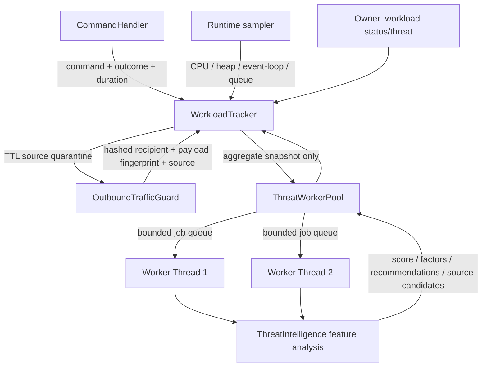

# Stage 59 — Workload Threat Intelligence & Multi-Worker Agent

**Release:** v2.35.24 · **Part:** 2 · **Date:** 2026-11-08 · **Status:** implemented; focused tests pass; live WhatsApp validation pending.

## 1. Objective

Extend Stage 58's outbound safety foundation into a background threat-analysis capability integrated with `WorkloadTracker`. It must detect unusual command and outbound patterns, isolate CPU analysis from the main event loop, explain its findings, and stop a clearly identified source from continuing to submit outbound messages when a high-confidence burst signature is observed.

This is a local reliability and compliance control. It is not a way to bypass WhatsApp enforcement, and it cannot guarantee that an account will not be restricted.

## 2. Architecture



The worker threads receive only aggregate windows, bounded source labels, and one-way hashes. They have no WhatsApp socket, network client, provider key, or message-sending interface. The threat monitor never sends a WhatsApp alert or progress message.

The current agent is a local feature/rule-based expert system (`local-feature-agent-v1`), not a generative LLM. No telemetry is sent to OpenAI, Gemini, or another external provider. This distinction is deliberate: the repository does not currently provide a local model runtime or a vetted privacy contract for exporting telemetry to an LLM.

## 3. Tracking model

`WorkloadTracker` now maintains bounded rings:

- Outbound attempts: current one-way recipient hashes, payload fingerprints, source label, timestamp, and outcome. Raw JIDs and message bodies are not retained.
- Blocked outbound actions: timestamp, normalized source label, policy reason, and optional recipient hash.
- Command execution: normalized command name, hashed actor identity, completion/failure outcome, timestamp, and duration. Command arguments, command text, raw sender/chat JIDs, and credentials are omitted.
- Command performance profiles: the existing p50/p95 and response-size aggregates remain separate from security event tracking.

The worker snapshot contains 10-second, 60-second and 5-minute outbound windows; 30 rolling 10-second buckets; source and recipient concentration; failed-send ratio; duplicate-block count; 60-second command and actor bursts; command velocity baseline; and runtime CPU, heap, event-loop delay, queue depth, and active workers.

Retention is bounded to 5,000 command/outbound records and 1,000 blocked outbound records. The persisted workload file has moved from schema version 1 to version 2. Version 1 files remain readable; the loader migrates their existing counters and outbound rows while initializing the new command history empty.

## 4. Threat analysis

`src/core/ThreatIntelligence.js` is a pure feature scorer. Scores are clamped to 0–100 and mapped to:

| Score | State |
|---:|---|
| 0–39 | NORMAL |
| 40–64 | ELEVATED |
| 65–84 | HIGH |
| 85–100 | CRITICAL |

Signal families include outbound 10-second burst and velocity deviation, global rolling-window pressure, repeated destination concentration, per-source burst, send failure ratio, duplicate retry pressure, command-per-actor burst, command velocity deviation, and runtime pressure. Each report includes the contributing factor keys and bounded evidence values so the owner can inspect why the score changed.

The report is a risk indicator, not a probability that WhatsApp will ban an account. No official WhatsApp thresholds are inferred from these local values.

## 5. Worker pool and failure handling

`src/core/ThreatWorkerPool.js` manages `worker_threads` with:

- Default concurrency: 2 workers (configurable 1–4).
- Default queue cap: 20 analysis jobs.
- Per-job timeout: 5 seconds by default.
- Queue-full rejection rather than unbounded growth.
- Worker restart after worker error/exit/timeout.
- Counters for submitted, completed, failed, rejected, and restarted jobs.
- Explicit shutdown; in-flight and queued jobs are rejected when the pool closes.

The monitor defaults to a 10-second interval and skips overlapping analysis runs. Monitoring is started by `Bot` after the WorkloadTracker history has been loaded and the outbound guard is attached. The worker pool is closed during graceful bot shutdown.

## 6. Automated containment

The agent cannot authorize or create an outbound message. Its only automatic action is a narrowly scoped, TTL-bounded source quarantine.

A source is considered for auto-quarantine only when the overall score is at least 60 and that single source produces at least seven outbound attempts in a rolling 10-second bucket. Default quarantine TTL is 60 seconds; configurable bounds are 10 seconds to one hour. The `OutboundTrafficGuard` checks the quarantine before reserving an outbound attempt or calling Baileys. A blocked attempt is counted separately as `outboundQuarantineBlocked`.

Quarantine does not:

- Add or expand recipients.
- Increase outbound limits or reduce mandatory cooldowns.
- retry failed messages.
- send alerts or reports to WhatsApp.
- bypass WhatsApp's own limits or enforcement.

The owner can inspect active quarantines via `.workload status` and manually clear them with `.workload clear-quarantine`. Clearing a quarantine does not disable the rolling rate limits, duplicate protection, allowlists, or broadcast opt-in.

## 7. Source attribution

`CommandHandler` already wrapped plugin execution with an AsyncLocalStorage outbound context. This stage extends attribution to command error replies, level-up messages, and energy/completion notices. This avoids classifying those intentional command side-effects as generic background traffic.

Unattributed background sends remain visible as `background:unattributed`; they are not automatically treated as a particular plugin. The owner should add explicit source contexts to future scheduled jobs and webhook deliveries.

## 8. Owner operations

- `.workload status` — runtime, generic workload scheduler, outbound counters, Threat Agent status, worker pool counters, last report and active source quarantines.
- `.workload threat` — request an immediate local analysis and return its summary only to the owner who invoked it.
- `.workload clear-quarantine` — clear current source quarantines. Other outbound controls remain enabled.
- `.workload pause` / `.workload resume` — pause/resume the existing generic WorkloadScheduler; they do not disable OutboundTrafficGuard or stop the threat monitor.

Background analysis remains silent. The agent does not push WhatsApp messages.

## 9. Configuration

```dotenv
WHISKAY_THREAT_AGENT_ENABLED=true
WHISKAY_THREAT_WORKERS=2
WHISKAY_THREAT_QUEUE_MAX=20
WHISKAY_THREAT_JOB_TIMEOUT_MS=5000
WHISKAY_THREAT_INTERVAL_MS=10000
WHISKAY_THREAT_AUTO_QUARANTINE=true
WHISKAY_THREAT_QUARANTINE_TTL_MS=60000
```

Worker count and queue size are startup settings. Restart the bot after changing them. The hot-reload UI exposes these values as configuration entries, but the current worker-pool instance retains the values read at construction until restart. `WHISKAY_THREAT_AGENT_ENABLED=false` prevents the periodic monitor from starting; manual `.workload threat` analysis remains an explicit owner-requested operation unless the command is disabled separately.

## 10. Files changed

- `src/core/ThreatIntelligence.js` — pure local multi-signal feature analysis and severity report.
- `src/core/ThreatWorkerPool.js` — bounded `worker_threads` pool and lifecycle.
- `src/workers/workload-threat.worker.js` — isolated worker entrypoint.
- `src/core/WorkloadTracker.js` — hashed command telemetry, rolling windows, threat monitor, persistence v2, quarantine registry and status.
- `src/core/OutboundTrafficGuard.js` — source quarantine gate before Baileys plus quarantine-block telemetry.
- `src/core/CommandHandler.js` — command execution tracking and attribution for side-effect messages.
- `src/core/Bot.js` — start the threat monitor after loading history and attaching the guard.
- `src/plugins/owner/workload.js` — owner status, immediate analysis and quarantine-clear controls.
- `.env.example` and `src/config/settings.js` — documented worker and agent settings.
- `test/stage59-workload-threat-agent.test.js` — feature scoring, real worker-thread execution, hashed persistence, auto-quarantine and guard enforcement.
- `package.json` / `package-lock.json` — v2.35.24 and `verify:stage59` integration.
- `README.md`, `docs/README.md`, `docs/project/CHANGELOG.md`, `docs/project/MEMORY.md` — release and operating guidance.

## 11. Verification

Run:

```bash
npm run verify:stage59
npm run verify:stage58
npm run verify:all
```

The Stage 59 test verifies local scorer behavior, two worker threads, quarantine decision from synthetic bursts, source-block enforcement before Baileys, and owner/runtime wiring. The combined Part 2 focused suite passed 72/72 tests in the build container. `node --check` and repository integrity checks are reported separately in the Stage 59 test report.

A full `npm test` result is not claimed here. Part 1's earlier full run was blocked by an incomplete dependency installation after a registry timeout. A clean `npm ci` and full test run are still required on a network-capable runner.

No live WhatsApp session, actual broadcast, account enforcement status, group recipient, or server deployment was exercised in this stage. An actual ban reason remains undetermined without WhatsApp's notice/reason code and timestamped outbound logs.

## 12. Migration and rollback

1. Back up the repository, `.env`, `data/workload-tracker.json`, database, and Baileys sessions before deployment.
2. Deploy the source package but retain the existing private runtime directories and existing `.env`. Merge only the seven `WHISKAY_THREAT_*` settings from `.env.example` if explicit configuration is desired.
3. The tracker reads persisted schema v1 and writes schema v2 on the next persistence flush. Keep a backup of the original file until status and telemetry have been verified.
4. Observe `.workload status` and request `.workload threat` manually in a private owner chat. Keep broadcasts and World Boss webhooks disabled during initial rollout.
5. To disable periodic analysis, set `WHISKAY_THREAT_AGENT_ENABLED=false` and restart. To disable auto-quarantine but retain reports, set `WHISKAY_THREAT_AUTO_QUARANTINE=false` and restart.
6. Rollback by restoring the previous source and package metadata. Preserve `data/workload-tracker.json`; schema v2's additional properties are ignored by the Stage 58 v1 loader, while the original outbound fields remain present. Do not restore old broadcast or testcommands implementations.

## 13. Known limitations

- This is a single-process tracker/worker pool. It is not a distributed multi-process cluster; multiple PM2 instances would each maintain separate in-memory rate/quarantine state. Keep `instances: 1` until a shared atomic coordinator exists.
- The feature agent is explainable rule-based analysis, not a trained model or generative AI. It does not infer intent from message content.
- A source quarantine can stop source-attributed sends only. Any code that sends through a different socket/library path outside the guarded Baileys methods needs a separate audit.
- Hashes reduce direct exposure but are not anonymous against every possible dictionary attack; telemetry files remain private runtime data and must never be included in release ZIPs.
- A low threat score does not prove that outbound behavior complies with WhatsApp policies. Platform policy, recipient consent, account quality, and provider enforcement remain external.
