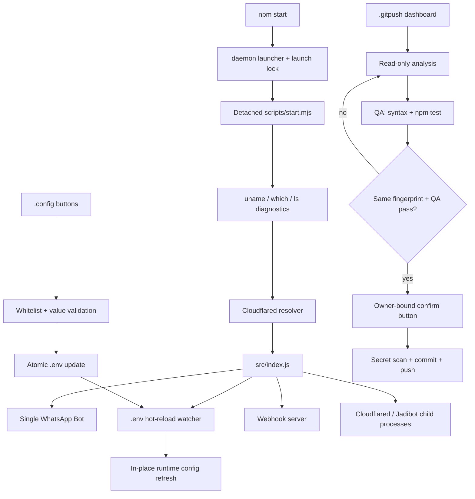

# Stage 46 — One-command Startup, Configuration Center and GitHub Control

**Release:** Whiskay Bot v2.35.0  
**Developer:** Arifi Razzaq  
**Runtime:** Node.js 20+, ESM, Baileys

## Runtime structure and ownership

- `package.json` — package identity, version `2.35.0`, author `Arifi Razzaq`, Node.js requirement, scripts, license and canonical repository metadata.
- `config/repository.json` — machine-readable developer and bot/website repository references; contact email remains blank because no verified address was supplied.
- `scripts/daemon.mjs` — detached start/stop/restart/status/log manager, launch lock, PID inspection and log routing.
- `scripts/start.mjs` — project-root bootstrap, `.env` preload, requested host diagnostics, Cloudflared resolver preflight and the bot's single-instance PID lock.
- `src/config/settings.js` — the 90-key, nine-category environment-variable whitelist, types/enums, secrecy labels and hot-reload/restart policy.
- `src/config/index.js` — maps environment values into the stable shared runtime config object.
- `src/lib/env-config.js` + `src/plugins/owner/config-manager.js` — validated atomic `.env` editing and the owner-only button/reply workflow.
- `src/core/EnvHotReloader.js` — debounced `.env` watcher without process replacement or duplicate listeners.
- `src/plugins/owner/github-push.js` + `scripts/auto-push.sh` — owner approval UI and guarded analysis/QA/commit/push execution.
- `src/plugins/general/owner-contact.js` — `.owner` contact identity sourced from `OWNER_NAME`.

## Goals

This iteration makes the normal start path one command, hardens the Cloudflared executable lifecycle, adds a safe owner-operated environment editor, and connects the supplied repository upload script to an interactive GitHub release flow.

## 1. Startup and tunnel lifecycle

`npm start` now executes `scripts/daemon.mjs start`, which launches a single detached bot process and returns to the shell. The detached child runs `scripts/start.mjs`; its bootstrap changes the working directory to the repository root and prints the requested host checks:

```bash
uname -m
which cloudflared
ls -lah bin/cloudflared-linux-arm64 data/bin/cloudflared-linux-arm64
```

It also checks Node/npm versions and asks the runtime Cloudflared resolver to identify an executable. A missing tunnel binary is diagnostic, not fatal to the main bot: the World Boss tunnel remains a child process and its retry loop continues in the background.

`worldBossTunnel.js` now resolves relative paths from the project root, checks the configured binary before falling back to `data/bin`, `bin`, and PATH, and clears the cached child reference after an asynchronous `spawn` error. This prevents an `ENOENT` child from being mistaken for a still-running process on the next retry.

The bot process and its Cloudflared/Jadibot child processes run in the background. Logs append to `.runtime/logs/whiskay-bot.log`. Use `npm stop` for graceful shutdown, `npm run restart` to restart, `npm run status` to inspect the PID, and `npm run logs` to follow logs. `npm run start:foreground` runs the same preflight bootstrap attached to the terminal. A PID lock in `.runtime/whiskay-bot.pid` and a launch lock prevent duplicate bot, WhatsApp socket, or webhook server instances. The launcher also detects a legacy `node src/index.js` process in the same project directory; `npm stop` can send that process SIGTERM before migrating. PM2 remains optional; its ecosystem runs one fork-mode instance with watch disabled.

## 2. Environment configuration architecture

The `.env` file remains the single source of truth for deploy-specific values. `src/config/index.js` converts it into the stable shared config object. It mutates that object in place on reload, so existing imports keep a valid reference.

`src/config/settings.js` is the whitelist/schema for `.config`; `src/lib/env-config.js` owns validation, atomic updates, masked status, and owner/chat-bound reply prompts. `.config` displays categories as buttons and a list selector. Selecting a key creates a prompt; the owner replies to that exact prompt with the new value. Secret values can only be changed in a private chat and are never echoed back.

`src/core/EnvHotReloader.js` watches the `.env` file with a debounce and serializes reload requests. Compatible values (owner display name, prefixes, AI provider settings, API credentials, and dynamic feature variables) refresh in-process. Values captured once during service boot (ports, directories, binary paths, process mode and watcher initialization) are labeled restart-required; the hot reloader does not launch a second server or silently restart the bot.

A real `.env` is not committed or bundled. `.env.example` contains known project defaults and intentionally blank credentials. Create the local file with `cp .env.example .env`; set `OWNERS`, provider keys, downloader endpoints and integration tokens yourself. To migrate from a previously running direct `node src/index.js` process, use `npm stop` once before the first daemon start; the launcher recognizes that legacy entrypoint in the same project directory.

## 3. Developer and owner identity

`package.json` now records Arifi Razzaq as author and includes MIT license, canonical repository, homepage, issue tracker, keywords, and a description. Unknown author email/contact metadata is intentionally not invented. `config/repository.json` records the bot and RPG repository endpoints. `.owner` reads `OWNER_NAME` and sends the configured owner contact; owner authorization remains controlled by `OWNERS`/`OWNER_LIDS`, not by the display name.

## 4. GitHub Control Center

The `scripts/auto-push.sh` has been revised as a review-first workflow. The old uploaded script could run `git reset --hard origin/main`, create/restore a stash, patch workflows, and attempt an automatic rebase/push. Those implicit destructive steps have been removed.

Owner command flow:

1. `.gitpush` opens the dashboard; **Analisis Repository** runs read-only inspection.
2. The report includes branch/remote, working-tree changes, diff, local commits, Cloudflared host checks, CI push-target warnings and `.env` exposure checks. It emits a content fingerprint for the reviewed state.
3. **Jalankan QA** runs syntax checks for JS/MJS/CJS files and `npm test`. A passing QA result is tied to the same fingerprint.
4. Only after QA passes does **Commit & Push** appear. The shell rechecks the fingerprint, main branch, remote ancestry, staged secret patterns and Git identity before committing and pushing.

Approval tokens are random, expire after 20 minutes, and are bound to the initiating owner and chat. If repository contents change between analysis/QA/push, the approval is rejected and analysis must be repeated. The script never displays secret values. Git transport authentication comes from the server Git configuration (SSH or a credential helper), not from a token value printed by the bot. Set `git config user.name "Arifi Razzaq"` and `git config user.email "<verified GitHub email or noreply address>"` once on the host. If push is rejected, the local commit is retained; no automatic reset or rebase is attempted.

Useful bot commands:

- `.gitpush` — open control center.
- `.gitpush analyze` — read-only analysis.
- `.gitpush qa TOKEN` — run syntax and test suite for the matching analysis token.
- `.gitpush confirm TOKEN` — commit and push after successful QA.
- `.config` — environment control center.
- `.owner` — official owner contact card.

## 5. Decisions and boundaries

- `config/setting.js` is not duplicated as a second source of truth. `src/config/settings.js` contains metadata/schema; `src/config/index.js` maps environment values into runtime config.
- `settings.json` is not used for secrets or a parallel copy of `.env`.
- Hot reload does not recreate listeners, webhook servers, or Cloudflared child processes. A restart-required setting remains saved but is not falsely reported as live-applied.
- The runtime does not auto-upload on every `npm start`. GitHub upload is always owner-triggered and requires interactive review/approval.
- The main bot is detached by `npm start`; Cloudflared and portal remain managed child processes. `npm stop` requests graceful shutdown. The launch/PID locks prevent repeated starts from producing duplicate servers.

## Architecture



## Validation status

The Stage 46 focused suite passes 10/10; Stage 42 passes 2/2, Stage 43 passes 6/6 and Stage 45 passes 10/10. The Stage 44 quiz/serializer file passes 7/7, while the combined Stage 44 command is 7/8 because the extracted workspace has no installed `dotenv` dependency for the Stage 41 test. A syntax scan passes for 257 JS/MJS/CJS files. Full WhatsApp native-button behavior, a live tunnel on the deployment host, and real GitHub credentials remain deployment-level checks; see the detailed test report.
